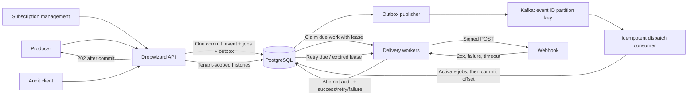

# Event-driven notification fanout

Java 25 + Dropwizard 5 REST service. PostgreSQL commits events, matching delivery jobs and an outbox together. The outbox publishes to Kafka; an idempotent Kafka consumer activates the delivery jobs. Bounded workers send signed webhooks, retry failures and retain delivery history. Small classes and explicit SQL keep the failure behavior inspectable.

**Status:** local implementation; see [executed validation and remaining gaps](docs/validation.md). A managed-cloud deployment and verified hosted CI run are separate from local success. Default credentials and local HTTP are development settings.

Read [current Kafka architecture](docs/architecture.md) and [submission status](docs/submission-status.md).

Read [functional requirements and full A–I design](docs/design.md), [architecture diagrams](docs/architecture.md), [API reference](docs/api.md), [operations](docs/operations.md) and [interview walkthrough](docs/interview.md).



## Development environment

All assessment editing/building/testing must occur in `/workspaces/notification-fanout` inside Ubuntu 24.04, not on the host Desktop/Downloads. Java source uses release 25 without preview features. Pinned dependencies: Dropwizard 5.0.2, PostgreSQL JDBC 42.7.14, compiler plugin 3.15.0, Surefire/Failsafe 3.5.6; Dropwizard's dependency set manages Jersey/Jackson/Jdbi/Liquibase/JUnit together. Integration tests use a real PostgreSQL 17 database and HTTP receiver; they require no Docker socket inside the development container.

### Existing prepared container

Use **IntelliJ Remote Development** connected to the Rancher-managed `notification-dev` container, and open `/workspaces/notification-fanout`. See [IntelliJ setup](docs/intellij.md). In its terminal:

```bash
cd /workspaces/notification-fanout
java -version
cat /etc/os-release
mvn -B -ntp verify
java -jar target/notification-fanout.jar db migrate config/local.yml
./scripts/start-local.sh
```

The prepared container uses persistent Docker volume `notification-workspaces`; its database is `notification-db` with separate `notifications` and `notifications_test` databases. Keep Rancher Desktop running. Do not delete these volumes; they contain the project and local data. No host GitHub credentials are mounted into the container.

### Reproduce from a clone

Open the repository through IntelliJ Dev Containers using `.devcontainer/devcontainer.json` (a Java-25-capable IntelliJ version is required). The same configuration is compatible with VS Code/Cursor if the assessment requires those editors. Docker Compose provisions the development environment and PostgreSQL, including the test database on the first empty-volume initialization. Do not start the `app` service simultaneously with the development service: they publish the same ports. Run the commands above inside the IDE container. Compose supplies DB_URL/TEST_DB_URL for its `db` hostname; the prepared environment defaults to `notification-db`.

Migrations are explicit. Tests migrate **only the configured test database**, then truncate its application tables between tests. Never point TEST_DB_URL at production or shared data. `mvn test` runs unit tests; `mvn verify` also runs integration tests and fails if PostgreSQL is unavailable.

### Packaged application

From the repository directory on a Docker-capable machine:

```bash
docker compose up -d db
docker compose run --build --rm migrate
docker compose up --build -d app
```

This tests the runtime-image packaging. Application runs as an unprivileged user. Dev Compose is not production infrastructure. App/DB credentials default to documented local-only values; production must use separate configuration and secrets, strict webhook destinations and HTTPS.

## Demonstrate retries and audit

Start the Java server, then run in a second IDE-container terminal:

```bash
cd /workspaces/notification-fanout
python3 scripts/receiver.py --fail-first 2
```

In a third container terminal:

```bash
cd /workspaces/notification-fanout
./scripts/demo.sh
```

The demo creates a subscription, posts a matching event, waits for two 500 responses and a 204, prints the full audit history and deletes its subscription. It exits nonzero on failure. The receiver verifies HMAC and timestamp. Reset its process to reset in-memory receiver counters; receiver persistence is outside this sender's scope.

API: `http://localhost:8080`; liveness `/health/live`, readiness `/health/ready`. Private development admin endpoint: `http://localhost:8081/metrics` and `/healthcheck`. Host ports bind only to 127.0.0.1; production needs network isolation as well.

## Filter syntax

```json
{
  "webhookUrl": "http://127.0.0.1:9090/hook",
  "filter": {
    "type": "order.created",
    "source": "checkout",
    "payloadConditions": [
      {"path": "/customer/tier", "operator": "eq", "value": "gold"}
    ]
  }
}
```

Omit filter/type/source/conditions for match-all at that level. All specified filters combine with AND. Paths use JSON Pointer: `/items/0/name`; escape `/` as `~1` and `~` as `~0`; empty path addresses the entire payload. Missing fields do not equal null. Strings are case-sensitive. JSON numeric scalar comparisons treat 1 and 1.0 as equal; booleans remain distinct. Object/array values use structural JSON equality. Only `eq` is supported; no executable expressions.

For security, webhook destinations must be administrator-approved **origins**; hostnames and literal IPs are supported with connection-time address checks. `config/local.yml` permits only `http://127.0.0.1:9090`, explicitly allowing local HTTP. Other URLs fail validation. Private, metadata and reserved destinations are blocked in production; certificate verification remains enabled.

## Delivery contract and guarantees

- Return 202 only after event and matching delivery jobs commit. Each selected subscription gets one job, enforced by a unique constraint.
- Matching uses active subscriptions visible to the ingestion SELECT. Subscriptions created later do not receive historical events. Soft deletion stops future matching; already queued jobs continue.
- Delivery uses at-least-once-style processing with **five bounded attempts**, not an unconditional eventual-receipt guarantee. A receiver can process the same delivery twice after a timeout or worker crash. Receiver-side deduplication by `deliveryId` is required for idempotent side effects.
- HTTP 2xx means delivered. Transport errors, timeouts, 408, 429 and 5xx retry. Other responses, including redirects, fail permanently. Redirects are disabled. Durable retries are controlled by the worker; the JDK client can perform internal connection recovery, so an application attempt is not a claim of exactly one network transmission. Retry-After is currently not honored; the configured bounded backoff applies.
- Backoff uses positive 50–100% jitter on `min(cap, base × 2^(attempt-1))`; default base 1s, cap 60s. Next times are persisted, so restarts do not reset schedules.
- Claims use a 30s lease; request timeout is 5s. HTTP occurs after claim commit, without holding row locks. Expired leases mark attempts `unknown`; old workers cannot overwrite a newer lease. Interrupted attempts count toward the attempt limit.
- A null audit HTTP code means no code was durably recorded. Policy rejection does not fabricate a response code. Exhausted work remains queryable as failed.
- PostgreSQL committed storage must survive. This design does not protect against losing the only database copy or skipping backups.

Ingestion accepts an optional tenant-scoped `Idempotency-Key`. Same key/content returns the existing event with `duplicate=true`; changed content returns 409. Object property order does not matter; numeric JSON representation can affect the content hash. Omitting the key allows repeated events. Keep keys as long as events are retained; future retention must define key expiry.

## Configuration and security

`config/local.yml` documents development settings. Environment: DB_URL, DB_USER, DB_PASSWORD, TEST_DB_URL, API_TOKEN, OTHER_API_TOKEN, WEBHOOK_SIGNING_SECRET, WORKER_ENABLED. API-only mode sets WORKER_ENABLED=false; a worker-enabled instance can process the same database. Worker-enabled instances also serve API routes; deploy behind appropriate routing if dedicated worker roles are desired.

Credentials map server-side tenants to bearer tokens. The supplied demo/other tokens are local examples; tenant ownership is checked on every resource query. Role-level permissions within a tenant are not implemented. Process-local fixed-window rate limits cover all authenticated requests; defaults support the local demo, not distributed quota enforcement.

Outgoing signature: derive tenant key `HMAC-SHA256(master_secret, "tenant:" + tenant_id)`; then signature `HMAC-SHA256(tenant_key, timestamp + "." + raw_body)` in `X-Webhook-Signature: v1=<hex>`. Timestamp is in X-Webhook-Timestamp. Provision only that tenant's derived key to its receiver, never the master secret. Receiver verifies a short time window and deduplicates deliveryId. See the sample receiver. Key rotation/versioned key IDs are future work.

## What we sacrifice for simplicity vs. what we would harden next

|Baseline choice|Benefit|Next hardening / trigger|
|---|---|---|
|Match in ingestion transaction|Atomic event/job guarantee|Async matcher and versioned membership when measured latency/fanout requires it|
|Kafka dispatch plus PostgreSQL retry scheduling|Durable broker handoff and queryable retry state|Tune publisher/consumer throughput using sustained load tests|
|One module, API+worker configurable|Understandable build and deployment|Separate services when ownership or scaling boundaries justify them|
|Approved origins and connection-time DNS checks|Constrain webhook network access|Enforce outbound network policy and review destination approvals|
|Shared DB, explicit tenant predicates|Small implementation|Database row-level security and stronger per-tenant quotas/fair scheduling|
|No ordering or replay|Independent recoverable jobs|Per-source serial scheduling; bounded replay with new delivery generation|
|Process-local throttling|Bounds one instance|Gateway/distributed limit when multiple replicas serve traffic|
|Local credentials and HTTP|Reproducible demo|Managed secrets, HTTPS ingress and production configuration before exposure|
|No automatic retention or backups|Avoid unsafe background deletion|Bounded purge excluding pending events; PITR and restore drills before production|
|Correlation logs + metrics|Inspectable local failures|Tracing, provisioned dashboards and paging rules in real deployment|

Full capacity calculations, cost assumptions, RPO/RTO proposals and decision reconsideration conditions are in the design. No performance or production-readiness claim is implied by estimated capacity.

## Submission

The repository includes `.github/workflows/ci.yml`, which runs unit/integration tests with Java 25 and PostgreSQL on push/PR. Verify a hosted green run after pushing; local tests do not prove GitHub Actions has run. Commit the README and Mermaid diagrams with the source. Choose a personal repository and grant interviewer access before submission. Sign out of accounts used on the assessment workstation after verifying remote files and preserving the project.
