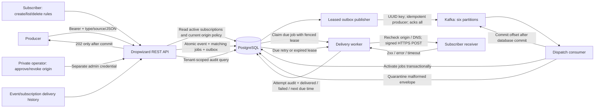
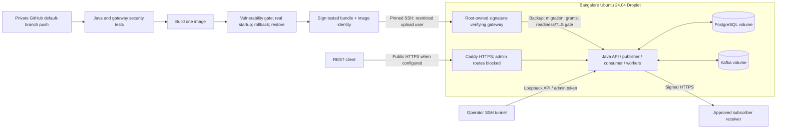

# Event Notification Fanout architecture



Subscription matching is synchronous in the ingestion transaction, defining the membership snapshot. HTTP delivery is asynchronous. A broker outage delays dispatch but does not remove accepted DB events. Outbox publication and Kafka consumption may repeat after crashes; database uniqueness prevents duplicate jobs. A successful receiver request whose response/result is lost may be retried: stable delivery identity and receiver deduplication remain essential. Retries are bounded; see README for terminal-failure semantics. Event UUID keys distribute one event type across partitions; per-source ordering is not implemented.

```mermaid
sequenceDiagram
 participant P as Producer
 participant A as REST API
 participant D as PostgreSQL
 participant O as Outbox publisher
 participant K as Kafka
 participant C as Consumer
 participant W as Delivery worker
 participant H as HTTPS receiver
 P->>A: POST structured event + optional idempotency key
 A->>D: BEGIN; read subscriptions; save event, matches and outbox; COMMIT
 A-->>P: 202 + event ID
 O->>D: Claim outbox lease
 O->>K: Publish with event UUID key
 K-->>O: Broker acknowledgement
 O->>D: Mark publication
 K->>C: Event envelope
 C->>D: Activate delivery jobs; COMMIT
 C->>K: Commit consumed offset
 W->>D: Claim due delivery + persist attempt; COMMIT
 W->>D: Check latest approved-origin state
 W->>H: Signed HTTPS POST; public-address DNS validation at connection
 H-->>W: Response or timeout
 W->>D: Save attempt and delivered/failed/retry schedule
 Note over D,W: Expired claims recover with a new lease; stale completions are fenced
```



The budget deployment has a single failure boundary. Named volumes preserve state across container replacement/reboot, not disk destruction. Local backups and a same-server restore do not establish off-host recovery. Public IP HTTPS uses an explicit short-lived ACME profile and persistent Caddy state; monitor renewal. Runtime destination policy is in PostgreSQL, so approvals/revocations require no restart. The operator key remains privileged; CI uses a different restricted key and a signed-release gateway. No managed Kafka or other new paid cloud service is used. Current evidence and remaining limits are in submission-status.md.
