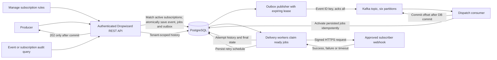
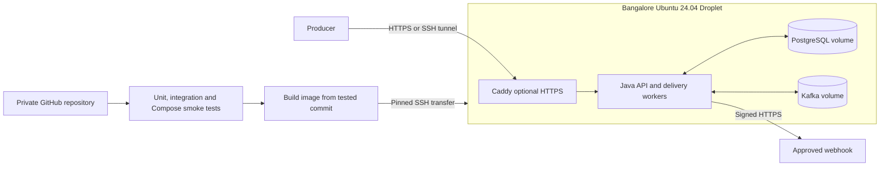

# Current Kafka-backed architecture

An unavailable Kafka broker delays dispatch but accepted events remain in the database outbox. Workers cannot claim newly accepted Kafka-gated deliveries before dispatch. A publisher crash can repeat Kafka publication; duplicate consumption does not create extra delivery jobs. Kafka offsets commit after the database dispatch transaction. Events still undispatched after the reconciliation interval can be republished. Webhook delivery remains at-least-once-style with bounded attempts and possible duplicates, requiring receiver deduplication by delivery ID.

Matching remains in the ingestion transaction, preserving the original active-subscription snapshot. PostgreSQL schedules delayed retries because Kafka does not provide arbitrary per-message scheduled delivery. Event IDs distribute a single event type across partitions; per-source ordering is not currently implemented.

For the selected low-cost DigitalOcean deployment, use one Bangalore Ubuntu 24.04 Droplet running Docker Compose: the API and delivery workers share one JVM, with a Kafka container and PostgreSQL container on the same private bridge. GitHub Actions deploys the tested revision over pinned SSH. PostgreSQL and Kafka persist in named volumes and have no published host ports. The API binds to host loopback; optional Caddy provides public HTTPS once a domain is configured. This is a single-server assessment deployment, with no host or broker failover. See [the deployment guide](../deploy/droplet/README.md) for setup and operational limits. The Bangalore Droplet is running the service, Kafka and PostgreSQL. GitHub CI/CD, live ingestion/dispatch, reboot persistence and a same-server backup restore have passed. Public HTTPS and a real receiver test await the domain and approved receiver origin. See submission-status.md for evidence and remaining limits.

The earlier App Platform/managed-cluster scaffolding is an unused alternative, not the active target. No managed Kafka will be provisioned for the selected deployment.
