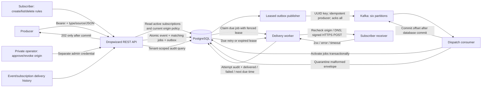
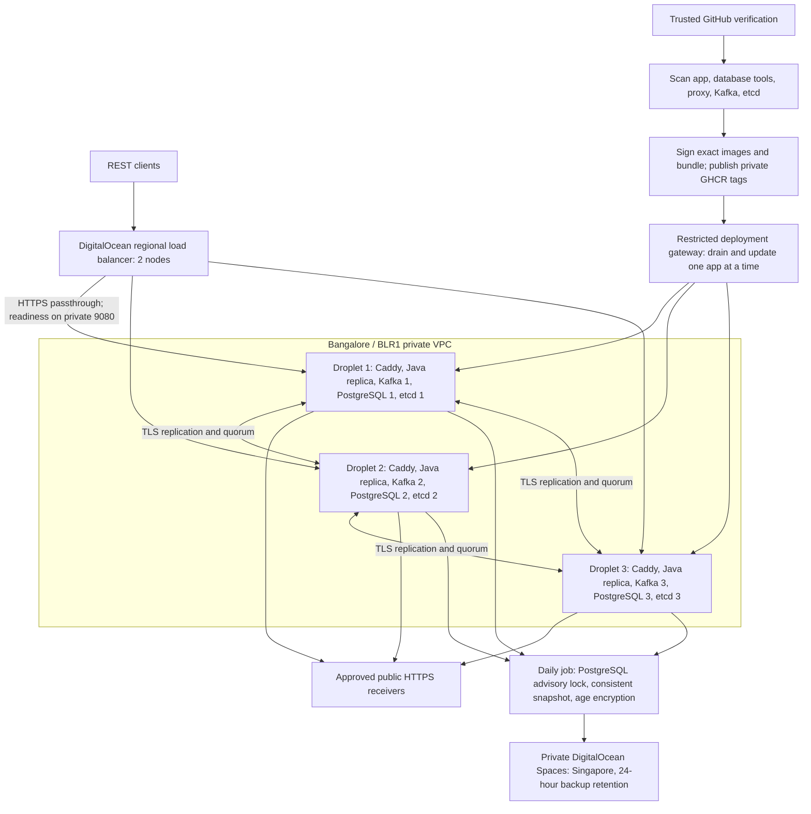

# Event Notification Fanout architecture



Subscription matching is synchronous in the ingestion transaction, defining the membership snapshot. HTTP delivery is asynchronous. A broker outage delays dispatch but does not remove accepted DB events. Outbox publication and Kafka consumption may repeat after crashes; database uniqueness prevents duplicate jobs. A successful receiver request whose response/result is lost may be retried: stable delivery identity and receiver deduplication remain essential. Retries are bounded; see README for terminal-failure semantics. Event UUID keys distribute one event type across partitions; per-source ordering is not implemented.

```mermaid
sequenceDiagram
 participant P as Producer
 participant A as REST API
 participant D as PostgreSQL
 participant O as Outbox publisher
 participant K as Kafka
 participant C as Consumer
 participant W as Delivery worker
 participant H as HTTPS receiver
 P->>A: POST structured event + optional idempotency key
 A->>D: BEGIN; read subscriptions; save event, matches and outbox; COMMIT
 A-->>P: 202 + event ID
 O->>D: Claim outbox lease
 O->>K: Publish with event UUID key
 K-->>O: Broker acknowledgement
 O->>D: Mark publication
 K->>C: Event envelope
 C->>D: Activate delivery jobs; COMMIT
 C->>K: Commit consumed offset
 W->>D: Claim due delivery + persist attempt; COMMIT
 W->>D: Check latest approved-origin state
 W->>H: Signed HTTPS POST; public-address DNS validation at connection
 H-->>W: Response or timeout
 W->>D: Save attempt and delivered/failed/retry schedule
 Note over D,W: Expired claims recover with a new lease; stale completions are fenced
```



The boxes represent exactly three application/data Droplets; the daily job runs on those hosts, not a fourth compute node. PostgreSQL has one writable primary and one required synchronous standby (`remote_apply`), plus the third replica. Patroni uses a three-voter TLS etcd quorum and requires watchdog fencing. Kafka has three brokers/controllers, six event partitions, replication factor three, minimum ISR two, `acks=all`, and no unclean election. Losing safety quorum refuses/blocks writes rather than acknowledging unsafe commits. Application pools reject connections that have become standbys.

The load balancer uses two managed nodes and private readiness probes. Caddy shares certificate/challenge storage and locks in a separate PostgreSQL database. Internal control, database and Kafka authorities are distinct; offline CA signing keys are not deployed. Internal certificates require renewal before their 90-day expiry. The cloud firewall and host firewall restrict cluster ports to the three private peers. Administrator endpoints remain private.

One synthetic local drill verified 106 acknowledged events, actual Kafka/webhook delivery during a simulated node loss, refusal of writes without quorum, recovery, log redaction and encrypted database restoration. Local containers share one Rancher VM, so that does not prove independent host fencing. Separate cloud evidence now records watchdog reboot, promotion to a different primary while its predecessor was powered off, two-broker webhook delivery and a restore from actual Spaces in [submission status](submission-status.md).

Daily Spaces backups provide off-host recovery, not synchronous regional disaster replication. A single-node failure target is zero acknowledged-event loss with a surviving safe quorum; total cluster destruction can lose up to roughly 24 hours. One-day retention cannot recover old corruption, and application-side expiry can be delayed during a whole-cluster outage. Per-source ordering and replay are not implemented.
