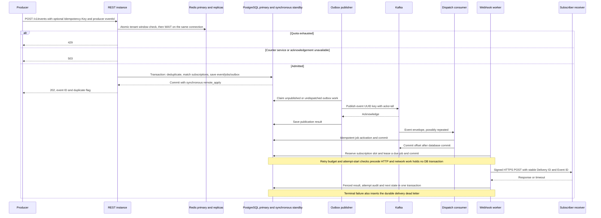
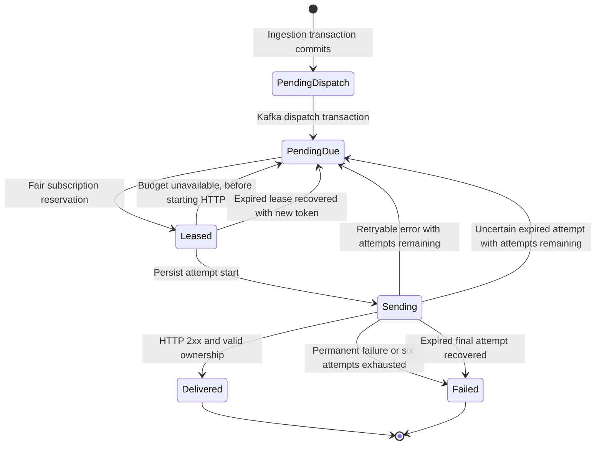
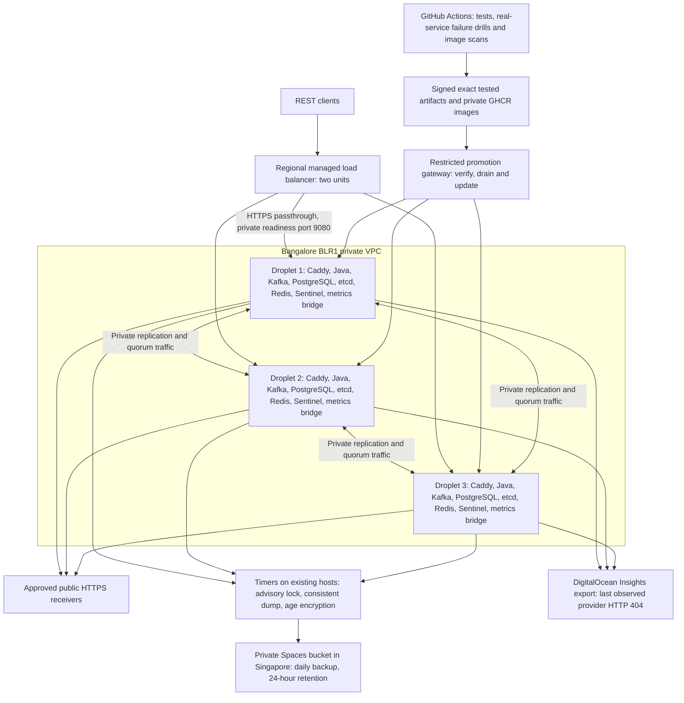

# Deployed architecture and request flows

This describes application revision `6474ad3b0c043677066c539f3523c075b7358af0`, verified on 24 November 2026. See [deployment evidence](submission-status.md), [requirements coverage](requirements.md) and [design decisions](design.md). Role names below are logical roles: PostgreSQL and Redis primaries can move between hosts.

## Event ingestion, fanout, retries and audit

```mermaid
flowchart LR
    P[Producer or subscriber] --> LB[DigitalOcean load balancer]
    LB --> A[One of three Dropwizard instances]
    A --> AUTH[Authenticate tenant and validate request]
    AUTH --> RL[Redis shared fixed-minute tenant limit]
    RL -->|Allowance exhausted| R429[HTTP 429]
    RL -->|Redis or replication unavailable| R503[HTTP 503]
    RL -->|Admitted write| TX[Primary transaction: identity check and subscription matching]
    TX --> DB[(PostgreSQL primary: events, jobs, outbox and audit)]
    TX -->|Commit before response| ACK[HTTP 202 with original or new event ID]
    DB --> O[Leased outbox publisher]
    O -->|Internal event UUID key, acks all| K[Kafka event topic: six partitions, RF3, min ISR2]
    K --> C[Three consumers in one group]
    C -->|Activate existing jobs and commit DB before offset| DB
    DB --> CLAIM[Fair subscription reservation and expiring delivery lease]
    CLAIM -->|Initial attempt| W[Bounded webhook worker]
    CLAIM -->|Retry requires shared tenant and subscription budget| RB[Redis retry budgets]
    RB -->|Granted| W
    RB -->|Unavailable or exhausted: defer without HTTP attempt| DB
    W -->|Recheck origin and DNS, signed HTTPS POST| H[Approved subscriber receiver]
    H -->|Response or timeout| RESULT[Token-checked result transaction]
    RESULT -->|Attempt audit and delivered, failed or next retry time| DB
    DB -->|Due retry or recovered lease| CLAIM
    RESULT -->|Terminal failure: same transaction| DL[(Delivery dead-letter outbox)]
    DL --> DP[Leased DLQ publisher]
    DP -->|Stable delivery ID key| DK[Kafka delivery DLQ]
    AUTH -->|Admitted history or list GET| RD[(PostgreSQL replica-only read pool)]
    DB -->|Required synchronous standby plus another streaming replica| RD
```

Matching happens **before** Kafka publication, inside ingestion's database transaction. The transaction saves the event, one job for each matching subscription and the outbox entry together. Kafka consumption activates those jobs; it does not create a second fanout. Subscription changes require no restart. Existing jobs retain their destination snapshot after a subscription is deleted.

The tenant allowance is 6,000 authenticated requests per fixed minute across all instances, including reads and writes. Redis stores counters, not authoritative event history. There is no independent per-user quota and no business-data response cache. Administrative destination policy, identity checks, job coordination and other consistency-sensitive reads use the database primary.

## Critical request sequence

## Delivery state and retry loop

The stored delivery status is only `pending`, `delivered` or `failed`; the diagram's pending substates explain dispatch readiness, due time and lease ownership. Transient errors allow one initial attempt plus five retries. Backoff and attempt history are durable. Permanent policy/HTTP failures terminate earlier. Expired final attempts also become failed/dead-lettered.

The final-state transaction rejects a stale or expired ownership token. It cannot undo an HTTP request already accepted by the receiver. Repeated HTTP effects remain possible; receivers must transactionally deduplicate `deliveryId`. DLQ publication can also repeat after an uncertain acknowledgement. Failed delivery history remains available if its Kafka DLQ publication is delayed.

## DigitalOcean deployment and failure boundaries

There are exactly three compute Droplets, not dedicated machines for every component. The load balancer and Spaces are separate managed services. Kafka, PostgreSQL and Redis are self-managed. All three hosts share a region; independent physical-host/availability-zone placement is not guaranteed.

| Layer | Deployed contract | Failure boundary |
| --- | --- | --- |
| Application | Three active instances; four delivery workers each; subscription concurrency one across instances | Healthy backends receive new traffic; in-flight requests can fail during replacement or failover |
| PostgreSQL | One primary, one required synchronous standby and another streaming replica; `remote_apply`; Patroni, three-member etcd and required watchdog | Single-node loss with safe surviving quorum targets preservation of acknowledged commits; unsafe writes block/fail |
| Kafka | Three brokers/controllers; six event partitions; RF3, min ISR2; idempotent producer and no unclean election | One broker loss is tolerated when remaining replicas are in sync; quorum loss delays dispatch |
| Redis | One primary, two replicas; three Sentinels with quorum two; private TLS ports 6379/26379 | Promotion tested with existing application clients; missing safe acknowledgement fails admission closed; recent counters can be lost because replication is asynchronous |
| Read queries | Standby-only pool, maximum four connections per application; primary/write pool maximum eight | Replica lag is visible as eventual consistency; no primary fallback when replicas are unavailable |
| Backup | One successful snapshot per UTC day, authenticated and age-encrypted, private Spaces; current snapshot metadata checks ten tables | Total cluster loss can lose roughly a day of data or more if backups fail/expire; no continuous WAL/PITR or regional service failover |

Caddy shares public certificate storage/locks in a separate PostgreSQL database. Internal PostgreSQL, Kafka, control-plane and Redis authorities are separate; offline signing keys are not deployed. Cluster firewalls allow only approved private peers; administrator APIs stay private. Root passwords are locked and SSH password authentication is disabled; authorized SSH keys are used.

The initial control-version cutover drained and stopped all old workers before migration/promotion. Compatible future releases use rolling application promotion. Infrastructure changes remain separate operations. Daily backups do not create an automatic pre-migration snapshot. See [release and recovery procedures](operations.md).

## Evidence and unfinished capabilities

The latest rollout preserved the original 10,136 events and five subscriptions by count/content comparison before adding synthetic probes. Cross-instance quota exhaustion, generated/explicit idempotency, conflict 409, public HTTPS, replica reads, one signed external webhook capture, Redis promotion and replica rejoin passed. Earlier evidence separately records whole-Droplet/PostgreSQL failover, Kafka operation with two brokers and an actual encrypted Spaces restore; those drills were not all repeated for the latest application release.

No managed queue, per-source ordered delivery, time-range replay API, per-user quota, horizontal autoscaler or general response cache is deployed. Metrics are emitted locally and bridges run, but Insights visibility remains unverified after the last observed provider 404. Alarms and tickets were explicitly excluded. No exhaustive-test, zero-interruption, full-region RPO0 or measured production-throughput claim is made. The [submission status](submission-status.md) records exact evidence and remaining work.
