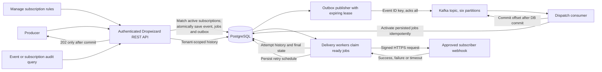

# Current Kafka-backed architecture

An unavailable Kafka broker delays dispatch but accepted events remain in the database outbox. Workers cannot claim newly accepted Kafka-gated deliveries before dispatch. A publisher crash can repeat Kafka publication; duplicate consumption does not create extra delivery jobs. Kafka offsets commit after the database dispatch transaction. Events still undispatched after the reconciliation interval can be republished. Webhook delivery remains at-least-once-style with bounded attempts and possible duplicates, requiring receiver deduplication by delivery ID.

Matching remains in the ingestion transaction, preserving the original active-subscription snapshot. PostgreSQL schedules delayed retries because Kafka does not provide arbitrary per-message scheduled delivery. Event IDs distribute a single event type across partitions; per-source ordering is not currently implemented.

For DigitalOcean, the prepared configuration targets App Platform API/worker components, Managed Kafka, Managed PostgreSQL, VPC networking and Container Registry. Deployment input templates and workflow scaffolding exist under deploy/digitalocean; they have not been applied or verified in a DigitalOcean account. Region, budget, cloud credentials and managed clusters remain to be selected. Never describe this repository as already deployed.
