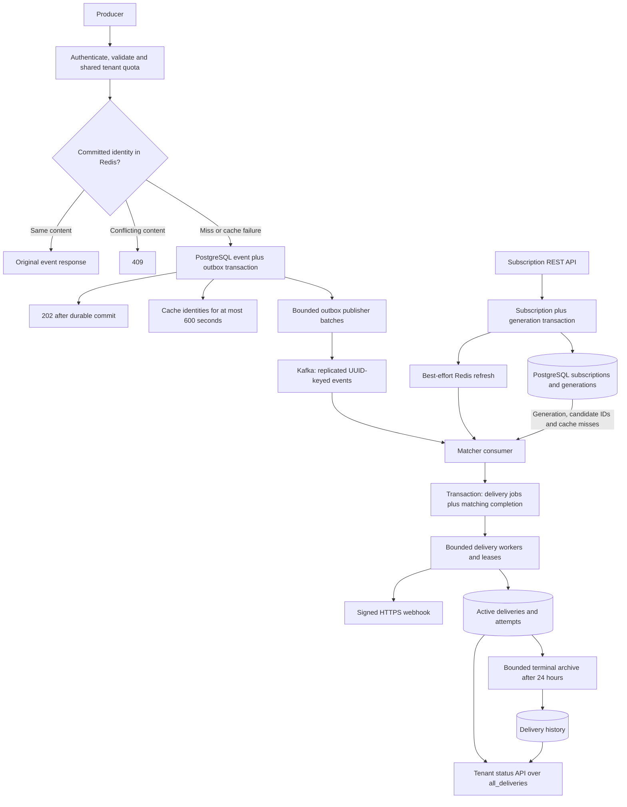
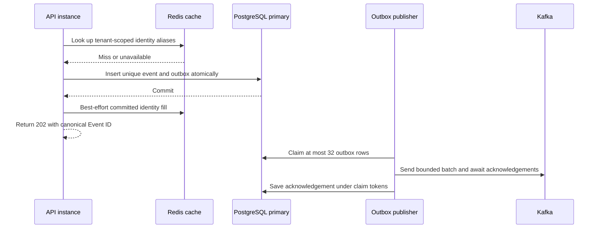
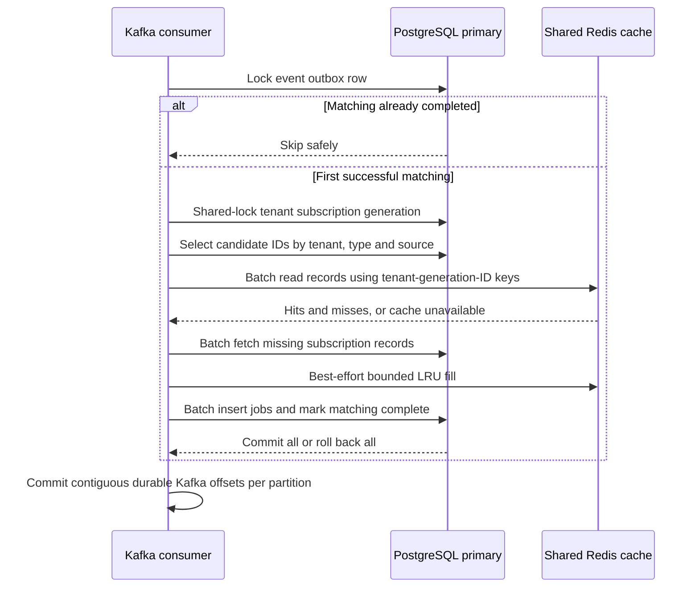
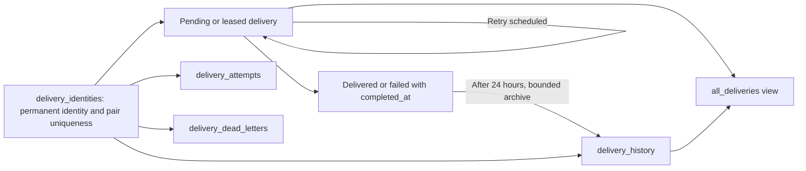

# Asynchronous matching, bounded caches and delivery history

This is the implementation contract for the November 26 redesign, deployed as f0c4d33 on all three existing hosts. [Submission status](submission-status.md) identifies the revision actually running and the checks performed. A target of **10,000 events/second is not a measured capacity claim** for the existing three 4-GB Droplets. No additional paid infrastructure is introduced.

## Requirements and boundaries

| Requirement | Implementation | Important boundary |
| --- | --- | --- |
| Immediate duplicate decision | Tenant/key and tenant/producer-ID PostgreSQL unique constraints; committed identity cache | Identical repeat returns original event with duplicate=true, changed content/identity returns 409; no new publication |
| Ten-minute Redis identities | Canonical internal ID, acceptance timestamp, content hash and configured identity; 600-second TTL | No payload/credentials cached; event identities are not LRU-evicted before expiry; PostgreSQL retains authoritative identity |
| Match after Kafka | Consumer transaction locks outbox row, reads current subscription generation, creates jobs and marks matching complete | API acknowledges before recipients are selected; Kafka-disabled development mode matches inline |
| Same Redis for subscriptions | Versioned per-tenant subscription records, candidate IDs from primary, batch fetch of cache misses | At most floor(active tenant subscriptions * 20/100) records in the current generation; fewer than five means zero cached records |
| Safe subscription changes | Increment persistent tenant generation in create/delete transaction; best-effort post-commit warm | Old generation is unreachable immediately, even if Redis update fails; no new PUT/PATCH endpoint |
| Delivery history | Move terminal records after 24 hours into delivery_history in bounded transactions | Pending/leased work stays active; attempts/DLQ reference permanent lightweight delivery_identities |
| Transparent status API | Tenant-filtered all_deliveries UNION ALL view inside existing replica-read transaction | Same IDs/API shape; ordinary read-replica lag remains |

## End-to-end architecture

## Atomic acceptance and duplicates

The event insert and outbox insert commit together. A Redis hit is used only for an identity populated after successful acceptance commit. Redis misses, expiry, eviction, malformed cache replies and connection failures fall back to PostgreSQL. The event cache does not replace a unique constraint or use Redis SET NX as a publication lock.

The explicit key is tenant-scoped. A supplied producer UUID is now unique within its tenant, not only within a configured user/compartment. Configured identity is still checked for conflicts and included in generated keys. Clients must reuse identities on retries. Distinct legitimate occurrences need distinct producer IDs or keys. PostgreSQL identity lifetime is the retained event lifetime, not ten minutes. Restoring the database to an older point requires clearing only the optional cache namespace before reopening traffic, so Redis cannot replay acceptance identities absent from the restored database.

API 202 means database durability, not Kafka acknowledgement. Kafka outage can accumulate accepted outbox work until admission/backlog limits intervene. Backlog admission samples a bounded database count at most once per second per app, and counts local new acceptances between samples; it is approximate across instances, not a global hard cap. Pool/HTTP limits remain hard resource boundaries. Never remove PostgreSQL from this path while still promising immediate authoritative duplicate rejection.

## Matching semantics and subscription cache consistency

Recipients are those visible when the successful matching transaction runs. A subscription created after acceptance but before matching can receive the event. A subscription deleted before matching is excluded. Deletion after matching does not cancel existing jobs. Replay after completed matching does not evaluate a newer generation.

Registration/deletion changes the generation under an exclusive row lock in the same transaction as its subscription change. Matchers hold a shared generation lock until matching commits. Redis keys include that generation: a stale fill cannot overwrite a newer generation's values. Old subscription generations expire and are subject to subscription-only LRU. Warming is optional; correctness uses the database generation on each matching transaction, so there is no independent cache-change delivery guarantee to lose. All business subscription writes must use this protocol. Direct SQL edits bypassing it are not supported operational updates.

The 20% policy is a maximum per tenant/current generation, not an exact occupancy promise or 20% of Redis memory. Active-count floors and global memory/entry bounds can lower subscription occupancy. Accesses update an explicit sorted-set LRU; it is not Redis allkeys-lru. Equal hotness across all rules will limit its benefit; candidate indexing remains important. Snapshot reconstruction as of event acceptance is not implemented. The existing cap of 1,000 active subscriptions/tenant bounds one matching batch; unrestricted fanout needs durable cursors/version retention before lifting that cap.

## Redis resources and failure policy

Cache keys use notification:cache:v2:*; quota keys retain notification:limits:v1:*. Server policy remains noeviction. An atomic Lua script owns cache-only data, expiry and subscription-only LRU indexes; it cannot evict quota keys. Defaults: 32 MiB conservatively accounted entry budget, 50,000 total entry ceiling, maximum accepted entry estimate 64 KiB, cleanup at most 256 expired entries per invocation plus a 60-second maintenance task. Reads reject expired entries immediately. Approximate accounting is not a guarantee of exact Redis RSS; bounded entries/values and server/container limits still apply.

Cache traffic uses its own fair two-connection pool with 200 ms connection/socket/pool-wait limits; quota traffic retains its independent pool. There are no unbounded cache tasks or background retry queues. Cache failure falls back to PostgreSQL; **rate-limit Redis failure still rejects admission** under the existing fail-closed policy. Both logical roles share the same physical Redis failure domain.

At 10,000 unique events/second, ten minutes contains six million event identities, possibly two alias entries each. The low-cost deployment cannot hold all of these. Identity entries retain their original ten-minute expiry and are never chosen for LRU eviction. Subscription entries can be evicted to make room. If the bounded cache cannot admit another identity, that write is counted in cache.capacity_rejected and PostgreSQL remains authoritative; the full-window working set therefore still requires adequate memory. Provisioning a larger dedicated cache requires actual entry-size/traffic measurements and a budget change.

## History, audit and deduplication

Archiving locks at most archiveBatchSize terminal rows, deletes them from deliveries and inserts the same columns into delivery_history using one data-modifying statement/transaction. Failure rolls back the move. all_deliveries is one UNION ALL statement snapshot, avoiding a lookup gap between two separate reads. Status APIs preserve tenant predicates, IDs, pagination order and attempt history; no client table choice is exposed. Read replicas can still lag.

The delivery identity trigger reserves the unique event/subscription pair before inserting active work. Its record survives archival, so accidentally re-inserting that pair cannot recreate delivery. Attempt/DLQ foreign keys point to this anchor. No automatic history deletion is introduced; history/identity retention and sharding remain separate design decisions. Moving rows reduces the active scheduling set, not total storage or write amplification. Historical records are part of encrypted backups.

## Capacity, validation and release

Ten thousand events/second is 864 million events/day. With ten matches it is 100,000 delivery jobs/second before retries. Existing 12 delivery workers, one active attempt/subscription, 6,000 requests/tenant/minute and small shared hosts do not establish this capacity. Those safety limits are retained rather than raised blindly. PostgreSQL acceptance, matching writes, Kafka partitions, webhook workers/receivers, storage and backup duration all require sizing. Sharding is not implemented.

Bounded publisher batches allow up to 32 records to be outstanding per loop, using one leased claim query and batched acknowledgement updates. Kafka offset commits cover only a contiguous successfully processed prefix per partition. Replays remain safe. Delivery insertion uses JDBC batching. These reduce round trips without changing the correctness contract; they are not benchmark results.

[AsyncCacheHistoryIT](../src/test/java/com/example/notifications/AsyncCacheHistoryIT.java) covers concurrent identities/consumers, matching-time creation/deletion, no rematch, cache expiry/failure, LRU/limits, matching rollback, outbox batches, transparent history, attempt/DLQ continuity and archive deduplication. Existing ServiceIT/KafkaIT/RedisIT continue to exercise HTTP, offsets, retry and database boundaries. [Validation](validation.md) records actual executed counts.

[scripts/load-events.js](../scripts/load-events.js) is an open-arrival k6 test with a configurable 10,000 requests/second target, unique identities and explicit remote-load guard. Run against a disposable capacity environment with representative payloads/subscriptions and adequate quotas. Its example acceptance thresholds are p99 below 500 ms, fewer than 1% request failures and zero generator-dropped iterations; these are proposed test gates, not a contracted or achieved SLO. A no-match test does not prove fanout capacity. Measure backlog drain after the test and record generator saturation, replica settings, duration and receiver latency.

Deployment requires a coordinated cutover: obtain passing signed application/runtime artifacts; stage before outage; pause automatic rolling promotion; drain all backends; stop old apps; migrate once; extend existing Redis ACLs only within cache namespace; start/verify all new apps; verify preserved data and public/synthetic flow; reopen ingress. Do not reverse migrations automatically or run an old matching contract against newly queued events. Backup tools/restore verifier must include subscription_versions, delivery_identities and delivery_history (13 snapshot metadata tables including Liquibase history). Earlier nine/ten-table evidence remains historical.

Release closure: [cloud evidence](evidence/cloud-async-cache-history-f0c4d33.json) confirms the functional checks and current public service. Capacity benchmarking and a new thirteen-table actual Spaces restore remain explicitly unexecuted.

## Ten-minute identity-retention policy and measured acceptance

The event-identity path is TTL-only: reads do not extend expiry, subscription pressure cannot evict unexpired event identities, and legacy identity entries are removed from the LRU index without deleting their values during rolling upgrades. Only subscription records participate in LRU. Cache writes that cannot fit the bounded byte/entry budgets fall back to PostgreSQL and increment cache.capacity_rejected. Pipeline responses are inspected so rejected/failed batched fills are observable.

The default cache budget is raised to 32 MiB accounted bytes / 50,000 aliases using the existing Redis allocation; no paid resize is performed. These are admission limits, not preallocated RAM. A full ten-minute window at 10,000 events/second still cannot fit the current small Redis process. Full-window retention is a memory-sizing requirement, not a consequence of setting TTL: existing entries are protected, but new entries can be refused when capacity is exhausted. PostgreSQL deduplication continues on every miss, including Redis outages.

The [paced public test](evidence/load-1000-per-minute-2026-11-26.json) on f0c4d33 submitted 1,000 unique events in 59.993 seconds: all 1,000 returned 202 without retries, all persisted and completed matching, and zero delivery jobs were created. Acceptance p95 was 77.63 ms and p99 121.16 ms. That historical test does not certify the retention follow-up or 10,000 events/second. Its 2,000 aliases occupied approximately 1.79 MB across measured cache structures; current representation extrapolates to roughly 10 GiB/member for twelve million aliases before headroom. Removing identity LRU reduces overhead, so final large-window sizing requires a new measurement.
