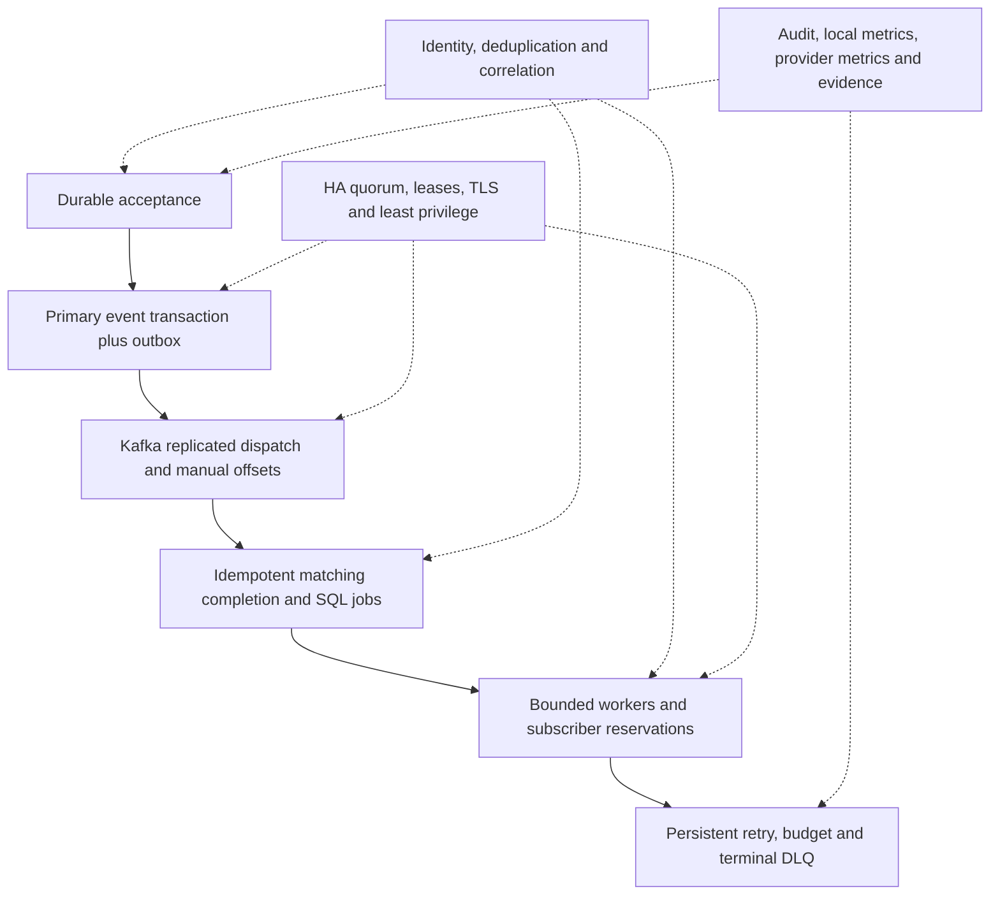
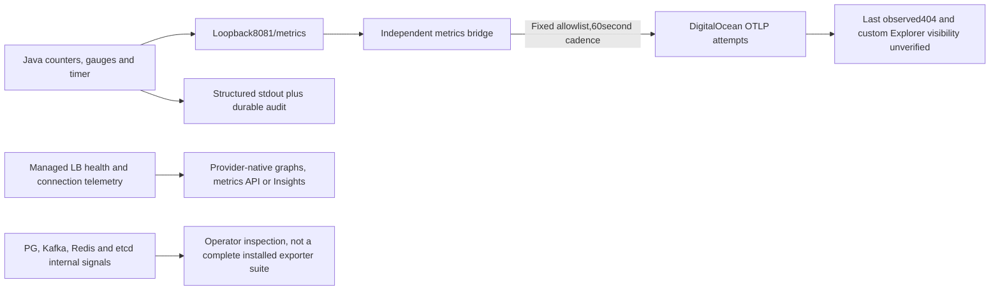

# Implemented system-design concepts and metrics catalogue

**Network access (27 November):** [Host VPC/interface rules block direct public backend web access; provider LB-only, SSH-source and outbound controls remain pending](network-hardening.md).

**November 26 redesign:** [Current asynchronous matching, 5-minute event identity cache, subscription consistency and delivery history contract](async-cache-history.md). Older revision-specific test/cloud evidence below remains historical until new release validation is recorded.

[Visual HLD](hld.md) | [Component LLDs](README.md#separate-low-level-design-documents) | [Metrics operations](metrics.md). This inventory is tied to the f0c4d33 source contract and later read-only LB settings, not a claim that all possible observability is deployed. Local declared instrumentation, exporter allowlist, provider-native telemetry and proposed/missing signals are explicitly different categories.

## Concepts map

| Concept | Actual mechanism/value | Verification signal and important limit |
| --- | --- | --- |
| Durable ingestion and transactions |Event and outbox in one PostgreSQL commit; jobs and matching completion in the consumer transaction with synchronous standby apply |Transaction rollback/storage tests and preserved cloud data; no universal regional RPO 0 |
| Asynchronous fanout |Kafka consumers create jobs after acceptance; HTTP outside DB transaction |KafkaIT journey and audit/receiver capture; matching is asynchronous |
| Idempotency |Explicit key or generated content/identity key plus producer ID constraints |events.duplicates, same original event, 409 on conflict; POST subscription lacks this contract |
| Deduplication |Unique event/subscription job and idempotent Kafka activation |Database constraints/replay tests; external receiver must deduplicate Delivery ID |
| Shared request rate limit |Redis atomic fixed-second 1,000/tenant across all apps |http.rate.limited and shared cloud fixture; no independent per-user quota or strict failover accounting |
| Bulkheads and fairness |Four worker loops/app, one live claim/subscription, least-recently-claimed reservation |Reservation/concurrency tests and pending age; not endpoint-wide or weighted fairness |
| Backpressure and bounded execution |HTTP 32 active/128 waiting, finite pools/deadlines, persistent DB queue and backlog rejection |admission metrics and 503 paths; not every library internal queue is hard bounded |
| Retry budgets/backoff |Tenant 300/subscription 30 per minute, persistent jitter, six total transient attempts |retry-budget deferred, attempt audit and tests; permanent failures stop early |
| Poison and terminal work |Malformed Kafka quarantine distinct from transactional delivery DLQ and leased publisher |quarantine/DLQ counters/history; publication may repeat and no automatic redrive API |
| Ownership fencing |Unique expiring SQL delivery/DLQ tokens and stale-result checks |stale counters plus concurrency tests; cannot recall issued HTTP or fence arbitrary receivers |
| Kafka partitioning/consumer groups |Internal event UUID, 6 partitions, 3 current consumers, RF 3/min ISR 2/acks all |Group/ISR CLI and distribution test; no source order or autoscaling |
| Database read separation |Writer 8/read 4 per app with strict standby role checks |replica/eventual headers and JDBC HA test; reads can lag or fail without standby |
| HA and safe failover |Three co-located hosts with distinct PG/etcd, Kafka and Redis/Sentinel safety |Recorded host and Redis failure drills; not two-host or region-loss tolerance |
| Load balancing/draining |Provider-managed distribution, private 5 s health/3 s timeout/2 thresholds, sticky off |Native health and readiness/drain evidence; no exact-ten-second RTO |
| Authentication and authorization |Static bearer identity, tenant predicates, separate admin, private admin routes |401/403/404 tests; no OAuth/OIDC, granular end-user IAM or RLS |
| Validation/SSRF protection |Body/type/path/filter/key bounds, approved HTTPS origin and connection-time DNS checks |Named validation/rebinding tests; not a network egress allowlist |
| Transport/signing security |HTTPS/TLS/mTLS by component plus tenant-derived HMAC/timestamp |Certificate/signature checks; HMAC is not encryption and loopback hop is HTTP |
| Backup/recovery |Daily consistent age-encrypted/authenticated Spaces dump and isolated restore |Historical nine-table actual restore and current ten-table tools; no WAL/PITR/full-service DR RTO |
| Correlation/audit |Canonical Event ID in MDC, Kafka/header/body/audit/DLQ and stable Delivery ID |Log/audit/HMAC tests; no complete distributed tracing backend |
| CI/CD and safe release |Real-service tests, scans, signed artifacts, portable image verification, drain/promote |Version-specific CI and runtime evidence; app rollback must retain contracts and schema is not reversed |
| Configuration/least privilege |Protected secrets, separate DB/Redis/control identities, bounded config and private ports |Configuration/role/ACL/gateway tests; active-data at-rest encryption not established |

General response caching, managed queue, source ordering, replay, ETag updates, per-user quotas, autoscaling, full distributed tracing and regional failover remain absent. Committed-identity and subscription caches are now distinct implemented caches; see the redesign contract. No alarms/tickets were requested. Host VPC/interface ingress blocks direct public web traffic; provider LB-UID-only rules remain pending. The private VPC is not proof of exclusive LB ingress, and shared state is not a browser session.

## How observations leave each component

The independent bridge has no database/bearer/Kafka/Redis credentials; it scrapes only loopback metrics. Its deployed JAR is cf92a03 while application revisions are tracked separately in submission-status.md; the allowlist is the verified shared contract. In-process telemetry is disabled to avoid double export. An application metric missing before its first code path runs is not necessarily a deployment failure; some counters are created lazily. Failed dependency gauge collection can omit a sample. A bridge/export failure does not govern event acceptance.

## Exact explicit application/export instruments

The following 29 allowlist mappings are extracted from MetricsExporter.java:20 counters and 9 gauges. These are declared/supported instruments, not proof of 29 visible, nonzero time series in the provider UI. This is not an exhaustive listing of every default library/JVM/Jetty metric.

| Local source name | OTLP name | Type | Meaning |
| --- | --- | --- | --- |
| `http.success` | `notification.http.success` | Counter | Application-filter responses below 400, excluding health |
| `http.client.errors` | `notification.http.client.errors` | Counter | Application-filter 4xx responses, excluding health |
| `http.server.errors` | `notification.http.server.errors` | Counter | Application-filter 5xx responses, excluding health |
| `http.rate.limited` | `notification.http.rate.limited` | Counter | Tenant request allowance rejections returned 429 |
| `events.accepted` | `notification.events.accepted` | Counter | New durable event accepted by ingest |
| `events.duplicates` | `notification.events.duplicates` | Counter | Ingest returns an existing accepted event |
| `delivery.attempts` | `notification.delivery.attempts` | Counter | Worker processed an HTTP outcome, not a unique durable business-effect count |
| `delivery.succeeded` | `notification.delivery.succeeded` | Counter | Successful saved delivery outcomes |
| `delivery.unsuccessful_attempts` | `notification.delivery.unsuccessful.attempts` | Counter | Unsuccessful worker outcomes |
| `delivery.retry_budget_deferred` | `notification.delivery.retry.budget.deferred` | Counter | Retry reservation deferred by shared budget/safety |
| `delivery.stale_results` | `notification.delivery.stale.results` | Counter | Database rejected an expired/replaced ownership result |
| `delivery.worker_errors` | `notification.delivery.worker.errors` | Counter | Worker processing exceptions |
| `delivery.recovered` | `notification.delivery.recovered` | Counter | Expired delivery claims recovered |
| `kafka.published` | `notification.kafka.published` | Counter | Acknowledged publication operations, including possible repeats |
| `kafka.publish_errors` | `notification.kafka.publish.errors` | Counter | Event outbox publish-path failures |
| `kafka.dispatched` | `notification.kafka.dispatched` | Counter | Successful activation processing, including replay calls |
| `kafka.consumer_errors` | `notification.kafka.consumer.errors` | Counter | Consumer-loop failures |
| `kafka.quarantined` | `notification.kafka.quarantined` | Counter | Malformed envelope quarantined in database |
| `kafka.dead_letters_published` | `notification.kafka.dead.letters.published` | Counter | Delivery-DLQ publication operations, possibly repeated |
| `kafka.dead_letter_publish_errors` | `notification.kafka.dead.letter.publish.errors` | Counter | Delivery-DLQ publisher failures |
| `metrics.scrape.success` | `notification.metrics.scrape.success` | Gauge | Bridge-only local scrape 1 success/0 failure |
| `events.acceptance_latency_p95_seconds` | `notification.events.acceptance.latency.p95` | Gauge | Local ingest timer p 95 in seconds, not an aggregate cluster percentile |
| `delivery.pending` | `notification.delivery.pending` | Gauge | Shared database pending delivery count |
| `delivery.oldest_pending_seconds` | `notification.delivery.oldest.pending.seconds` | Gauge | Shared oldest pending delivery age in seconds |
| `kafka.outbox_pending` | `notification.kafka.outbox.pending` | Gauge | Shared undispatched event/outbox count |
| `kafka.oldest_undispatched_seconds` | `notification.kafka.oldest.undispatched.seconds` | Gauge | Shared oldest undispatched event age in seconds |
| `redis.replicas` | `notification.redis.replicas` | Gauge | Observed Redis primary replica count |
| `http.admission.waiting` | `notification.http.admission.waiting` | Gauge | Local suspended/waiting HTTP requests |
| `http.admission.rejected` | `notification.http.admission.rejected` | Gauge | Local cumulative admission rejections represented as a gauge |

Source: [MetricsExporter](../src/main/java/com/example/notifications/MetricsExporter.java), [MetricsBridge](../src/main/java/com/example/notifications/MetricsBridge.java), [application registration](../src/main/java/com/example/notifications/NotificationApplication.java). Export counters use delta temporality; source counters are cumulative within a process. The bridge baselines its initial scrape and handles source counter reset, so samples/increments can still be lost around outages/restarts. No reliable exactly-once metric delivery is claimed.

### Additional local-only custom instrumentation

| Local instrument | Type | Export status |
| --- | --- | --- |
| `delivery.stale_reservations` |Counter |Not in the current OTLP allowlist; failed attempt-start ownership check |
| `kafka.dispatch_errors` |Counter |Not in the current OTLP allowlist; partition activation/offset processing failure |
| `events.acceptance_latency` |Timer |Timer stays local; its p 95 is exported through the mapped seconds gauge |

Adding these to a future export is a code/compatibility change, not something this documentation silently deployed. Runtime-library metrics must be inspected at the actual admin endpoint before promising individual JVM/DB-pool series. No complete Kafka group-lag, PostgreSQL pool/lock/WAL, Sentinel quorum or etcd-leader metric suite is exported by the 29 custom mappings above.

## Provider-native and component operations signals

| Component | What is implemented/available | What is not claimed |
| --- | --- | --- |
| Notification/Dropwizard |Explicit metrics above, structured logs, health, durable delivery audit |Full tracing, global percentiles, exactly-once counters or configured paging |
| PostgreSQL/Patroni |Role/lag/sync and pool/config SQL inspection, backup status, app backlog gauges |A complete PG exporter/dashboard/alert suite, automatic at-rest encryption or DR RTO |
| Kafka |CLI topic/ISR/group/lag inspection plus app publish/activate/quarantine/DLQ metrics |A configured broker/JMX collector or a consumer-lag metric in notification.* |
| Redis/Sentinel |Observed primary replica gauge, client errors/readiness and shared-window effects |A full Sentinel/Redis CPU/latency/eviction/quorum dashboard |
| etcd/watchdog |Member/quorum/Patroni/control and boot/fencing inspection |An installed dedicated etcd exporter or alerting pipeline |
| Caddy |JSON access logs, TLS and private readiness/drain behavior |A configured Caddy Prometheus collector or application counters covering every proxy/network rejection |
| DigitalOcean LB |Provider-supported backend_up, backend_health_check_failures, backend_downtime and droplet_health metrics |Current account samples/health notifications were not verified or configured; not a Docker-exit Kafka event |
| Hosts/Spaces |Host monitoring and backup timer/manifest observations are recorded historically |Fresh validation of every infrastructure time series, continuous backup or automatic incident tickets |

[DigitalOcean LB telemetry](https://docs.digitalocean.com/products/insights/reference/telemetry/load-balancers/) documents provider-native names. They are separate from our custom notification exporter and its last observed provider 404. Provider support is not the same as verified current samples. Metrics/alert policies/events are different: there is no configured email/ticket/alarm or reliable failure-event publication into Kafka. A fast container restart may never meet LB unhealthy thresholds.

## Aggregation and diagnosis rules

- Sum delta accepted/duplicate/attempt counters across instances only with an appropriate time window and restart/export-loss understanding. Do not interpret an activation/publication counter as unique delivery count.
- Shared-database pending/outbox counts and oldest ages are observed by multiple apps: use max rather than summing three copies. Independent workload partitions would require a different rule.
- Never average/sum local p 95 gauges to claim a global p 95. Obtain histograms/distributions and define the workload/SLO before global percentile reporting.
- Do not sum the Redis replica gauge from three apps into a cluster replica count. A negative/unavailable/omitted sample needs investigation, not treatment as healthy zero.
- http.admission.rejected is a cumulative local value represented as a gauge, not an exported delta counter. http.client.errors includes 429, so summing it with rate.limited double-counts those responses.
- Event/tenant/user IDs, payloads, receiver URLs and credentials are excluded from custom metric labels. Use Event ID/Delivery ID in protected logs/audit for individual investigations.

Readiness, failed probes, backlog age, error rates, ISR/lag, quorum, disk runway, certificate/backup age and connection saturation are useful operating signals, not an agreed SLO or a set of alarms already created. Full production dashboards, representative soak/capacity measurements and external notification policy remain explicit future work.

## New local instruments and operational checks

The redesign adds local counters `cache.hits`, `cache.misses`, `cache.errors`, `cache.capacity_rejected` and `delivery.archived`. They are deliberately not silently added to the existing OTLP bridge allowlist: its deployed revision and provider visibility must be validated separately. The existing 29 mappings above remain the export contract. Inspect cache errors/hit ratio, Redis memory, generation churn, matching completion/backlog, active/history counts and archive throughput alongside prior delivery/DB signals. Shared physical Redis remains a failure boundary even though the cache pool is separate from limiter traffic.
