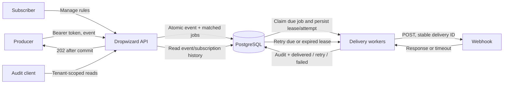

# Notification fanout: design and implementation contract

> Current Kafka implementation and verified scope: see [submission-status.md](submission-status.md) and [architecture.md](architecture.md). Earlier milestone descriptions below are retained as historical design context.

## A. Clarifications
Agreed: Java 25, Dropwizard, Maven, Ubuntu 24.04; development under /workspaces/notification-fanout; mandatory requirements first, extensions later. Personal GitHub destination and visibility remain undecided. This is the target design; executed checks are recorded separately.

## B. Requirements and acceptance criteria
### Functional requirements
- FR1: Authenticated event ingestion accepts type, source and any JSON payload. Return 202 only after the event and all matching delivery jobs commit atomically. A failed commit must not return success.
- FR2: Create, list and soft-delete tenant-owned subscriptions without restart. Subscriptions specify URL and optional type, source and payload equality conditions.
- FR3: Each matching subscription gets one durable job. The active subscriptions visible to the matching SELECT define membership. Concurrent creation/deletion may fall either side of this boundary. Deletion excludes future matching; existing jobs continue using the stored destination.
- FR4: Deliver outside database transactions. Persist attempts, use capped exponential backoff with jitter, recover expired worker leases, and expose pending/delivered/failed states.
- FR5: Query history by event/subscription, including attempt times, actual HTTP code or null, error category and final status. Missing/foreign resources return 404.
- FR6: Tenant-scoped idempotency key: same content returns original event ID; changed content returns 409; concurrent repeats are resolved by database uniqueness.
- FR7: Tenant identity comes from configured credentials; every resource query enforces ownership. Clients cannot select their tenant.

### Measurable targets, not benchmark claims
Assume 10 events/s average, 100 peak, 3 matches/event, 1 KiB payload and <=1000 active subscriptions/tenant. Target p95 acceptance <250 ms at average traffic; healthy receiver delivery p95 <2 s when worker capacity exceeds arrivals. No acknowledged work lost on process restart if PostgreSQL committed storage survives. Bound request body to 256 KiB, conditions to 20, pages to 100. All tests pass on Java 25 and real PostgreSQL. 99.9% monthly availability is a proposed operational objective, not proven by a local run.

### Rules and exclusions
Filters combine with AND; omitted filters match all; strings case-sensitive; payload paths use JSON Pointer; missing differs from null. Equality only. Destination/filter immutable; replace subscription to update. Events with zero matches are retained. Success means webhook 2xx, not subscriber business completion. No baseline ordering, replay, UI, email/SMS, arbitrary expressions, cross-region operation or compliance certification.

## C. Architecture
One codebase, API and bounded worker roles, one PostgreSQL database. Matching is synchronous inside acceptance; HTTP delivery is asynchronous. No broker dual-write. No cache to invalidate.



```mermaid
sequenceDiagram
 participant P as Producer
 participant A as API
 participant D as PostgreSQL
 participant W as Worker
 participant H as Webhook
 P->>A: POST /v1/events + Idempotency-Key
 A->>D: BEGIN; event; subscription snapshot; matching jobs; COMMIT
 A-->>P: 202 + event ID
 W->>D: Claim job + lease + attempt; COMMIT
 W->>H: POST notification
 H-->>W: Response or timeout
 W->>D: Save attempt + delivery result atomically
 Note over W,D: Crash recovery records unknown outcome and retries after lease expiry
```

## D. Key decisions and alternatives
|Decision|Why|Tradeoff|Revisit when|
|---|---|---|---|
|Java 25 + Dropwizard 5|Requested stack, explicit small classes and records|Manual wiring|Team conventions differ|
|PostgreSQL queue|Atomic acceptance, history and restart recovery|Polling/write load share DB|Measured backlog or DB saturation|
|Match during ingestion|Simple consistent event/job commit|O(subscriptions+fanout) latency|Large fanout misses latency target|
|One Maven module|Simple build and deployment|Less release isolation|Different teams need independent ownership|
|No cache/search/partitions|No demonstrated need|DB does more reads|Profiling or retention operations justify complexity|
|Real DB tests via environment|Tests SQL/locks without nested Docker|Provision test DB first|Testcontainers fits developer environment|

Async fanout later needs durable progress and versioned subscription membership. Broker evolution needs an outbox committed with the event, idempotent publication and consumers, rather than separate save/publish operations.

## E. Contracts and data
Version prefix /v1. POST/GET events; POST/GET/DELETE subscriptions; GET delivery; GET event/subscription deliveries. 202 accepted event, 201 created subscription, 204 delete; 400/422 invalid input; 401 authentication; 404 missing/foreign; 409 conflicting idempotency; 413 oversized; 429 throttled; 503 DB unavailable. Errors include code/message/requestId. Bounded limit/offset pages are not a snapshot across concurrent changes. Webhook envelope schemaVersion=1; additive fields allowed; incompatible semantics need a new version.

Tables: events (tenant, ID, type/source/payload, key/hash, accepted_at); subscriptions (tenant, ID, URL/filter, created/deleted_at); deliveries (tenant, event/subscription IDs, destination snapshot, status, attempts, next time, lease token/expiry); attempts (delivery, number, start/end, code, outcome/error). Unique tenant/key, event/subscription, delivery/attempt number. Foreign keys preserve ownership relationships; tenant predicates on all API reads. Index due pending work, expired leases and event/subscription history. Explicit versioned migration before serving; later changes additive, backward-compatible. No destructive startup migrations.

## F. Detailed behavior and security
Pending -> delivered; pending -> pending scheduled retry; pending -> failed. Claim and attempt creation atomic. HTTP outside locks. Completion requires current lease token; expired owners cannot overwrite newer results. Lease exceeds HTTP deadline. Interrupted attempts have unknown outcome and null status; they count toward bounded attempts. Five total attempts default. Retry transport failures, 408/429/5xx; redirects and other non-2xx terminal. Positive capped exponential jitter; injectable clock/random for tests. Exhausted jobs remain failed, never silently discarded.

Guarantee: durable acceptance and at-least-once-style processing with bounded retries, not unconditional eventual receipt. Receiver can process then lose response; worker can die after send but before saving. Stable delivery ID lets receiver deduplicate; exactly-once external effects require receiver cooperation. Loss of sole DB storage is outside process-recovery protection.

Trust boundaries: caller/API, worker/untrusted destination, application/DB. Server-side credential-to-tenant mapping; parameterized SQL; no payloads/secrets in logs; bounded input/concurrency and per-tenant process-local rate limiting. Multiple replicas multiply rate limits; move to gateway later. Baseline destinations are administrator-allowlisted literal IPs (no DNS rebinding); HTTPS required outside explicitly enabled local demo. Reject URL credentials/fragments, redirects and unexpected endpoints. Unrestricted hostnames are deferred until connection-time IP validation and egress enforcement exist. Outgoing HMAC identifies sender. Production needs TLS ingress, private admin ports, least-privilege DB credentials separate from migration role, encrypted storage/backups, managed secrets and rotation. No jurisdiction-specific compliance assumed; payload classification determines additional controls.

## G. Implementation milestones
M1: Verify Ubuntu/Java/Maven/PostgreSQL, save requirements/design.
M2: Migration, filters, subscriptions, atomic event ingestion, real webhook, audit; pass first integration flow.
M3: Retries/recovery/concurrency/idempotency/tenant and security checks.
M4: Reproducible container/Compose, CI, README, demo, operations/load harness; record actual tests and gaps.
M5: Push to selected personal GitHub and verify CI when destination/authentication available. Extensions afterward. No stubs represented as complete.

## H. Validation, deployment, operations
Test filter edge cases, URL policy and retry math; real-DB atomicity, constraints, simultaneous requests/claims, stale leases, interrupted attempts, terminal failure and isolation; HTTP end-to-end with controlled receiver. CI Java 25/PostgreSQL runs mvn verify on push/PR. Load measurements reported separately from assumptions.

Deploy immutable image; take backup; run compatible migration once; start/gate new instances; drain old workers within HTTP timeout; rollback app to compatible image, not blind reverse migrations. Separate dev/test/prod. DigitalOcean is deferred. Local Compose is not hardened production deployment.

SLIs: acceptance success/latency, delivery delay, backlog age, terminal failure rate, worker activity. Alert sustained DB failure or oldest pending >60 s; isolate receiver-specific incidents. Liveness independent of DB; readiness checks DB. Admin metrics private. Correlation IDs in logs, no high-cardinality event metric labels. Full tracing is deferred.

RPO=0 for acknowledged commits on process restart with surviving DB; verify recovery in tests. Proposed production disaster targets RPO<=5min/RTO<=60min require managed PITR and restore drills, not supplied by local Compose. Initial retention target 7 days; exclude pending events and clean dependent history in small batches; automated purge/restore drill remain explicit release gaps. Runbooks: check oldest queue, worker and DB; allow scheduled retries during receiver outage; terminal redrive requires explicit operator action (API deferred); rotate exposed credentials; restore into new DB and verify before traffic switch.

## I. Capacity, costs, risks, evolution
Assumptions: 10 events/s average, 100 peak, 3 matches, 1.2 attempts/delivery, 1KiB events, 7 days. Daily events=864000, deliveries=2592000, attempts=3110400. Approx row+index budgets 1.5KiB/event + 0.8KiB/delivery + 0.5KiB/attempt yield 5.04GB/day decimal, 35.3GB/week; allow >=71GB plus WAL/backups, then measure. Payload-only egress 2.65GB/day, 3.19GB including retry multiplier, before envelopes/TLS. Peak sends=360/s; at 200ms mean response, needed concurrent sends=72; aim >=96 after fairness/DB benchmarks. Local default 8 is intentionally not sized for that peak. Five-second receiver timeouts drastically reduce capacity; backlog age drives scaling.

Approx writes/event: event 1 + delivery inserts 3 + delivery claim/finish 7.2 + attempt start/finish 7.2 =18.4 row writes excluding indexes/WAL/recovery. Reads include subscription lookup per event plus audit assumed one query per ten events; returned rows and fanout dominate. At 1000 rules, 100 peak events/s can mean 100000 evaluations/s. Add candidate indexing/batching based on measurement. Replicas only for stale-tolerant audit reads; never job claims or idempotency. Time partitioning when retention cleanup becomes costly.

Planning allowance, not vendor quote: app/worker $25-60/month, managed DB $30-100, backups/logging/egress $10-40: $65-200 before HA/broker/workload adjustments. Verify live regional pricing before deployment. Main drivers: fanout, retries, retention, bandwidth. Next: measured load baseline, tenant fair scheduling, async matcher, outbox+broker, partitions. Ordered delivery needs serialized (tenant,subscription,source) and failed-head policy. Replay needs bounded authorized ranges and a new generation of delivery IDs.
