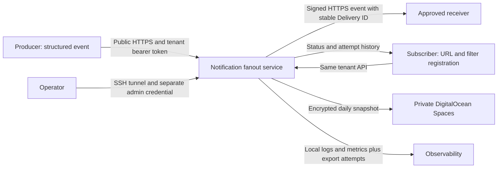
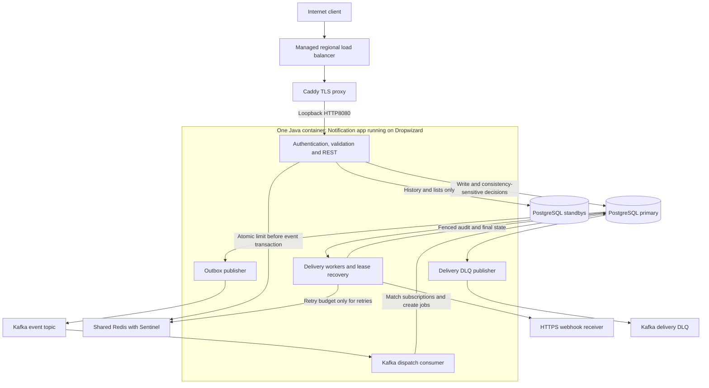
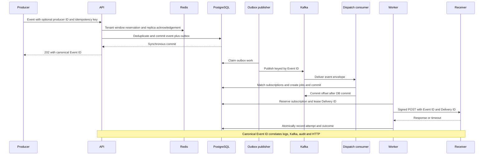
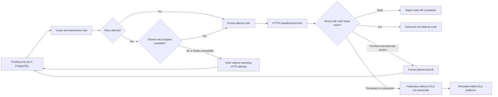
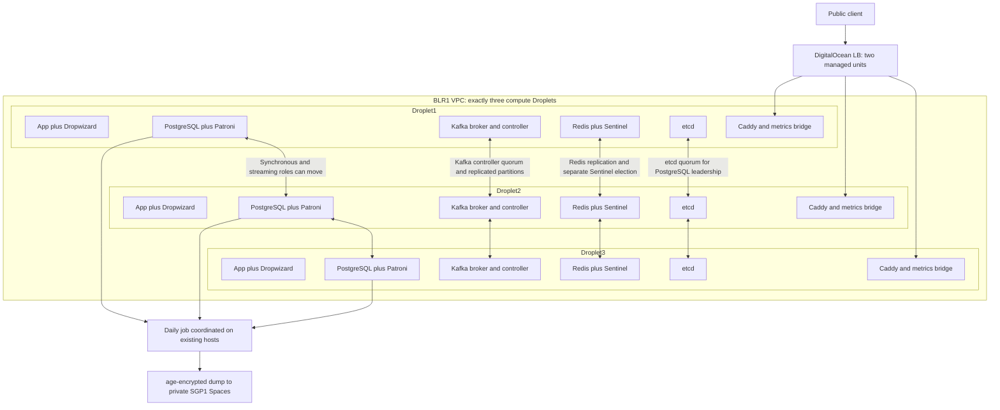
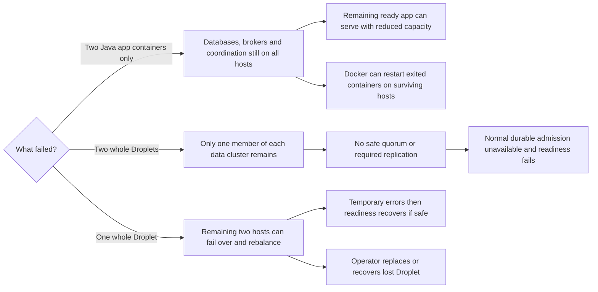
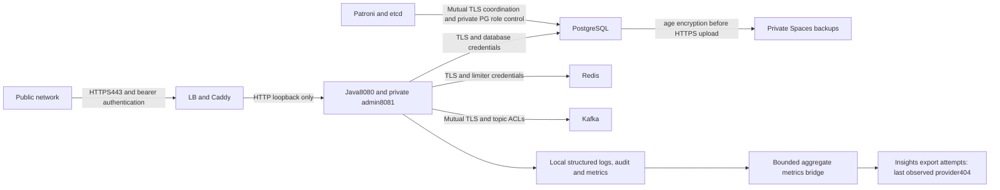

# Visual high-level design

**November 26 redesign:** [Current asynchronous matching, 5-minute event identity cache, subscription consistency and delivery history contract](async-cache-history.md). Older revision-specific test/cloud evidence below remains historical until new release validation is recorded.

Start with [requirements](requirements.md). Explain diagrams 1 through 7 in order, then open the relevant [component LLD](README.md#separate-low-level-design-documents). Values describe the f0c4d33 runtime and 25 November 2026 read-only LB inspection. The functional redesign was deployed as f0c4d33; later documentation-only changes do not require another runtime deployment.

## 1. System boundary: who uses it?

Contract: accept type/source/arbitrary JSON durably, match subscriptions, deliver asynchronously with bounded retries, and expose audit. Operators approve public receiver origins before registration. No replay/update/ordering API is hidden in this boundary. Exactly-once receiver business effects need receiver-side transactional deduplication.

## 2. One deployable app with separate responsibilities

**Dropwizard is the runtime inside the Notification app, not an additional application replica.** Ingestion commits event and outbox; Kafka consumers match subscriptions and create jobs in a second atomic transaction. Completed matching is not repeated on replay. Network delivery holds no database connection/transaction. One codebase keeps assessment complexity low; role separation into services is future work if independent scaling/ownership requires it.

## 3. Follow one event and its identifiers

The API does not synchronously publish Kafka in its request thread; the separate outbox role performs that work. A repeated producer request returns the original event or 409 for conflict. A repeated Kafka record does not create another event/subscription job. A lost successful HTTP response can still lead to repeated webhook effects.

## 4. Delivery attempts are durable, not an in-memory retry queue

Defaults: six total attempts means initial plus five retries, 30 second lease, 1 second retry base/60 second cap, four delivery workers/app, one active delivery/subscription across all instances. Shared retry budgets are 300/tenant/minute and 30/subscription/minute. Expired/uncertain started attempts count toward exhaustion. There is no unconditional eventual-receipt promise.

## 5. Three machines, several independent HA mechanisms

The backup job runs on whichever existing host acquires the database advisory lock, not a fixed database leader or fourth machine. PostgreSQL, Redis and Kafka do not share one election protocol. etcd is used by Patroni, not Kafka or Redis. Each host's roles share CPU/disk/memory and a region. This design targets one-host loss with a safe surviving quorum, not independent-zone or regional disaster tolerance.

## 6. Understand the two failure cases

Docker restart is not a Droplet replacement controller. There is no horizontal autoscaler. A healthy but hung process may be excluded by LB health without automatically being restarted. LB checks HTTP 9080/health/ready every 5 seconds, timeout 3 seconds, thresholds 2 failed/2 successful, sticky sessions off. Distribution is provider-managed rather than a user-configured round-robin/least-connections selector. These settings do not guarantee exactly-ten-second recovery.

## 7. Security and observability boundaries

The control-plane arrow represents Patroni coordination and role management, not etcd replicating PostgreSQL data. Kafka and Redis use their own independent mechanisms. Public tenant endpoints require a token, but they are not private-only endpoints. Root SSH is key-only; cloud/UFW still allow public 22/80/443 and broad egress. No dedicated API gateway/WAF/OIDC is deployed. Webhook allowlisting and connection-time DNS checks mitigate SSRF in application code, not a restrictive network egress policy. Active-data disk/TDE/field encryption has not been established; do not claim complete encryption at rest. Backups are encrypted, while local proxy-to-Java traffic is loopback HTTP.

Local/custom application instrumentation and native LB metrics are different paths. Metrics Explorer visibility for notification.* remains unverified after provider 404; LB native health signals are provider-supported but current samples were not verified. No alarms/tickets are configured by request. See [the complete concepts/metrics catalogue](concepts-and-metrics.md).

## Explain the concrete limits

| Control | Implemented value | What it does not prove |
| --- | --- | --- |
| Tenant window |6,000 authenticated requests/minute shared across apps | No separate user quota or strict no-overshoot accounting through Redis failover |
| HTTP admission/app |32 active, 128 waiting, 1 second wait; Jetty 8-64 threads | Not a full bound on every library-internal queue |
| JDBC/app |8 write plus 4 standby-read maximum;3 second pool wait | Not 36 connections per DB: app totals are 24 write plus 12 read across cluster; other clients need headroom |
| PostgreSQL |100 connections/server, remote_apply and required sync standby | No regional RPO 0 or infinite connection capacity |
| Kafka |6 partitions, 3 consumers, RF 3/min ISR 2, event UUID key | No per-source ordering, managed queue or automatic scaling |
| Delivery |12 global workers and 1 active attempt/subscription | Not a guarantee of high fanout throughput or endpoint-wide isolation |
| Daily backup |One successful UTC-day snapshot and 24-hour retention | No continuous WAL/PITR or guaranteed usable backup if expiry/new-backup failure overlap |

Illustrative sizing, not a benchmark:100 events/s with three matches needs 300 delivery attempts/s. At 200 ms/receiver, 12 workers have an idealized 60 attempts/s ceiling, leaving 240 jobs/s backlog growth before retries and other overhead. The historical 10,000-event no-match probe and Kafka distribution test do not prove that fanout load. [Capacity assumptions and decisions](design.md#i-capacity-cost-and-evolution) explain the arithmetic and remaining measurements.

## What is complete and what is next?

Mandatory ingestion, subscriptions/filtering, fanout/retries/status and audit are implemented and deployed. Unit/integration/CI and named cloud checks are recorded in [validation](validation.md) and [submission status](submission-status.md). Per-user quotas, general cache, managed queue, source ordering, replay, resource updates/ETags, autoscaling, full tracing, complete at-rest encryption and regional failover are not claimed. Use [the LLD directory](README.md#separate-low-level-design-documents) to explain each component without inventing additional services.
