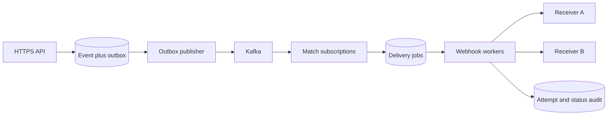

# Interview demo: one event, two subscribers, verified webhooks

Use this page for a fresh live demonstration. Prepare the two free webhook inboxes before the interview; perform the numbered demo steps on screen. All payloads are synthetic.

**Public links:** [process health](https://174.138.121.225/health/live) · [service readiness](https://174.138.121.225/health/ready) · [architecture](hld.md) · [detailed troubleshooting](manual-two-subscriber-test.md).

Run every Bash block in the **same IntelliJ terminal connected to the Rancher Ubuntu container**. The public load-balancer URL uses HTTPS 443; Droplet application ports and metrics are private. This page creates new identities each time you start preparation. To retry an uncertain operation, preserve its existing files and keys instead of starting over.

## Prepare before screen sharing

Confirm the terminal first:

```bash
uname -s
cd /workspaces/notification-fanout && pwd
```

Expected: Linux and /workspaces/notification-fanout. Stop if this fails. Your Mac's /Users path is not the container workspace.

```bash
set -euo pipefail
umask 077
BASE_URL='https://174.138.121.225'
mkdir -p .deploy/manual-tests
RUN_DIR=$(mktemp -d "$PWD/.deploy/manual-tests/interviewer.XXXXXX")
RUN_ID=$(python3 -c 'import uuid; print(uuid.uuid4())')
EVENT_TYPE="interview.order.created.$RUN_ID"
SOURCE='interview-demo'
PRODUCER_EVENT_ID=$(python3 -c 'import uuid; print(uuid.uuid4())')
EVENT_KEY="interview-event-$RUN_ID"
SUB_KEY_1="interview-sub-1-$RUN_ID"
SUB_KEY_2="interview-sub-2-$RUN_ID"
read -r -s -p 'Tenant API token: ' API_TOKEN
printf '\nRun files: %s\n' "$RUN_DIR"
test -n "$API_TOKEN"
```

Enter the existing notification-service tenant token privately before screen sharing. It is not a GitHub, DigitalOcean or Webhook.site token. An authorized operator can retrieve it from the protected cloud configuration; see [token and environment setup](manual-two-subscriber-test.md#1-prepare-the-local-terminal). Never print the full configuration, enable shell tracing, or commit the run folder.

Define three small terminal helpers. They save responses, preserve TLS checks, and stop on unexpected status codes. POSTs are never automatically retried.

```bash
api_request() {
  local method="$1" path="$2" input="$3" output="$4" key="${5:-}"
  local args=(--silent --show-error --max-time 10
    -X "$method" -D "$output.headers" -o "$output" -w '%{http_code}'
    -H "Authorization: Bearer $API_TOKEN")
  if [ -n "$input" ]; then
    args+=(-H 'Content-Type: application/json' --data-binary "@$input")
  fi
  if [ -n "$key" ]; then args+=(-H "Idempotency-Key: $key"); fi
  HTTP_STATUS=$(curl "${args[@]}" "$BASE_URL$path")
}
expect_status() {
  if [ "$HTTP_STATUS" != "$1" ]; then
    printf 'Expected HTTP %s, received %s. Inspect saved response files; preserve keys.\n' "$1" "$HTTP_STATUS" >&2
    return 1
  fi
}
get_eventual() {
  local path="$1" output="$2" attempt
  for attempt in $(seq 1 20); do
    api_request GET "$path" '' "$output"
    if [ "$HTTP_STATUS" = 200 ]; then return 0; fi
    case "$HTTP_STATUS" in 404|503) sleep 1 ;; *) expect_status 200; return 1 ;; esac
  done
  expect_status 200
}
```

A curl transport failure stops the command sequence. For a lost POST response, retry that exact api_request with the same input file/key. After a transient GET failure, retry the read. Do not send a new logical event to troubleshoot a read.

Create two fresh external receivers configured to return 204:

```bash
create_inbox() {
  local number="$1" status
  status=$(curl --silent --show-error --max-time 15     -o "$RUN_DIR/inbox-$number.json" -w '%{http_code}'     -X POST https://webhook.site/token     -H 'Content-Type: application/json'     --data '{"default_status":204,"default_content":"","default_content_type":"text/plain","timeout":0,"expiry":86400}')
  case "$status" in 200|201) ;; *) printf 'Inbox creation returned HTTP %s; inspect its saved response.\n' "$status" >&2; return 1 ;; esac
  jq -e '.uuid | type=="string" and length==36' "$RUN_DIR/inbox-$number.json" > /dev/null
}
create_inbox 1
```

**Wait at least 65 seconds** before running the next block. The provider documents one free inbox creation per minute; wait longer after 429. Do not retry inbox creation blindly after a lost response. If provider authentication is required, use two inboxes you own through its authorized UI/API. The approved receiver origin is https://webhook.site:443; a different hostname requires operator approval.

```bash
create_inbox 2
INBOX_1=$(jq -er '.uuid' "$RUN_DIR/inbox-1.json")
INBOX_2=$(jq -er '.uuid' "$RUN_DIR/inbox-2.json")
test "$INBOX_1" != "$INBOX_2"
WEBHOOK_1="https://webhook.site/$INBOX_1"
WEBHOOK_2="https://webhook.site/$INBOX_2"
printf 'Viewer 1: https://webhook.site/#!/view/%s\nViewer 2: https://webhook.site/#!/view/%s\n' "$INBOX_1" "$INBOX_2"
```

Open the **viewer URLs**, not the receiving URLs: opening a receiving URL generates an extra GET capture. Keep inbox identifiers private. Never send API_TOKEN to Webhook.site. [Provider creation contract](https://docs.webhook.site/api/tokens.html), [request history contract](https://docs.webhook.site/api/requests.html).

## 1. Explain the flow and show health

Say: “The API commits the event and outbox together before 202. Publishers send it to Kafka. Consumers match current subscriptions and create delivery jobs. Workers send signed webhooks, and the audit API exposes each attempt.”



```bash
curl --fail-with-body --silent --show-error --max-time 10 "$BASE_URL/health/live"
printf '\n'
curl --fail-with-body --silent --show-error --max-time 10 "$BASE_URL/health/ready"
printf '\n'
```

Expected: alive and ready, both 200. One load-balanced response checks the responding backend; it is not proof that all three hosts are healthy.

## 2. Create two subscriptions and prove registration idempotency

Say: “Both subscriptions match this run's unique type and source. Receiver A requires a gold customer; receiver B requires the Bangalore region. Keys make uncertain registration retries safe.”

```bash
jq -n --arg url "$WEBHOOK_1" --arg type "$EVENT_TYPE" --arg source "$SOURCE"   '{webhookUrl:$url,filter:{type:$type,source:$source,payloadConditions:[{path:"/customer/tier",operator:"eq",value:"gold"}]}}'   > "$RUN_DIR/subscription-1-request.json"
jq -n --arg url "$WEBHOOK_2" --arg type "$EVENT_TYPE" --arg source "$SOURCE"   '{webhookUrl:$url,filter:{type:$type,source:$source,payloadConditions:[{path:"/region",operator:"eq",value:"blr1"}]}}'   > "$RUN_DIR/subscription-2-request.json"
for n in 1 2; do
  if [ "$n" -eq 1 ]; then key="$SUB_KEY_1"; else key="$SUB_KEY_2"; fi
  api_request POST /v1/subscriptions "$RUN_DIR/subscription-$n-request.json" "$RUN_DIR/subscription-$n.json" "$key"
  expect_status 201
  api_request POST /v1/subscriptions "$RUN_DIR/subscription-$n-request.json" "$RUN_DIR/subscription-$n-replay.json" "$key"
  expect_status 201
  jq -e --slurpfile original "$RUN_DIR/subscription-$n.json" '. == $original[0]' "$RUN_DIR/subscription-$n-replay.json"
done
SUB_1=$(jq -er '.id' "$RUN_DIR/subscription-1.json")
SUB_2=$(jq -er '.id' "$RUN_DIR/subscription-2.json")
test "$SUB_1" != "$SUB_2"
printf 'Subscription A: %s\nSubscription B: %s\n' "$SUB_1" "$SUB_2"
```

Expected: four POST responses 201, but only two created Subscription IDs. Inspecting the saved JSON proves both replays returned the original creation representation. Without Idempotency-Key, registrations remain distinct.

Use a controlled demo tenant without concurrent subscription changes. Before emitting the event, inspect all active subscription pages for other broad type/source matches:

```bash
offset=0
: > "$RUN_DIR/subscription-pages.jsonl"
while :; do
  get_eventual "/v1/subscriptions?limit=100&offset=$offset" "$RUN_DIR/subscription-page.json"
  jq -c '.items[]' "$RUN_DIR/subscription-page.json" >> "$RUN_DIR/subscription-pages.jsonl"
  if [ "$(jq -r '.hasMore' "$RUN_DIR/subscription-page.json")" = false ]; then break; fi
  offset=$((offset+100))
  test "$offset" -le 1000
done
jq -s -e --arg a "$SUB_1" --arg b "$SUB_2" --arg type "$EVENT_TYPE" --arg source "$SOURCE"   '[.[] | select(.id!=$a and .id!=$b) | select((.filter.type==null or .filter.type==$type) and (.filter.source==null or .filter.source==$source))] | length==0'   "$RUN_DIR/subscription-pages.jsonl"
```

If this check fails, stop and use an appropriately isolated demo tenant; do not delete other subscriptions. This is an eventually consistent precheck, not a freeze on concurrent rule changes. Any subscription visible to the successful consumer matching transaction can affect recipients.

## 3. Send one new structured event

```bash
jq -n --arg producer "$PRODUCER_EVENT_ID" --arg type "$EVENT_TYPE" --arg source "$SOURCE" --arg run "$RUN_ID"   '{eventId:$producer,type:$type,source:$source,payload:{synthetic:true,testRun:$run,orderId:"interview-order-001",amount:125,customer:{tier:"gold"},region:"blr1"}}'   > "$RUN_DIR/event-request.json"
api_request POST /v1/events "$RUN_DIR/event-request.json" "$RUN_DIR/event-response.json" "$EVENT_KEY"
expect_status 202
jq -e '.duplicate==false' "$RUN_DIR/event-response.json"
EVENT_ID=$(jq -er '.event.id' "$RUN_DIR/event-response.json")
printf 'Producer Event ID: %s\nInternal Event ID: %s\n' "$PRODUCER_EVENT_ID" "$EVENT_ID"
get_eventual "/v1/events/$EVENT_ID" "$RUN_DIR/event-get.json"
jq -e --arg id "$EVENT_ID" '.id==$id and .payload.synthetic==true' "$RUN_DIR/event-get.json"
```

Say: “202 confirms PostgreSQL acceptance, not completed delivery. The producer UUID identifies my original occurrence. The internal Event ID is the Kafka key and downstream correlation ID. GETs use read replicas, so a short delay is normal.”

## 4. Prove both notifications arrived

```bash
deadline=$((SECONDS+120))
while [ "$SECONDS" -lt "$deadline" ]; do
  api_request GET "/v1/events/$EVENT_ID/deliveries?limit=100&offset=0" '' "$RUN_DIR/deliveries.json"
  case "$HTTP_STATUS" in 404|503) sleep 2; continue ;; esac
  expect_status 200
  if jq -e --arg a "$SUB_1" --arg b "$SUB_2"     '[.items[] | select(.subscriptionId==$a or .subscriptionId==$b)] | length==2 and all(.[]; .status=="delivered")'     "$RUN_DIR/deliveries.json" > /dev/null; then break; fi
  sleep 2
done
jq -e --arg event "$EVENT_ID" --arg a "$SUB_1" --arg b "$SUB_2"   '[.items[] | select(.subscriptionId==$a or .subscriptionId==$b)] | length==2 and all(.[]; .eventId==$event and .status=="delivered" and any(.attempts[]; .httpStatus==204 and .outcome=="delivered" and .startedAt!=null and .finishedAt!=null))'   "$RUN_DIR/deliveries.json"
jq '.items[] | {id,eventId,subscriptionId,status,attemptCount,attempts}' "$RUN_DIR/deliveries.json"
DELIVERY_1=$(jq -er --arg sub "$SUB_1" '.items[] | select(.subscriptionId==$sub) | .id' "$RUN_DIR/deliveries.json")
DELIVERY_2=$(jq -er --arg sub "$SUB_2" '.items[] | select(.subscriptionId==$sub) | .id' "$RUN_DIR/deliveries.json")
test "$DELIVERY_1" != "$DELIVERY_2"
for n in 1 2; do
  if [ "$n" -eq 1 ]; then inbox="$INBOX_1"; sub="$SUB_1"; delivery="$DELIVERY_1"; else inbox="$INBOX_2"; sub="$SUB_2"; delivery="$DELIVERY_2"; fi
  curl --fail-with-body --silent --show-error --max-time 15     "https://webhook.site/token/$inbox/requests?sorting=newest&per_page=100" > "$RUN_DIR/receiver-$n.json"
  jq -e --arg event "$EVENT_ID" --arg sub "$sub" --arg delivery "$delivery"     '[.data[] | select(.method=="POST") | (.content | fromjson?) | select(.event.id==$event and .subscriptionId==$sub and .deliveryId==$delivery)] | length>0'     "$RUN_DIR/receiver-$n.json"
done
printf 'PASS: one accepted event, two distinct delivered jobs, both receiver captures verified.\n'
```

Show both viewer tabs. The Event ID must be the same; Subscription IDs and Delivery IDs must differ. Show attempt timestamps and 204 in the audit. If receiver history is delayed, repeat only its GET/check. Do not create another event.

The inspector exposes signature headers but does not itself validate HMAC or deduplicate business side effects. Our separate [cloud release evidence](evidence/subscription-idempotency-cloud-2026-11-27.json) includes cryptographic verification. Delivery is at-least-once; a successful smoke test does not prove exactly-once HTTP execution, high throughput or failover.

## 5. Prove event replay and conflicting subscription rejection

```bash
api_request POST /v1/events "$RUN_DIR/event-request.json" "$RUN_DIR/event-replay.json" "$EVENT_KEY"
expect_status 202
jq -e --arg id "$EVENT_ID" '.duplicate==true and .event.id==$id' "$RUN_DIR/event-replay.json"
jq '.filter.source="conflicting-source"' "$RUN_DIR/subscription-1-request.json" > "$RUN_DIR/subscription-conflict.json"
api_request POST /v1/subscriptions "$RUN_DIR/subscription-conflict.json" "$RUN_DIR/subscription-conflict-response.json" "$SUB_KEY_1"
expect_status 409
get_eventual "/v1/events/$EVENT_ID/deliveries?limit=100&offset=0" "$RUN_DIR/deliveries-after-replay.json"
jq -e --arg a "$SUB_1" --arg b "$SUB_2" --arg d1 "$DELIVERY_1" --arg d2 "$DELIVERY_2"   '[.items[] | select(.subscriptionId==$a or .subscriptionId==$b) | .id] | sort == ([$d1,$d2] | sort)'   "$RUN_DIR/deliveries-after-replay.json"
printf 'PASS: event replay preserved its ID and both Delivery IDs; changed subscription returned 409.\n'
```

Say: “Redis accelerates recent event duplicates; PostgreSQL is authoritative. Subscription registration keys persist in PostgreSQL independently of the event cache. Retrying does not create extra subscriptions or delivery jobs.”

## 6. Show metrics and finish

On **each Droplet's authorized operator console**, use the same commands. This is separate from your local container terminal:

```bash
hostname
curl --fail-with-body --silent --show-error --max-time 5 http://127.0.0.1:8080/health/ready
curl --fail-with-body --silent --show-error --max-time 5 http://127.0.0.1:8081/metrics   | jq '{accepted:.counters["events.accepted"],duplicates:.counters["events.duplicates"],delivered:.counters["delivery.succeeded"],pending:.gauges["delivery.pending"],oldestPending:.gauges["delivery.oldest_pending_seconds"]}'
```

| Node | Operator destination | Metrics address inside that node |
| --- | --- | --- |
| 1 | 64.227.168.29 | http://127.0.0.1:8081/metrics |
| 2 | 139.59.13.207 | http://127.0.0.1:8081/metrics |
| 3 | 159.65.153.56 | http://127.0.0.1:8081/metrics |

Counters are per process and reset on restart. A single event need not increment every instance's counters. Shared backlog gauges must not be summed across nodes. DigitalOcean custom Metrics Explorer visibility remains unverified; use these loopback metrics for the demo. Do not disable firewalls or trigger a production failure drill during an interview demonstration.

Optional cleanup, back in the **original container Bash session**, after the interviewer has seen both captures:

```bash
api_request DELETE "/v1/subscriptions/$SUB_1" '' "$RUN_DIR/delete-1.txt"
expect_status 204
api_request DELETE "/v1/subscriptions/$SUB_2" '' "$RUN_DIR/delete-2.txt"
expect_status 204
unset API_TOKEN
```

This deletes only your two subscriptions. Event/delivery audit remains queryable. Deletion does not cancel already-created jobs. Replaying a deleted subscription's original creation key does not reactivate it; a fresh registration needs a fresh key. Do not clear shared Redis or delete database rows.

## Success criteria and recovery notes

| Check | Expected |
| --- | --- |
| Public health | 200 |
| Two registrations, each retried | Original 201 representation per key; two distinct subscription IDs |
| One new event | 202, duplicate=false |
| Stored event | Same internal ID and synthetic payload |
| Delivery audit | Two distinct delivered IDs, completed 204 attempt timestamps |
| Independent receivers | Matching event/subscription/delivery IDs in both captures |
| Event replay | 202, duplicate=true, original Event ID and unchanged Delivery IDs |
| Changed filter with original subscription key | 409 |

If something fails, preserve RUN_DIR and inspect the saved response/headers. 401 means credentials; 429 means application or provider quota; 503 means an unavailable dependency/admission limit; 400/422 means input/policy validation. A bounded poll timeout is a diagnosis point, not permission to create duplicate resources. Use [the full runbook](manual-two-subscriber-test.md#troubleshooting).

This page is a repeatable procedure, not a claim that a new demonstration was executed when the document was generated. Previous passing cloud evidence remains separately dated and linked. Documentation changes require no application redeployment.

Documentation validation on 27 November 2026: all 13 Bash blocks parsed; three generated request files and both filter matches passed; 13 positive/negative predicate cases passed; the request/status/read-retry helpers passed with a local curl test double; local links resolved; and 47 repository Mermaid diagrams parsed. These are offline guide checks, not a newly executed cloud demonstration.
