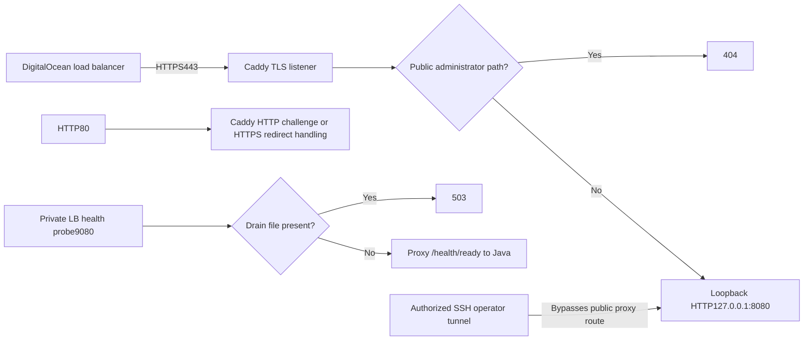
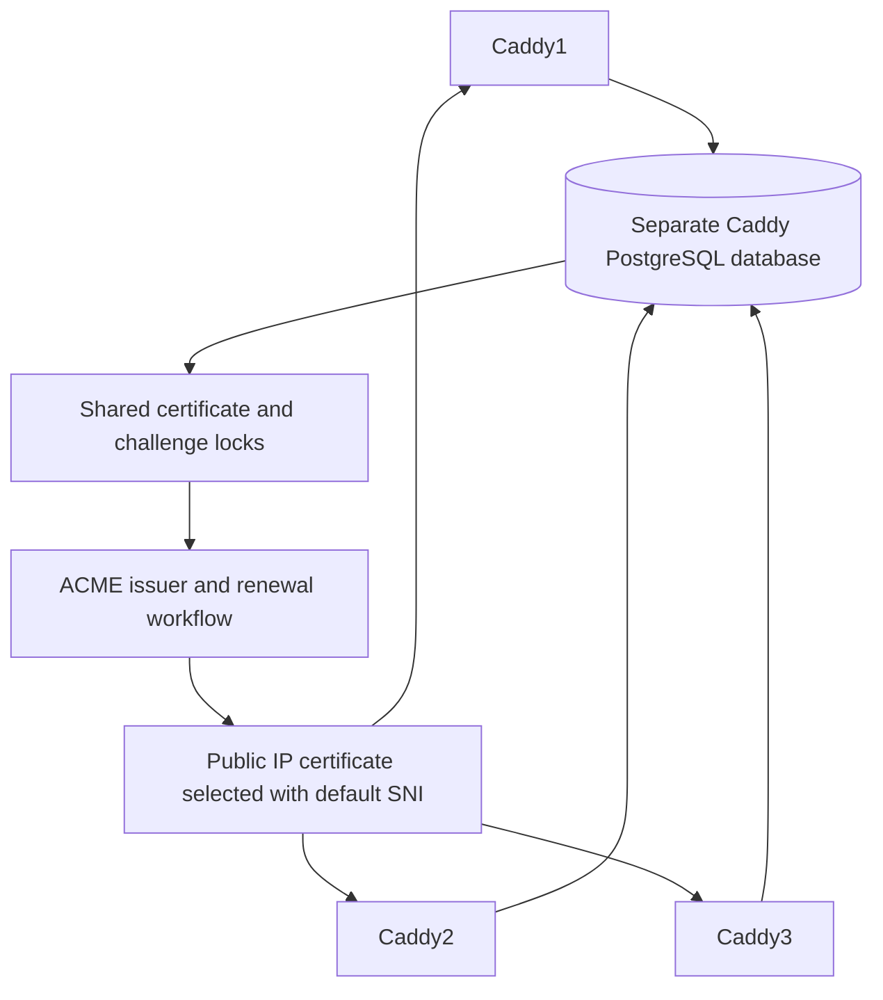

# Caddy reverse-proxy low-level design

**27 November network update:** [Direct public backend access is blocked by host VPC/interface rules; provider firewall and SSH/egress follow-up remain outstanding](../network-hardening.md). Earlier network observations below are historical where superseded.

**November 26 redesign:** [Current asynchronous matching, 5-minute event identity cache, subscription consistency and delivery history contract](../async-cache-history.md). Older revision-specific test/cloud evidence below remains historical until new release validation is recorded.

[Visual HLD](../hld.md) | [Load balancer LLD](load-balancer.md) | [Dropwizard runtime](dropwizard.md). One Caddy proxy runs on each of the three application/data hosts. It terminates public TLS and shares certificate state through a separate PostgreSQL database. It is not a dedicated API gateway or user identity provider.

## Low-level requirements

| ID | Implemented requirement | Acceptance check |
| --- | --- | --- |
| C-01 | Provide publicly trusted HTTPS to the Java application | Live HTTPS certificate validation and health/API probes pass |
| C-02 | Keep Java/admin ports off public interfaces | Proxy to 127.0.0.1:8080; app admin/metrics 8081 remains loopback |
| C-03 | Keep administrator origin-management routes private | Public /v1/admin/* returns 404; operators use SSH tunnel |
| C-04 | Expose independent private drain/readiness routing | Port 9080/health/ready proxies app readiness unless drain file forces 503 |
| C-05 | Coordinate certificates across three proxies | Shared PostgreSQL certificate/challenge storage and locking |
| C-06 | Bound ingress and avoid sensitive configuration leakage | Proxy body cap 300 KB, application cap 256 KiB; filtered JSON storage logs |

## Frontend, private health and administrator path

The LB's own HTTP-to-HTTPS redirect setting is off; Caddy owns its redirect/ACME behavior. The public listener forwards approved routes but does not validate bearer tokens; the application does. Public 80/443 currently accept arbitrary network sources on Droplets, not just the LB. Administrator rejection is not a replacement for tenant authorization. No per-user routing, rate-limit plugin, WAF or response cache is configured in Caddy.

## Shared certificate storage and cold-start boundary

The custom PostgreSQL storage module and its build dependencies are pinned/scanned. DSN selects the writable primary with TLS identity verification; it uses separate Caddy credentials/database, not the tenant database runtime role. Existing in-memory certificates can serve during a DB outage; a cold start, challenge or renewal can need the database. Automatic public renewal is configured, but an elapsed renewal cycle is not proven by one valid certificate probe. This database is not included in the notification business-data dump. Do not put DSNs or offline authority keys in Git/logs.

## Configuration and release behavior

[HA Caddyfile](../../deploy/ha/Caddyfile) defines shared storage, ACME short-lived profile, default_sni for the public address, public admin rejection, X-Content-Type-Options, server-header removal, access logging and body bound. Port 9080 routes only /health/ready and otherwise 404. Proxy memory cap is 160 MiB in the HA renderer. Do not generalize Java/Redis process privilege/capability settings to the proxy image without checking its own image/Compose definition.

Application promotion sets the local drain file, waits, migrates/starts the app, checks readiness and removes the drain only when safe. Initial coordinated cutover retained drains until all apps were verified. Proxy infrastructure is updated separately, not rebuilt/restarted for every app deployment. Compatible rolling updates can route around one drained backend. In-flight connections can still fail; no zero-interruption guarantee is claimed.

## Failure matrix and observability

| Failure | Actual consequence |
| --- | --- |
| One proxy/app host lost | LB excludes it after failed health probes and healthy peers remain |
| App unhealthy while Caddy lives | Private readiness proxies non-success or times out; LB can exclude the backend |
| Intentional drain |9080 health returns 503 even while the app may still answer locally |
| Notification DB/Redis safety loss | Java readiness can fail and propagate to LB; proxy itself is not authoritative for data safety |
| Shared certificate DB unavailable | Certificate cold-start/renewal/challenge operations can fail even if a loaded certificate still serves |

JSON access logs and health routes are implemented. Native LB connection/health/response metrics are provider-supported; there is no configured Caddy Prometheus collector/exported Caddy-specific notification.* series. Application http.* metrics count only requests reaching its filter, not every TLS handshake, proxy rejection or network failure. No alarms/tickets by request. See [catalogue](../concepts-and-metrics.md) and [network rules](../network-security.md).

CI validates proxy configuration, HTTPS/drain routing and credential leakage boundaries; prior cloud probes verified public trust, unauthorized tenant 401 and public administrator 404. [Current evidence](../submission-status.md) distinguishes those checks from certificate-renewal and region-recovery gaps. Source: [renderer](../../deploy/ha/render.py), [Caddyfile](../../deploy/ha/Caddyfile), [release drain logic](../../deploy/droplet/ha-release.sh). Reconsider certificate storage isolation, stricter LB-only ingress, WAF or independent proxies when explicit security/availability requirements justify extra operations/cost.
