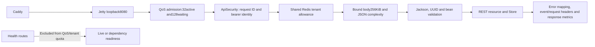
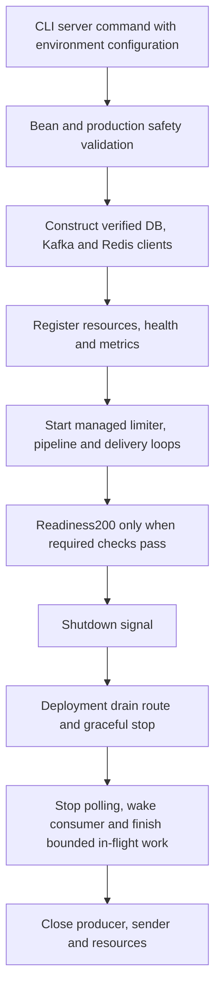
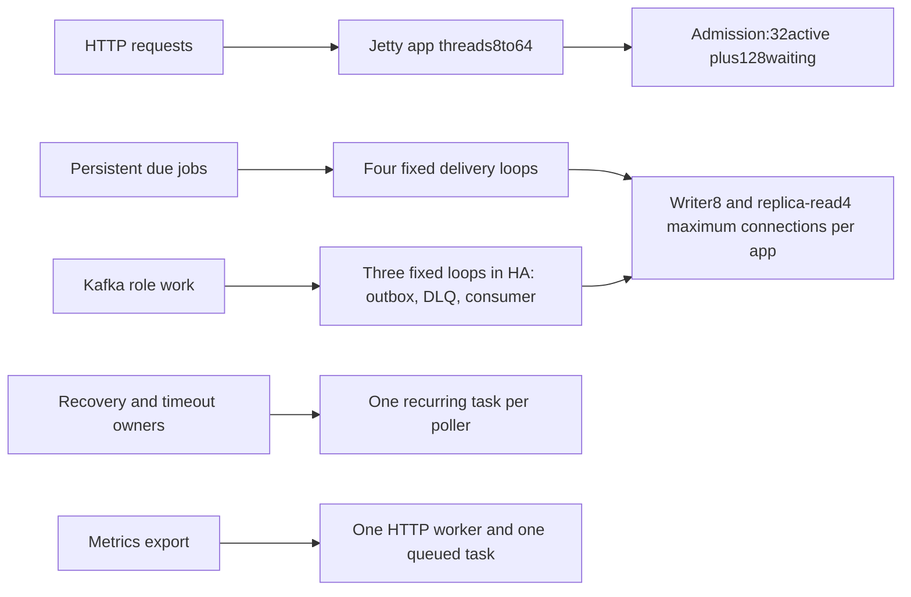

# Dropwizard runtime low-level design

**27 November network update:** [Provider LB-only backend ingress and restricted egress are deployed; SSH sources remain unchanged by user decision](../network-hardening.md). Historical observations below remain version-pinned.

**November 26 redesign:** [Current asynchronous matching, 5-minute event identity cache, subscription consistency and delivery history contract](../async-cache-history.md). Older revision-specific test/cloud evidence below remains historical until new release validation is recorded.

[Visual HLD](../hld.md) | [Business application LLD](notification-app.md). Dropwizard 5/Java 25 runs inside each Notification application JVM. It is a framework/runtime, not a fourth service or an additional set of three app replicas. Source/config reference f0c4d33.

## Low-level requirements

| ID | Implemented requirement | Acceptance check |
| --- | --- | --- |
| DW-01 | Bind app 8080 and admin 8081 to loopback in HA | Public LB ports 8080/8081 are not application/admin entry points |
| DW-02 | Bound application request admission independently of worker queues |32 active requests, 128 suspended/waiting, 1 second maximum wait; health excluded |
| DW-03 | Reject invalid configuration and untrusted requests before business changes | Production requires shared limiter; credentials/config/TLS validated; entity size/auth/type validation |
| DW-04 | Manage long-running roles and bounded shutdown | Fixed delivery/Kafka loops, recurring pollers, managed lifecycle and Compose grace 45 seconds |
| DW-05 | Provide separate liveness/readiness and correlation | Liveness process-alive; readiness depends on limiter/store/worker/consumer health; request/event IDs |
| DW-06 | Keep metrics private and optional export bounded | Loopback admin metrics; one bounded export worker/queue and finite transport deadlines |

## Request path inside the JVM

Authentication is before entity parsing in the application filter. Request admission is earlier in the HTTP stack; unauthenticated requests still occupy bounded frontend resources. Type/source/payload, idempotency header, filters, destination policy and tenant ownership each have their own validation layer. Caddy's 300 KB body cap is additional; the effective application body cap is 256 KiB. See [the API contract](../api.md) for 400/401/403/404/409/413/415/422/429/503 semantics and the standard Dropwizard parsing/validation envelope exception.

## Managed startup and shutdown

Liquibase migration is an explicit deployment CLI step, not an unconditional request-time auto-migration. The diagram groups lifecycle responsibilities rather than claiming transactional startup across dependencies. A failed startup is not accepted as a ready backend. Rolling deployment first drains private 9080 readiness; direct liveness can stay available during dependency failure.

## Pools and queue boundaries

Fixed application-loop executors use fair SynchronousQueue handoff with no work backlog and explicit rejection. Scheduled owners submit a fixed recurring task rather than one task per event. Jetty keeps its required internal I/O dispatch queue; this implementation does not claim every library/internal queue is bounded. Kafka/Jedis/HTTP client internal resource limits have their own configuration. Admin threads are 1 to 8. Redis pool 8, fair wait at most 1000 ms, connection/socket timeout 1000 ms. JDBC wait 3 seconds and socket 10 seconds; SQL statement/lock deadlines 5/3 seconds in HA.

## Health and failure behavior

`/health/live` returns process alive without authentication. `/health/ready` combines limiter replication health, Store primary health, worker poll freshness 30 seconds and Kafka consumer poll freshness 60 seconds when enabled. A health 200 is not proof every queued delivery succeeds or a measured latency SLO. Private Caddy 9080 checks/drains and managed LB 5 second probes/two-failure thresholds are separate layers.

One process exit can be restarted by Docker unless-stopped. A hung/unhealthy live process can be removed from routing without an automatic replacement. Wrong TLS/Redis HA settings fail startup rather than silently downgrading production. Token identity and protected state stay in shared configuration/database; no HTTP session affinity is required.

## Metrics, validation and limits

Local metrics include http.success/client.errors/server.errors/rate.limited, http.admission.waiting/rejected and acceptance latency. JSON logging includes event_id/tenant_id MDC, with request_id for unmatched/invalid requests. No event-specific context is fabricated for unrelated library connection logs. There is no complete distributed tracing backend. [Metrics catalogue](../concepts-and-metrics.md) distinguishes source instruments, allowed OTLP names, local-only instruments and provider-native telemetry.

Core/config, ServiceIT admission/security and exporter/bridge tests cover the runtime boundaries; hosted CI starts the exact image with least-privilege DB roles and exercises failed startup rollback. Source: [NotificationApplication](../../src/main/java/com/example/notifications/NotificationApplication.java), [BoundedServerFactory](../../src/main/java/com/example/notifications/BoundedServerFactory.java), [BoundedExecutors](../../src/main/java/com/example/notifications/BoundedExecutors.java), [ApiSecurity](../../src/main/java/com/example/notifications/ApiSecurity.java), [HealthResource](../../src/main/java/com/example/notifications/HealthResource.java), [config](../../config/ha.yml).

No OAuth/OIDC, separate API gateway, public admin port, resource update/ETag endpoint or automatic Droplet scaling is implemented. Increase pool/thread bounds only after measuring workload and combined host/DB capacity; a larger thread count can worsen saturation.

## Cache lifecycle and history maintenance

Optional RedisApplicationCache has a separate fair two-connection pool with 200 ms limits and one fixed 60-second maintenance task. It closes before the shared limiter during managed shutdown. Cache errors are optional misses, while quota errors remain fail-closed. Delivery recovery also archives a bounded terminal batch (default 100 per pass, after 24 hours). New local counters cache.hits/misses/errors/capacity_rejected and delivery.archived are not added to the existing bridge allowlist automatically.
