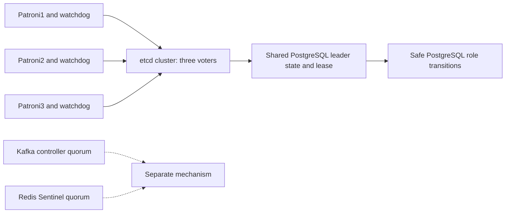
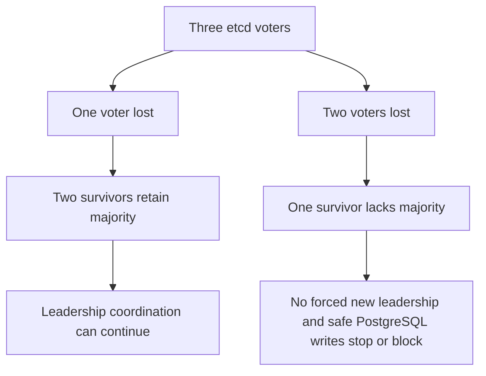
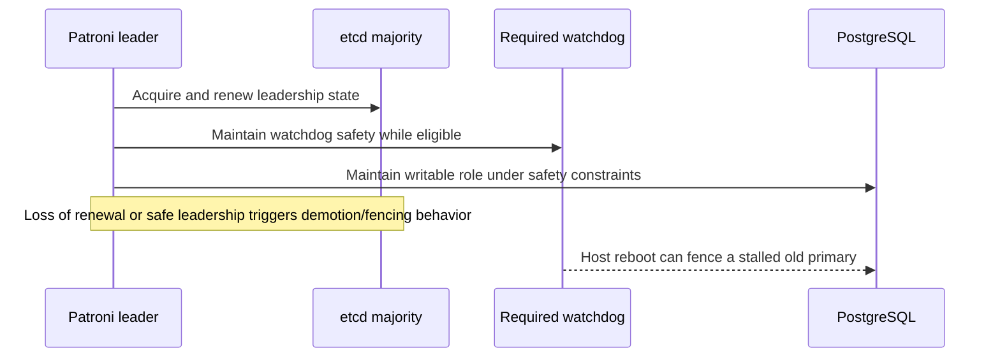

# etcd and PostgreSQL leadership low-level design

**November 26 redesign:** [Current asynchronous matching, 5-minute event identity cache, subscription consistency and delivery history contract](../async-cache-history.md). Older revision-specific test/cloud evidence below remains historical until new release validation is recorded.

[Visual HLD](../hld.md) | [PostgreSQL/Patroni LLD](postgresql.md). Three etcd voters coordinate Patroni's PostgreSQL leadership. etcd does not store event payloads, schedule webhook jobs, elect Kafka controllers or replace Redis Sentinel. Infrastructure renderer is the source of these settings.

## Low-level requirements

| ID | Implemented requirement | Acceptance check |
| --- | --- | --- |
| E-01 | Keep PostgreSQL leadership coordination available through one voter loss | Three distinct members with two-member majority |
| E-02 | Prevent unsafe concurrent writable-primary ownership | Patroni lease/role protocol plus required watchdog and strict synchronous PG |
| E-03 | Encrypt and restrict coordination access | Private 2379 client/2380 peer, mutual TLS, separate control authority |
| E-04 | Keep application credentials outside control plane | Java app mounts no control-plane client/signing keys |
| E-05 | Bound coordination storage and preserve membership | Backend quota 256 MiB, configured compaction retention, member data volume; no blind cluster reset |

## What participates in which election?

The diagram does not mean etcd alone guarantees data durability. PostgreSQL synchronous acknowledgement and eligible member state determine which committed data can be preserved; watchdog fencing protects against an unsafe old primary. Application delivery lease tokens are another, separate ownership mechanism in SQL.

## Majority and failure boundary

No majority means operators must recover safe membership, not change election rules to disguise failure. A host loss also removes the PostgreSQL/Kafka/Redis roles colocated there. During network partition, minority and majority cannot both be treated as independently safe clusters. Full-region/disk destruction is not covered by three members in one region.

## Lease and watchdog relationship

Rendered Patroni values are ttl 30 s, loop_wait 5 s, retry_timeout 5 s, strict sync with one synchronous standby and required watchdog safety margin 5 s. These are not proof of exact recovery time under every scheduling/network failure. Production watchdog is required; the disposable CI fixture cannot reboot its shared runner host and is not a physical-host fencing test.

## Configuration, security and operations

etcd binds private peer addresses, uses distinct server/client certificates, stores state in its own data volume, and has 256 MiBbackend quota/compaction retention 1 configured by renderer. Patroni scope is notification-ha-v 1 under /notification/. Do not publish control private keys, discard member data, reuse another cluster's token or force-bootstrap over a live quorum. Offline CA signing keys are not deployed. PostgreSQL/Redis/Kafka have separate authorities/identities; public/private membership is not permission to administer etcd.

A member update is an operator-controlled infrastructure operation: one member at a time, confirm majority and PostgreSQL safety before proceeding. Docker restart on an existing host is not provisioning a replacement host. Whole-service recovery additionally needs protected credentials/configuration; daily PostgreSQL dumps do not themselves recreate etcd state and safe membership.

## Observability and evidence

etcd quorum/member/leader health, database role/lag and watchdog checks are operator/CLI inspection signals in this deployment, not entries in the notification.* custom metric map. A full etcd Prometheus collector, dashboard, alarm and regional control-plane disaster workflow are not configured. App readiness can expose downstream primary unavailability but does not explain the root cause by itself. [Metrics and concepts](../concepts-and-metrics.md).

Source: [HA renderer](../../deploy/ha/render.py), [runtime installer](../../deploy/ha/install-runtime.sh), [watchdog boot check](../../deploy/ha/test-watchdog-boot.sh). HA unit tests and a real three-process TLS etcd/PostgreSQL CI drill cover rendered safety settings and database failover. Earlier cloud evidence separately records watchdog reboot and a powered-off primary with promotion to another host. Those facts are not proof of every split-brain or regional-failure scenario. See [validation](../validation.md). Separate coordination hosts or a managed database become candidates when shared-host contention or stronger failure isolation justifies their cost.
