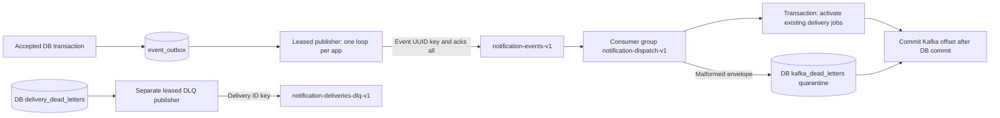
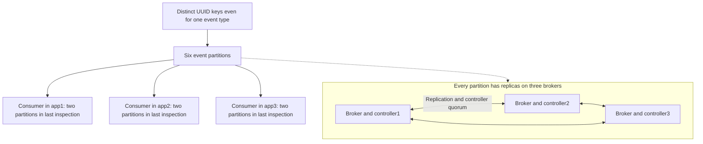
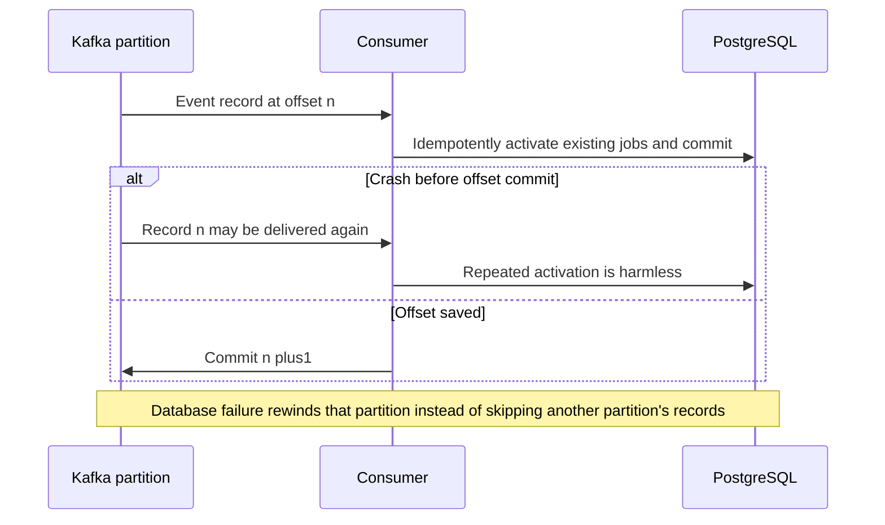

# Kafka low-level design

[Visual HLD](../hld.md) | [PostgreSQL outbox](postgresql.md) | [Notification workers](notification-app.md). Real self-managed Kafka 4.3.2 runs as three broker/controller members, one per existing Droplet. Managed Kafka was explicitly deferred. The application is 6474ad3; broker infrastructure remains separately versioned.

## Low-level requirements

| ID | Implemented requirement | Acceptance check |
| --- | --- | --- |
| K-01 | Avoid independent DB/Kafka acceptance writes | API commits database outbox before 202 and a separate role publishes |
| K-02 | Distribute a single event type without a type-key hotspot | Internal event UUID key across six event partitions |
| K-03 | Preserve safe publication with one broker down | RF 3/min ISR 2, acks=all, producer idempotence, unclean election off |
| K-04 | Commit consumer progress only after durable state | Idempotent activateDispatch commits before per-partition offset commit |
| K-05 | Recover duplicates/partition failures without skipping work | Seek failed partition to failed record; malformed records quarantined before offset advance |
| K-06 | Separate terminal delivery publication from retry execution | Durable delivery DLQ row, leased publisher and delivery-ID keyed DLQ topic |
| K-07 | Authenticate and bound clients | Mutual TLS/topic-group ACLs, finite send/block/poll/shutdown bounds and fixed role loops |

## DB and broker boundary

PostgreSQL owns acceptance/job membership; Kafka is dispatch transport, not the only durable event copy. Outbox redrive can publish the same event after uncertain publication/dispatch. Consumer replay is expected and safe for job creation. Publishing to Kafka and marking its acknowledgement are not a distributed transaction, including the DLQ path. Delivery retries are scheduled in PostgreSQL, not by a Kafka delayed-message queue. Input quarantine and delivery-exhaustion DLQ are different mechanisms.

## Partitions, consumers and replicas

Currently one consumer per app, three group members and six partitions. At most six consumers in this group can process partitions concurrently without increasing partitions. Extra app instances can still serve API/delivery work, but their consumers may be idle. Count/sizing should use lag and sustained activation throughput, not just API RPS. Four HTTP delivery workers/app are separate from consumers. Producer event UUID keys distribute one type; they do not guarantee source ordering. The DLQ also uses six partitions/RF 3/min ISR 2 in HA.

## Replay and commit crash windows

The rebalance listener seeks assigned partitions to committed offsets (or beginning when absent). max.poll.records 50 and max.poll.interval.ms 600000; auto commit and auto topic creation are disabled. Poll timeout 500 ms; readiness checks consumer poll freshness 60 seconds. Broker/group generation handling is not a universal external fencing token; delivery ownership is enforced later in SQL. A zero consumer lag also does not prove webhook completion: jobs can be activated but still awaiting HTTP.

## Configuration, security and capacity

| Configuration | HA value |
| --- | --- |
| Event and DLQ topics | notification-events-v 1 and notification-deliveries-dlq-v 1 |
| Broker/controller count |3, one per Droplet |
| Event partitions / RF / minimum ISR |6 /3 /2 |
| Producer safety |acks=all, enable.idempotence=true, max.in.flight.requests.per.connection=1 |
| Producer deadlines |max.block 5 s, request 5 s, delivery 10 s, synchronous send get 10 s |
| Producer request cap |1 MiB; REST input is separately 256 KiB |
| Role loops/app |One outbox publisher, one DLQ publisher, one consumer |
| Private ports |9092 broker and 9093 controller, mutual TLS |
| Retention |Configured 7 days and 128 MiB/partition transport retention, not an indefinite archive or instantaneous disk quota |

App certificates have topic read/write/describe, group-read and idempotent-write permissions, not broker administration. Broker/controller identities and trust roots are separate from PostgreSQL/control/Redis. Only private peers reach these ports. Broker payloads are not application-field-encrypted; complete active-storage encryption-at-rest is not established. Do not log client properties or poison payloads into shared logs; quarantine is protected database data.

## Metrics, failure handling and proof

Exact app counters: kafka.published, publish_errors, dispatched, consumer_errors, quarantined, dead_letters_published and dead_letter_publish_errors; outbox_pending/oldest_undispatched_seconds gauges. kafka.dispatch_errors is additionally local-only in the current OTLP map. Producer publication/consumer activation counters are attempts/progress, not exactly-once business counts. Broker ISR, partition leaders, group assignment/lag and disk usage require broker/CLI/provider inspection; no complete broker JMX collector/dashboard is configured here. [Catalogue](../concepts-and-metrics.md).

One whole host loss leaves two controllers and two in-sync replicas per healthy partition in the tested scenario. Remaining consumers rebalance; short errors/duplicates are possible. Two whole-host losses remove safe quorum/ISR. Outbox remains in PostgreSQL but cannot accept unsafe primary commits if its own quorum is also lost. A broker outage alone can delay retained dispatch; it does not authorize dropping accepted rows. Do not enable unclean election or force unsafe storage promotion to improve apparent availability.

[KafkaIT](../../src/test/java/com/example/notifications/KafkaIT.java) covers real broker outage/restart, offsets, quarantine, duplicate envelopes, outbox recovery, DLQ and 10,000 single-type UUID records across six partitions. Earlier cloud evidence delivered a webhook with two brokers; latest app cloud smoke verified normal dispatch. Neither proves representative high-fanout capacity or per-source ordering. Source: [KafkaPipeline](../../src/main/java/com/example/notifications/KafkaPipeline.java), [KafkaSettings](../../src/main/java/com/example/notifications/KafkaSettings.java), [HA renderer](../../deploy/ha/render.py), [HA config](../../config/ha.yml). Reconsider partitions, independent workers, retention/managed service or source-order scheduling only from measured requirements.
