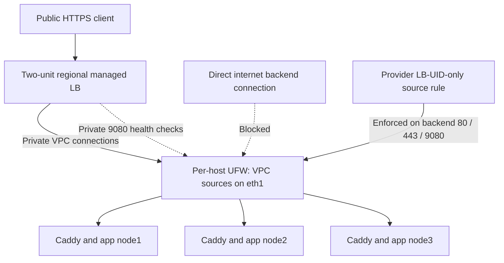
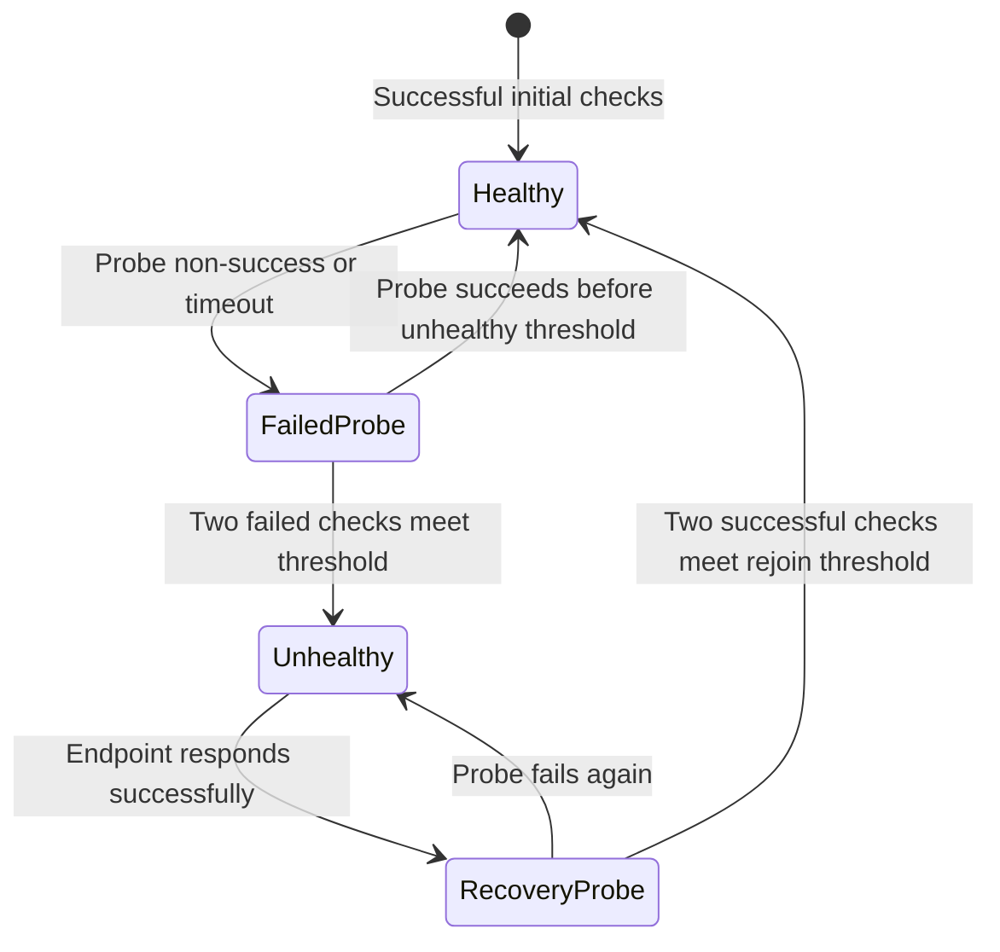
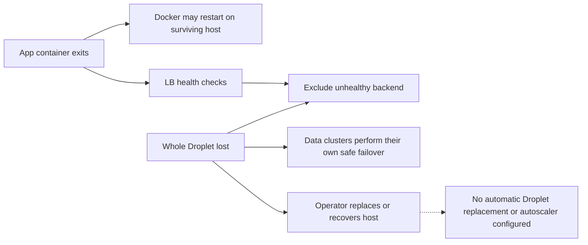

# DigitalOcean load-balancer low-level design

**27 November network update:** [Provider LB-only backend ingress and restricted egress are deployed; SSH sources remain unchanged by user decision](../network-hardening.md). Historical observations below remain version-pinned.

**November 26 redesign:** [Current asynchronous matching, 5-minute event identity cache, subscription consistency and delivery history contract](../async-cache-history.md). Older revision-specific test/cloud evidence below remains historical until new release validation is recorded.

[Visual HLD](../hld.md) | [Caddy LLD](caddy.md) | [Recorded settings](../evidence/load-balancer-2026-11-25.json). A managed regional external HTTP load balancer named notification-fanout-ha has two managed units and three BLR 1 backend Droplets. It is outside the three application/data compute nodes.

## Low-level requirements

| ID | Implemented requirement | Acceptance check |
| --- | --- | --- |
| LB-01 | Give clients one public ingress address | https://174.138.121.225 with normal public certificate validation |
| LB-02 | Route around unhealthy/drained backends | Probe private HTTP 9080/health/ready with configured thresholds |
| LB-03 | Rejoin recovered applications without sticky user state | Two successful probes; sticky sessions off; shared DB/Redis state |
| LB-04 | Keep TLS/application concerns separated | Forward to Caddy; Java handles auth/validation/limits and Caddy handles TLS/admin path rejection |
| LB-05 | Record effective values rather than assumed defaults |25 November read-only Control Panel inspection with cancelled edit forms and sanitized JSON |

## Distribution and health routing

DigitalOcean manages new connection/request distribution internally; the legacy round_robin/least_connections selector is deprecated. Do not infer traditional round-robin from an old API example. No internal algorithm name, exact equal request split or request-by-request rotation was established. Sticky sessions off does not disable ordinary connection reuse. Provider contract: [features](https://docs.digitalocean.com/products/networking/load-balancers/details/features/) and [API](https://docs.digitalocean.com/reference/api/reference/load-balancers/).

## Effective configuration and state transition

| Live setting inspected 25 November 2026 | Value |
| --- | --- |
| Managed units / backend Droplets |2 /3 |
| HTTP forwarding |80 HTTP to 80 HTTP |
| HTTPS forwarding |443 HTTPS to 443 HTTPS and Caddy termination |
| Health protocol/port/path |HTTP /9080 /health/ready |
| Probe interval / response timeout |5 s /3 s |
| Unhealthy / healthy threshold |2 failed /2 successful checks |
| Sticky sessions |Off |
| Backend keepalive |Enabled |
| HTTP idle timeout |60 s |
| PROXY protocol / LB HTTP-to-HTTPS redirect |Disabled /off; Caddy owns redirect handling |

This is the configured threshold behavior, not a precisely timed measured RTO. Probe phase, 3 second timeout, in-flight requests and dependency recovery affect interruption. A fast Docker restart can finish before enough failed probes: LB may never mark the backend unhealthy. The LB probes an endpoint, not Docker lifecycle events directly.

## Failure responsibility diagram

Two app-only failures do not imply data quorum loss; one ready app may continue at reduced capacity. Two whole-host failures remove safe PostgreSQL/etcd/Kafka/Redis operation and normal durable admission becomes unavailable. Do not promise that the LB can create missing data replicas, repair a hung process or preserve in-flight request responses. Producer retries must keep event identity.

## Network, telemetry and acceptance evidence

Public ingress, no dedicated API gateway/WAF, host-blocked public backend 80/443, deployed provider LB-UID-only ingress and restricted egress, with key-only SSH source scope retained by user decision are documented in [network/security](../network-security.md). Private readiness is VPC-restricted; no public Java/admin listener is exposed. Credential authentication remains in the app even for healthy backends.

Provider-native health metrics include do.load_balancers.backend_up, backend_health_check_failures, backend_downtime and droplet_health. They are not app notification.* instruments and are not a Kafka event stream. DigitalOcean exposes health graphs and alert-policy capabilities, but current native metric samples/alert delivery were not validated/configured. No alarms/tickets by request. The application OTLP 404 issue is separate from whether native LB telemetry exists. [Provider telemetry](https://docs.digitalocean.com/products/insights/reference/telemetry/load-balancers/).

The historical 25 November overview showed three Active backends and Healthy LB; read-only Settings inspection confirmed the table without saving changes. After host hardening on 27 November, aggregate public readiness passed, but a subsequent authenticated provider inspection confirmed all three backends Active and the LB Healthy; a single readiness response alone would not prove that. CI tests private proxy drain routing, and cloud HTTPS/replay/history probes verified public routing. No live equal-distribution benchmark or exact recovery-time SLA was measured. There is no versioned Terraform-managed LB resource in this repository: [sanitized observed configuration](../evidence/load-balancer-2026-11-25.json) is evidence, not an infrastructure provisioning module. Reconsider region topology, ingress filtering or scaling after explicit requirements and measurements.
