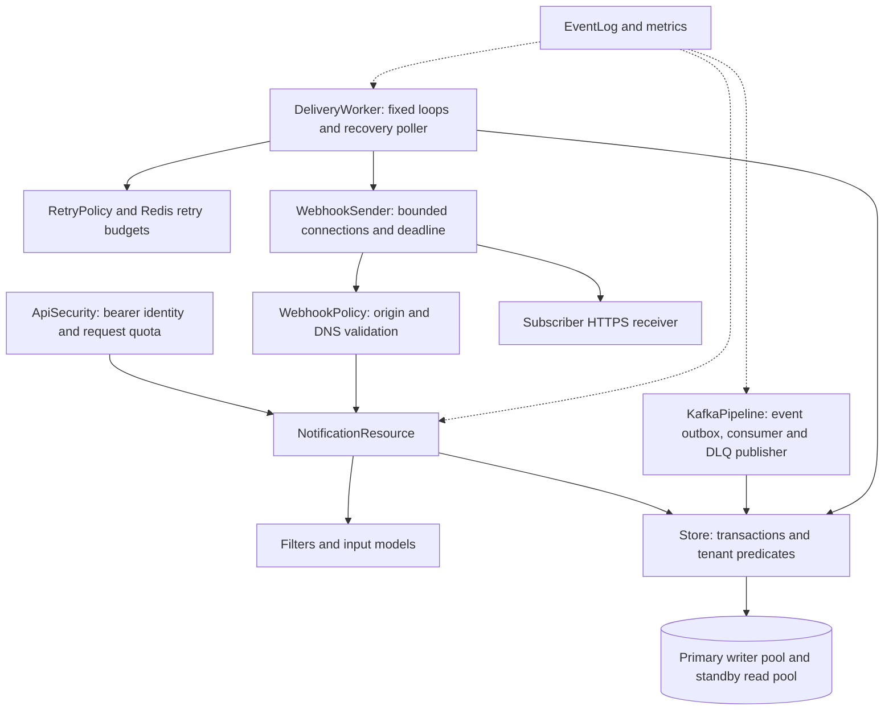
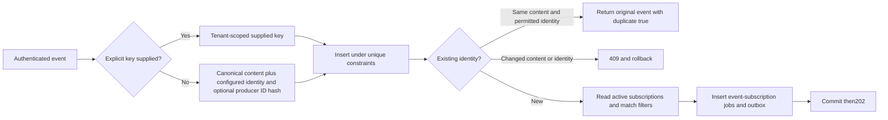
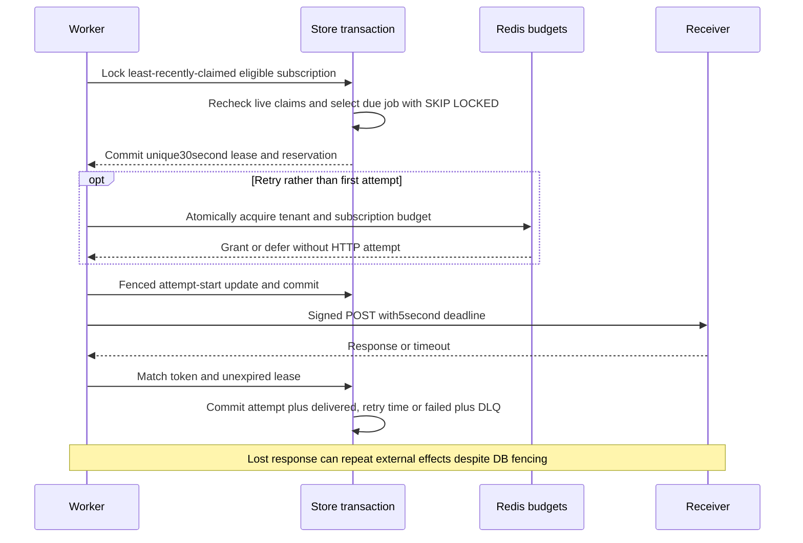

# Notification application low-level design

[Visual HLD](../hld.md) | [Design guide](../README.md) | [Concepts/metrics](../concepts-and-metrics.md). This is business logic inside the [Dropwizard JVM](dropwizard.md), deployed three times. Source reference 6474ad3. No separate notification microservice is implied for each internal class.

## Low-level requirements

| ID | Implemented requirement | Acceptance check |
| --- | --- | --- |
| APP-01 | Persist event, matching jobs and outbox atomically before 202 | A failed transaction returns failure and leaves no partial accepted event/fanout |
| APP-02 | Derive tenant from credentials and scope every tenant resource | Foreign resource returns 404; user/body cannot select another tenant |
| APP-03 | Deduplicate explicit/generated event identity across app instances | Concurrent matching repeats return the same event, conflict 409; one job/event/subscription |
| APP-04 | Apply current subscription snapshot without restart | Type/source/JSON Pointer equality conditions match; deleted registrations affect future matching only |
| APP-05 | Bound and fairly allocate HTTP work | Four delivery loops/app; one live claim/subscription across instances; no DB transaction during HTTP |
| APP-06 | Make attempts/retries/failure inspectable and crash recoverable | Stable Delivery ID, expiring claim, bounded attempts, token-checked result and atomic terminal DLQ |
| APP-07 | Prevent unsafe destinations and authenticate callbacks | Approved public HTTPS origin, connection-time DNS checks, HMAC/timestamp/IDs |
| APP-08 | Query history using strict replica reads | Replica role checked with no primary fallback; eventual-consistency headers |

## Responsibility diagram

The API creates jobs during acceptance; KafkaPipeline later activates them. Store owns database decisions, not HTTP. The sender owns network deadlines/policy enforcement, not database retries. Redis is shared admission/budget state, not the source of event identity or audit.

## Identity and fanout transaction

The service's canonical event UUID is generated once for the accepted event, never randomly inserted into the fallback key on every retry. Caller-supplied producer eventId is optional and distinct. Canonical object key order is stable; array order/types/numeric representation remain meaningful. Retained database identities determine the deduplication lifetime, not Redis TTL. Separate identical occurrences need new producer IDs or explicit keys.

POST subscription has no event-style idempotency contract: repeated successful creates can register the same endpoint multiple times. Unique jobs are per subscription ID, not per URL. There is no PUT/PATCH/ETag or time-range replay API.

## Claim, attempt and completion

Failed permanent policy/HTTP outcomes terminate early. Transient/network failures allow six total started attempts, with persisted 50-100% jitter on min(60 s, 1 s times 2^(attempt-1)). Unknown started attempts after a crash count toward exhaustion. Budget-deferred reservations do not consume an attempt. Recovery issues a replacement token; stale completions cannot update the new owner. Fairness is least-recently-claimed subscription scheduling, not weighted tenant/endpoint-wide scheduling.

## Interfaces, bounds and security

Public routes and examples are authoritative in [API](../api.md). Body 256 KiB, type/source 128 characters, up to 20 equality conditions, request quota 6,000/tenant/minute, tenant/subscription retry budgets 300/30 per minute. Signed callback body has schemaVersion 1, stable deliveryId, subscriptionId and canonical event. Network calls use neither DB connections nor claim-row locks; global HTTP concurrency is at most 12 with default three apps/four workers.

Tenant predicates and database foreign keys/unique constraints protect ownership/job identity. Administrative destination approval is separate and public admin paths are blocked. Static credentials/configured user/compartment are not an end-user IAM system. Public demo receivers are for synthetic data. No complete active-data at-rest encryption has been established.

## Metrics, proof and failure limits

Application instruments include events.accepted/duplicates, events.acceptance_latency, delivery attempts/success/unsuccessful attempts, pending count/age, retry-budget deferrals, recovered claims, stale results and worker errors. delivery.stale_reservations is local-only in the current exporter map. Use [the exact local/export catalogue](../concepts-and-metrics.md); metrics are not exactly-once business counts after crashes, and a stale result can be counted without a successful database transition.

[ServiceIT](../../src/test/java/com/example/notifications/ServiceIT.java), [KafkaIT](../../src/test/java/com/example/notifications/KafkaIT.java), [RedisIT](../../src/test/java/com/example/notifications/RedisIT.java) and [CoreTest](../../src/test/java/com/example/notifications/CoreTest.java) cover concurrent identities, rollback, matching, retries, timeout, reservations, fencing and audit. Latest cloud replay across three apps produced one synthetic event and one signed external receipt. Representative long-duration fanout/fairness and unconditional receiver exactly-once behavior are not proven.

Failure boundary: one app crash can be restarted by Docker; other instances share the durable queue. Two app-only failures can leave one app serving. Two whole-host failures remove data-cluster safety. HTTP uncertainty can produce duplicates; receiver must atomically deduplicate Delivery ID. Terminal failed jobs are queryable, not automatically redriven. Redis and primary unavailability can stop admission while retained work remains durable.

## Source and evolution triggers

[NotificationResource](../../src/main/java/com/example/notifications/NotificationResource.java), [Store](../../src/main/java/com/example/notifications/Store.java), [DeliveryWorker](../../src/main/java/com/example/notifications/DeliveryWorker.java), [WebhookSender](../../src/main/java/com/example/notifications/WebhookSender.java), [HA config](../../config/ha.yml). Split internal roles only for measured independent scale/ownership. Add ordering/replay with explicit membership, delivery-generation and failure policies; do not infer them from Kafka or idempotency alone.
