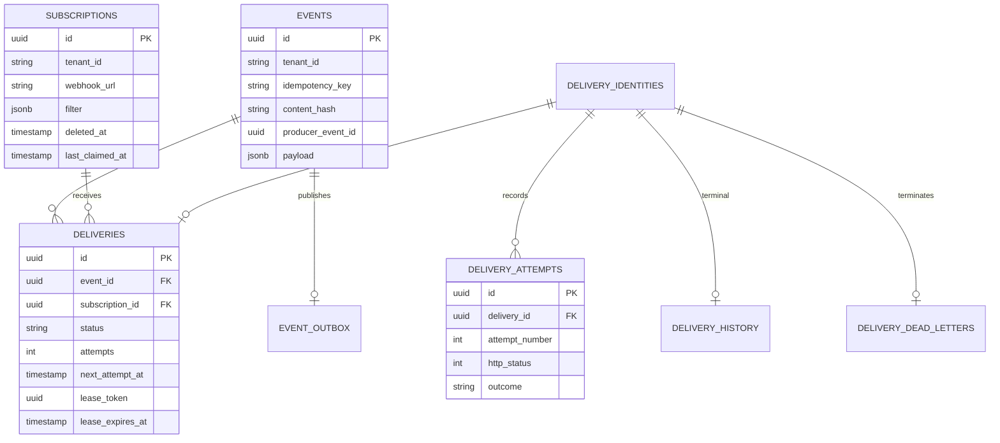
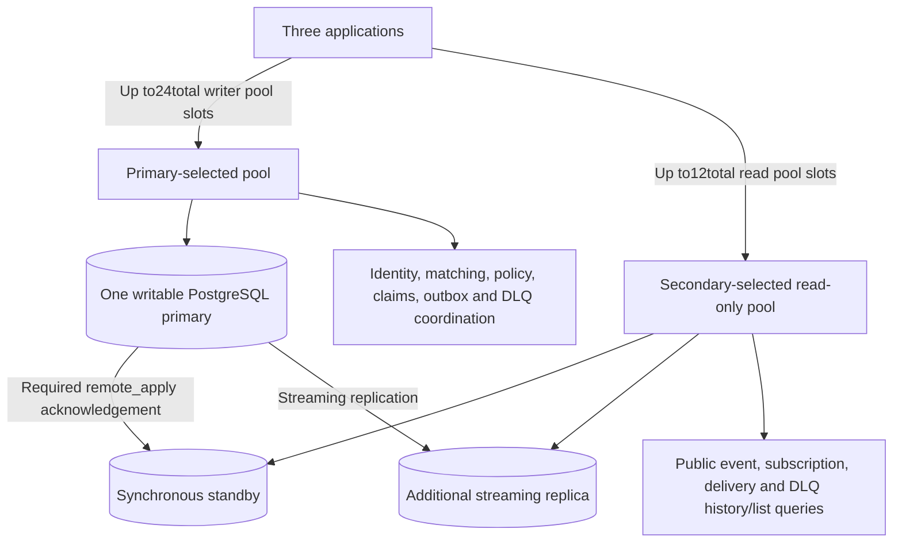
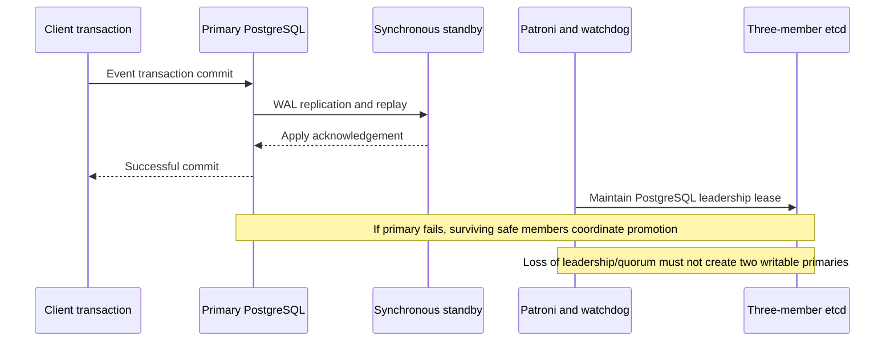

# PostgreSQL and Patroni low-level design

**November 26 redesign:** [Current asynchronous matching, 10-minute caches, subscription consistency and delivery history contract](../async-cache-history.md). Older revision-specific test/cloud evidence below remains historical until new release validation is recorded.

[Visual HLD](../hld.md) | [etcd coordination](etcd.md) | [Operations](../operations.md). Three self-managed PostgreSQL 17/Patroni members on existing BLR 1 hosts. Logical roles move; do not hard-code node 3 as permanent primary. Runtime read/write configuration is f0c4d33; running database infrastructure was not replaced by that app rollout.

## Low-level requirements

| ID | Implemented requirement | Acceptance check |
| --- | --- | --- |
| PG-01 | Commit event/outbox before 202 and jobs/matching-completion atomically after Kafka | Partial writes roll back on constraint/storage errors |
| PG-02 | Enforce identity and tenant/job relationships in SQL | Unique tenant/key, producer identity and event/subscription job pair; composite tenant foreign keys |
| PG-03 | Preserve acknowledged event writes through safe single-host loss | remote_apply and required synchronous standby, Patroni safe promotion, etcd quorum and watchdog |
| PG-04 | Serve history through standbys only | Role-checked read-only repeatable-read transaction; reject primary/unavailable standby |
| PG-05 | Bound connections/queries and short-lock job claims | Writer 8/read 4 max per app, pool wait 3 s, statement 5 s/lock 3 s, server max_connections 100 |
| PG-06 | Make completion, retries and DLQ atomic | Attempt audit/final state/DLQ commit together with ownership checks |
| PG-07 | Provide low-cost off-host restore | Daily consistent encrypted/authenticated Spaces dump; current metadata thirteen tables; support historical formats |

## Logical data relationships

This is a selected-column logical diagram, not replacement DDL. Additional durable tables hold event_outbox, delivery_dead_letters, malformed Kafka quarantine, approved origins and origin-policy audit; Liquibase maintains history/lock tables. [Versioned migrations](../../src/main/resources/migrations) are authoritative. Current backup metadata checks twelve application tables plus databasechangelog (13); historical snapshot formats remain supported. Intermediate SQL quota counters were removed by migration 007; Redis owns admission counters.

## Connection routing and transaction boundaries

A pool rejects a connection in the wrong role. Public read transactions check pg_is_in_recovery before/after the query; no primary fallback. Standby lag can yield temporary 404 or old audit after a successful write. The committed write response remains available. Validation-on-borrow and short connection age help role changes; queries still use explicit role checks. Pool maxima are across apps, not an entitlement to fill 100 server connections. Caddy certificate storage, replication, migrations, backup and operators need headroom. Changing host size does not automatically change self-managed max_connections.

Claim transactions lock a subscription row, recheck live reservations, select a due delivery with SKIP LOCKED, set a random ownership token/expiry and commit. Attempt-start and result updates require valid ownership. HTTP runs outside SQL. Due/expired/history/producer-identity indexes support these access patterns. Origin policy and idempotency decisions never use an eventually consistent standby.

## Coordination, promotion and recovery

Rendered Patroni defaults: ttl 30 s, loop_wait 5 s, retry_timeout 5 s, synchronous_mode/strict true, required sync count 1, maximum_lag_on_failover 0, timeline checks, required watchdog with 5 safety margin. PG uses fsync/full_page_writes/wal_log_hints, max_connections 100, shared_buffers 128 MB, WAL sender/slot bounds and SCRAM/TLS. These configuration values are not an exact failover RTO. Losing two whole hosts removes quorum/safe replication; writes block/fail rather than force an unsafe asynchronous promotion. Redis and Kafka use separate mechanisms.

## Backup and restore flow

```mermaid
flowchart LR
    T[Timers on existing three hosts] --> LOCK[Database advisory lock and due UTC-day check]
    LOCK --> SNAP[Export consistent snapshot and dump plus row counts]
    SNAP --> ENC[age encryption, hash and authenticated manifest]
    ENC --> SP[Private SGP1 Spaces objects]
    SP --> VERIFY[Authenticate, download and decrypt on authorized cloud host]
    VERIFY --> RESTORE[Isolated disposable PostgreSQL restore]
    RESTORE --> COUNTS[Compare recorded snapshot table counts]
```

One successful UTC-day snapshot, retention 24 hours plus timer delay. The current HA-path restore script supports the newer metadata, but a read-only check found a stale legacy `/usr/local/sbin/notification-restore-test` copy on the first host; use the version-qualified command and caveat in [operations](../operations.md#restore-command-version-caveat-25-november-documentation-review). The earlier real Spaces restore checked nine historical snapshot counts; latest tools/backup-role access support ten-table metadata but a new ten-table actual Spaces restore was not performed. Snapshots do not include cluster login roles or Caddy's separate certificate database. Recovery also needs TLS, credentials/configuration, grants and service reconstruction. Whole-cluster loss can lose roughly a day or more/no recoverable backup if expiry and backup failure overlap. No WAL/PITR, provider-native expiry guarantee, application-data retention, full-service disaster RTO or complete active-data encryption-at-rest is claimed.

## Security, observability and tests

Runtime role has scoped DML, migration owner runs schema changes, backup role can read the new DLQ table, and Caddy has a separate database/user. Private peer 5432 with verified TLS; PostgreSQL password authentication is distinct from SSH keys. Do not publish DSNs, root-only configuration or backup plaintext.

App backlog/age gauges and audit indirectly observe database-backed work. Patroni role/lag, synchronous standby, connection utilization, locks, WAL/disk and backup age are operational inspection signals; a dedicated PostgreSQL exporter/dashboard/alert suite is not implemented by notification.* metrics. See [catalogue](../concepts-and-metrics.md). Source/config: [Store](../../src/main/java/com/example/notifications/Store.java), [HA config](../../config/ha.yml), [renderer](../../deploy/ha/render.py), [backup](../../deploy/ha/spaces-backup.py), [restore](../../deploy/ha/restore-test.sh).

ServiceIT covers transactions/constraints/claims/read roles; hosted HA tests exercise real sync failover/JDBC standbys. Historical whole-Droplet/actual-Spaces checks and latest data-preservation evidence are separate in [validation](../validation.md). Reconsider pooling, partitions, retention or a managed database when measured connection/IO/storage/SLO demands justify it, not just because event counts grow.

## New durable structures

`subscription_versions` serializes subscription-generation changes against matching. `delivery_identities` preserves delivery ID and event/subscription pair uniqueness across archival. `delivery_history` stores terminal records moved after 24 hours. `all_deliveries` is a view, not a fourth new table; status queries use it within one replica-read transaction. Attempts and DLQ foreign keys now reference the identity anchor. Migrations 008–010 include backfill, trigger, runtime/backup privileges and candidate/outbox indexes.
