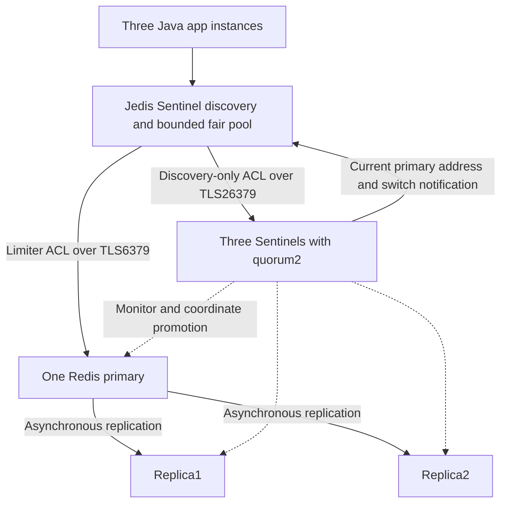
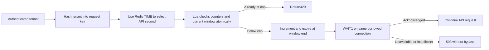
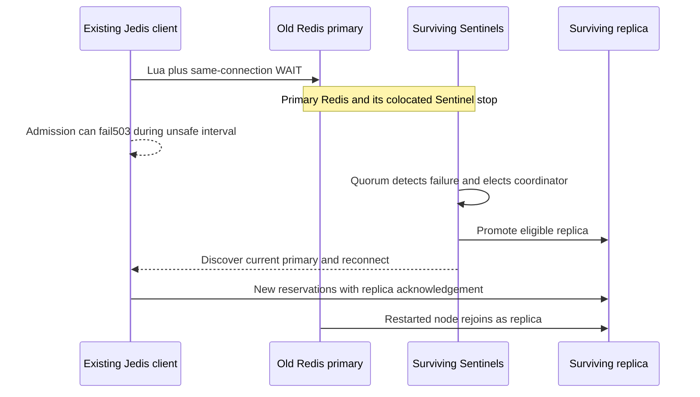

# Redis and Sentinel low-level design

**27 November network update:** [Provider LB-only backend ingress and restricted egress are deployed; SSH sources remain unchanged by user decision](../network-hardening.md). Historical observations below remain version-pinned.

**November 26 redesign:** [Current asynchronous matching, 5-minute event identity cache, subscription consistency and delivery history contract](../async-cache-history.md). Older revision-specific test/cloud evidence below remains historical until new release validation is recorded.

[Visual HLD](../hld.md) | [Controls contract](../reliability-controls.md) | [Redis operations](../../deploy/ha/redis.md). This is one Redis primary/two replicas plus three Sentinel processes on the existing hosts, not sharded Redis Cluster and not a general application-response cache. Source/runtime f0c4d33.

## Low-level requirements

| ID | Implemented requirement | Acceptance check |
| --- | --- | --- |
| R-01 | Enforce one tenant limit before event persistence across all apps | Atomic Redis TIME second script, 1,000 requests/tenant/second, read/write requests both count |
| R-02 | Fail admission closed without safe Redis service | No local/SQL fallback; allowance exhaustion 429, Redis/acknowledgement failure 503 |
| R-03 | Atomically apply tenant and subscription retry budgets | Both counters consumed or neither;300/tenant/minute and 30/subscription/minute defaults |
| R-04 | Follow an elected primary without app restart | Three Sentinel endpoints, quorum 2, verified TLS and separate discovery credentials |
| R-05 | Require replication acknowledgement on the same write connection | Recent-replica write guard plus WAIT 1 after Lua on the same borrowed connection |
| R-06 | Bound memory, connections, worker resources and privileges | Pool 8/client, 64 MiB data/noeviction, 128 clients/server, separated ACL identities |

## Clients, replication and independent election

Redis/Sentinel do not use etcd or Kafka's controllers. Primaries can move. The application receives only limiter/discovery credentials and public Redis CA, not Redis admin/control/replication/peer credentials or TLS signing keys. The default data/Sentinel users are disabled. Data/control, replication, Sentinel peer administration and discovery roles are separate.

## Atomic fixed-window reservation

API request key is `notification:limits:v1:{tenantSHA256}:requests:second`; the legacy minute key uses `:requests`. Retry budgets still use minute windows. Retry keys share the tenant hash tag and include tenant/subscription identities. One retry script checks both budgets before either increments. Keys hold counts/window numbers, not event payloads or idempotency records. Health/invalid credentials do not spend tenant quota; no independent end-user quota exists. On retry-budget refusal/outage the worker defers its reservation without starting another HTTP attempt.

Redis TIME avoids separate instance clocks. The script does not reset a counter into an earlier observed window. Fixed minute boundaries still allow a burst spanning two windows. Redis replication is asynchronous: WAIT/min-replica guards reduce uncertainty but do not guarantee a linearizable quota or strict zero overshoot after promotion. This store is load/abuse protection, not financial entitlement accounting. PostgreSQL retains accepted events and idempotency.

## Failover and recovery

The latest cloud test observed 503,503,200 on an existing application client and all three apps recovered; stopped member rejoined and new primary had two replicas. This is a named test result, not a guaranteed failover time. Two whole-host losses remove Sentinel majority and required data replication. Never overwrite persistent elected configuration on restart: bootstrap refuses existing Redis/Sentinel configuration files.

## Bounds, storage and security

| Setting | Implemented value |
| --- | --- |
| Client pool |8 connections, fair blocking wait, max wait 1000 ms |
| Network timeout |Connection/socket 1000 ms each; not a single end-to-end request deadline |
| Write acknowledgement |requiredReplicas 1, WAIT timeout 500 ms |
| Data process |128 MiB container, 0.5 CPU, data maxmemory 64 MiB/noeviction, maxclients 128 |
| Sentinel process |64 MiB, 0.15 CPU, maxclients 128 |
| Write safety/persistence |min-replicas-to-write 1, max-lag 2 s, AOF appendfsync always |
| Sentinel |quorum 2, down-after 5000 ms, failover-timeout 30000 ms, parallel-syncs 1 |
| Transport/process |TLS-only private/loopback ports 6379/26379, UID 999, read-only root, capabilities dropped, pids 64 |

Replica acknowledgement is not a guarantee every replica persisted the latest quota, nor that Sentinel will always choose a replica containing every acknowledged increment. AOF is not a substitute for PostgreSQL event durability. At-rest disk encryption for active Redis data is not established. TLS certificate validation and separate ACLs remain mandatory even inside the VPC. No privileged ACL/configuration dump belongs in diagnostic output.

## Metrics, validation and evolution

redis.replicas is an app gauge of observed primary replica count. http.rate.limited and delivery.retry_budget_deferred show effects on admission/retries; raw latency/CPU/evictions/Sentinel quorum are not a complete exported Redis dashboard in this implementation. Readiness checks primary/replication health. Provider-native Redis monitoring is not created just by self-hosting Redis. [Exact catalogue](../concepts-and-metrics.md).

[RedisIT](../../src/test/java/com/example/notifications/RedisIT.java), config tests and [real TLS/Sentinel drill](../../deploy/ha/test-redis-cluster.py) cover shared windows, hostname rejection, restricted app ACLs, existing-client promotion, missing replica refusal and rejoin. [Latest cloud evidence](../evidence/cloud-redis-6474ad3.json) records separate cloud failover and shared quota checks while all backends were drained, with synthetic counter removed before reopening. Source: [RedisRateLimiter](../../src/main/java/com/example/notifications/RedisRateLimiter.java), [settings](../../src/main/java/com/example/notifications/RedisSettings.java), [bootstrap](../../deploy/ha/redis-cluster.py). Reconsider strict accounting, per-user verified claims or a different burst algorithm only with explicit semantics and tests; no extra paid Redis service was added.

## Targeted caches added in this redesign

Committed event identities expire after 300 seconds and fall back to PostgreSQL. Current-generation subscription records have a per-tenant 20% ceiling and explicit LRU. Cache-only Lua eviction retains server noeviction and cannot remove quota keys. Separate two-connection/200 ms cache pool limits interference with limiter traffic. Global defaults cap estimated cache bytes at 32 MiB and entries at 50,000. Only subscriptions participate in LRU; unexpired event identities are protected, and new cache writes can be refused at capacity. No strict full-five-minute working-set or 10,000/s capability is claimed. See the [cache contract and failure diagrams](../async-cache-history.md).
