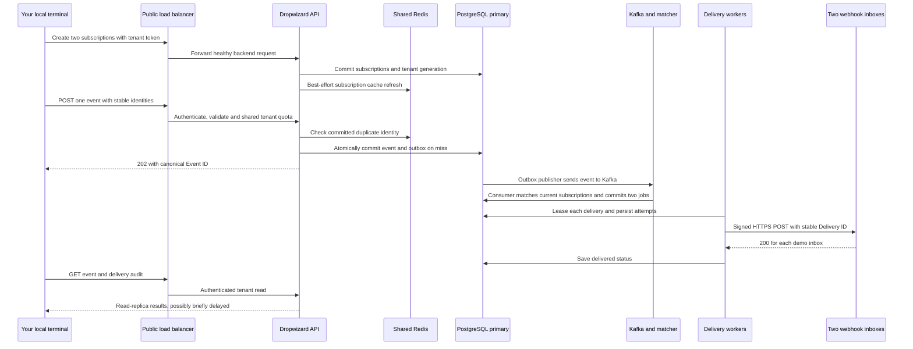

# Manual test: one event, two subscriptions, two webhook deliveries

**Updated: 27 November 2026 (IST).** Source contracts and deployment evidence are linked below; this is a manual smoke-test guide, not a capacity or failover test.

**Network access:** use the load-balancer URL below. Direct public Droplet application access is blocked; [current network hardening and remaining controls](network-hardening.md). Loopback metrics still require an authorized shell inside each Droplet.

## Open these health URLs directly in your browser

| Check | Full clickable URL | Expected response |
| --- | --- | --- |
| **Process health — liveness** | [https://174.138.121.225/health/live](https://174.138.121.225/health/live) | HTTP 200, `{"status":"alive"}` |
| **Service health — readiness** | [https://174.138.121.225/health/ready](https://174.138.121.225/health/ready) | HTTP 200, `{"status":"ready"}`; HTTP 503 when unavailable |

**Per-Droplet metrics:** [Open the individual commands for all three Droplets](#10-metrics-and-operator-health). Metrics are private; execute the commands inside the selected Droplet.

Neither URL requires a bearer token. Use HTTPS on the standard port 443; do not append `:8080` or `:8081`. The service is an API, so its base URL is not a web dashboard. A health response is from the backend selected by the load balancer; it does not individually verify all three Droplets. All `/v1` API requests below require your tenant token.

This is a repeatable smoke test for the deployed application at **https://174.138.121.225**. Run the commands in order in the **same Bash session**. It creates two subscriptions under your token's tenant, sends one new event, checks its two deliveries, and optionally verifies idempotency and removes the test subscriptions. It does not require an application redeployment.

The examples use synthetic data and two distinct Webhook.site inboxes. Both subscriptions belong to one authenticated tenant; they are not two new tenant accounts. The tenant is determined by the bearer token. Keep your token and inbox IDs private; do not commit run output. Only the two subscription POSTs and the single event POST create application resources. Subscription POST is idempotent when you preserve the explicit key and identical body used below. Without a key, repeated creation intentionally creates distinct subscriptions. See [subscription retry rules](subscription-idempotency.md).

## Where to run each check after network hardening

| Your task | Where to execute it | Address to use |
| --- | --- | --- |
| Open process/service health | Browser on your computer | The two clickable load-balancer URLs above |
| Register subscriptions, send an event, query delivery audit | Local Bash in the Rancher development container | `https://174.138.121.225/v1/...` with your tenant bearer token |
| Inspect a webhook notification | Webhook.site viewer or its history API | Viewer/history address, not the receiving URL |
| Inspect Java health, admin health or metrics on a specific instance | Authorized console/shell inside that Droplet | `127.0.0.1:8080` / `127.0.0.1:8081` |
| Check direct public backend access | External client | Expected to fail on Droplet 80/443; use the LB for API traffic |

[Short onboarding page](onboarding.md) | [Deployed ingress/egress policy, verification and retained SSH access](network-hardening.md).

Do not replace the load-balancer IP with a Droplet IP in the API commands. Direct-backend blocking is intentional. The host firewall permits private VPC/interface traffic; a provider LB-identity-only rule is also deployed. SSH access remains key-only with broad source scope, so this is not a claim that all host ports are private. Preserve your existing operator access and never use the restricted CI identity as a general shell.

## What this test exercises in the current design



| Design aspect | Current behavior and what the demo proves |
| --- | --- |
| Public entry point | Managed LB `174.138.121.225`, HTTPS 443. Three Droplets run one app each; direct backend HTTP/HTTPS is blocked. Public admin/metrics endpoints are unavailable. |
| Authentication and isolation | Static tenant bearer credential; all resources are tenant-scoped. Supplying a tenant/user field does not change authenticated identity. No OAuth/OIDC, separate API gateway or per-user quota. |
| Shared admission | Redis fixed-second quota: **1,000 authenticated requests per tenant per second across all three apps**, including reads and duplicate submissions. It is a quota, not measured throughput. Redis limiter failure rejects admission; optional cache failure falls back to PostgreSQL. |
| Input validation | Body at most 256 KiB; nonblank type/source at most 128 characters; JSON depth at most 32; up to 20 payload equality conditions. HTTPS destinations require administrator-approved origin and safe DNS/TLS validation. |
| Acceptance and queue | 202 follows the PostgreSQL event/outbox transaction. Kafka publication, matching and delivery happen later. Kafka is not the first durable store or a direct public producer endpoint. |
| Kafka distribution | Six partitions, three consumers total (one/app); canonical internal Event UUID is the partition key. RF3, minimum ISR2, producer acknowledgements from all in-sync replicas. No per-source delivery ordering claim. |
| Rule selection | Subscriptions visible in the successful consumer matching transaction determine recipients. Create before matching can include a new rule; delete before matching excludes it. Delete after matching does not cancel created deliveries. Keep both test subscriptions until the demo completes. |
| Duplicate protection | Tenant-scoped explicit key and/or producer Event UUID, backed by PostgreSQL uniqueness. Redis retains admitted committed identities for up to 300 seconds from original acceptance; replay does not extend expiry. The bounded cache cannot guarantee every event fits for the full window; PostgreSQL is authoritative on misses. |
| Subscription cache | Same Redis service, generation-scoped records, database fallback and subscription-only LRU; at most 20% of a tenant's active subscriptions cached. With only these two active subscriptions, the floor is zero; the demo does not require cache hits. Keyed subscription creation replays 201/conflicts 409; no PUT/PATCH or ETag update API; delete/create replaces a subscription. |
| Worker safety | Four bounded workers/app, twelve total; one active attempt per subscription across apps, fair scheduling and shared retry budget. Database leases and claim tokens reject stale saved results. These do not prevent a remote side effect after an ambiguous network failure. |
| Retries and DLQ | Transient errors can use the initial attempt plus **five retries**, six total; backoff/jitter and retry budget can defer attempts. Non-retryable errors can fail earlier. Terminal failures are persisted in the delivery DLQ; Kafka DLQ publication retries independently. |
| Audit and history | Terminal deliveries move after 24 hours to history in bounded atomic batches. Existing event/subscription/delivery URLs return the same IDs and attempts through a logical active/history view; pending jobs stay active. History has no automatic one-day deletion. |
| Read replicas | Tenant GETs use standby-only reads; headers `X-Read-Source: replica` and `X-Read-Consistency: eventual`. Brief 404/empty reads can follow a successful write; no automatic read fallback to primary. |
| Delivery guarantee | At-least-once HTTP attempts. A stable Delivery ID enables receiver-side deduplication; it does not establish exactly-once webhook effects. Two distinct subscriptions intentionally create two delivery identities. |

The five-tenant target is 5,000 events/second aggregate, **not a validated limit on this fleet**. This guide creates one logical event, not load. For deeper contracts see [API](api.md), [matching/cache/history](async-cache-history.md), [reliability controls](reliability-controls.md), [capacity limits](capacity-1000-rps.md) and [current release evidence](submission-status.md).

## Start a fresh demonstration

For each new demonstration, rerun section 1 once to generate a new run ID, Event ID, event key and two subscription keys. Create two fresh inboxes (or use two unexpired inboxes you own), register both filters for the new event type, verify creation replay, and then send one event. Reuse the saved variables/files only when retrying that same run. A fresh run intentionally creates new resources; preserve an uncertain prior run's identities rather than replacing them to retry.

The `/workspaces` path exists inside the Rancher development container, not your Mac shell. In IntelliJ's container terminal, verify before proceeding:

```bash
uname -s
cd /workspaces/notification-fanout && pwd
```

Expected: Linux and `/workspaces/notification-fanout`. Stop if either check fails. `BASE_URL` below is a plain URL; do not paste Markdown link formatting. The tenant-token prompt hides typing; paste only the tenant token and press Enter. The protected cloud token file is on a Droplet, not in this container; see [onboarding](onboarding.md).

## 1. Prepare the local terminal

Use the IntelliJ terminal in the Rancher Ubuntu development container. Keep development/test files under `/workspaces`; do not use the host Desktop or Downloads. The terminal needs Bash, curl, jq and Python 3.

```bash
bash
cd /workspaces/notification-fanout
set -euo pipefail
umask 077
BASE_URL='https://174.138.121.225'
read -r -s -p 'Tenant API token: ' API_TOKEN
printf '\n'
mkdir -p .deploy/manual-tests
RUN_DIR=$(mktemp -d "$PWD/.deploy/manual-tests/two-subs.XXXXXX")
RUN_ID=$(python3 -c 'import uuid; print(uuid.uuid4())')
EVENT_TYPE="assessment.demo.$RUN_ID"
SOURCE='manual-interview-test'
PRODUCER_EVENT_ID=$(python3 -c 'import uuid; print(uuid.uuid4())')
IDEMPOTENCY_KEY="manual-$RUN_ID"
SUB_KEY_1="subscription-1-$RUN_ID"
SUB_KEY_2="subscription-2-$RUN_ID"
printf 'Run files: %s\nEvent type: %s\n' "$RUN_DIR" "$EVENT_TYPE"
```

Use your existing tenant token, not the administrator token or a DigitalOcean token. An authorized operator can obtain the existing service-tenant token from the protected `api_token` field in `/opt/notification-fanout/ha/secrets.json` on a Droplet, or from the team's secure credential store. Do not print the full secrets file or paste credentials into GitHub/chat. No real token is embedded in this document. Keep this session open because subsequent commands use these variables.

### Files and identities used by this run

| File or value | Meaning |
| --- | --- |
| `$RUN_DIR/inbox-1.json`, `inbox-2.json` | Responses from Webhook.site; each UUID builds a receiving URL. These are not subscription or event input files. |
| `subscription-1-request.json`, `subscription-2-request.json` | Inputs to our subscription POST: receiving URL and matching filter. |
| `subscription-1.json`, `subscription-2.json` | Saved 201 creation responses containing Subscription IDs. |
| `$SUB_KEY_1`, `$SUB_KEY_2` | Separate stable subscription-creation retry identities; do not regenerate them on a retry. |
| `event-request.json` | Event input including the producer-generated `eventId`; retain it for retries. |
| `event-response.json` and `$EVENT_ID` | Accepted response and service-generated canonical internal Event ID, used in GET URLs, logs and webhook comparisons. |
| `$IDEMPOTENCY_KEY` | Event submission retry key; separate operation scope from subscription keys. |

To locate the actual inbox response file, run `printf '%s/inbox-1.json\n' "$RUN_DIR"` in this same session after section 3. Never substitute an inbox UUID for an API bearer token. Each new logical event can match two subscriptions and therefore has two distinct Delivery IDs; a retry of one delivery preserves its Delivery ID.

## 2. Check public health

```bash
curl --fail-with-body --silent --show-error --max-time 10 \
  -w '\nHTTP %{http_code}\n' "$BASE_URL/health/live"
curl --fail-with-body --silent --show-error --max-time 10 \
  -w '\nHTTP %{http_code}\n' "$BASE_URL/health/ready"
```

Expected: `200 {"status":"alive"}` and `200 {"status":"ready"}` (body appears before the HTTP line). No authentication is required for these two routes. Readiness checks the responding application's dependencies/workers; a healthy public response alone does not prove every backend is healthy.

Browser links: [liveness](https://174.138.121.225/health/live), [readiness](https://174.138.121.225/health/ready). Use standard HTTPS port 443. Public `:8080` and `:8081` are not application entry points. Do not disable certificate verification with `-k`.

## 3. Create two independent external inboxes

The approved `https://webhook.site:443` origin was exercised by the successful 27 November cloud webhook test. An operator may subsequently revoke approval, so treat a policy rejection as a reason to check the current allowlist. The paths below share this approved origin. You do not need to allowlist each inbox path. A different host/subdomain requires a private administrator operation; tenant API calls cannot approve it.

Create inbox 1:

```bash
curl --fail-with-body --silent --show-error --max-time 15 \
  -X POST 'https://webhook.site/token' \
  -H 'Content-Type: application/json' \
  --data '{"default_status":200,"default_content":"ok","default_content_type":"text/plain","timeout":0,"expiry":86400}' \
  > "$RUN_DIR/inbox-1.json"
INBOX_1=$(jq -er '.uuid' "$RUN_DIR/inbox-1.json")
```

**Wait at least 65 seconds before the next inbox-creation request.** Webhook.site documents a free-tier creation limit of one per minute. If another creation already consumed the quota, wait longer after HTTP 429. Do not use a paid plan for this smoke test. If account authentication is required, use two inboxes you create through your entitled browser session and assign their IDs to `INBOX_1` and `INBOX_2` instead.

Create inbox 2:

```bash
curl --fail-with-body --silent --show-error --max-time 15 \
  -X POST 'https://webhook.site/token' \
  -H 'Content-Type: application/json' \
  --data '{"default_status":200,"default_content":"ok","default_content_type":"text/plain","timeout":0,"expiry":86400}' \
  > "$RUN_DIR/inbox-2.json"
INBOX_2=$(jq -er '.uuid' "$RUN_DIR/inbox-2.json")
test "$INBOX_1" != "$INBOX_2"
WEBHOOK_1="https://webhook.site/$INBOX_1"
WEBHOOK_2="https://webhook.site/$INBOX_2"
printf 'Viewer 1: https://webhook.site/#!/view/%s\nViewer 2: https://webhook.site/#!/view/%s\n' "$INBOX_1" "$INBOX_2"
```

Open the two printed viewer URLs. Do **not** open the receiving URL itself to inspect history: doing that generates an extra captured GET request. Webhook.site is a third-party request inspector; send only this synthetic payload. The inbox identifier is different from your notification-service bearer token. Never send `API_TOKEN` to Webhook.site.

Provider contracts: [create inbox](https://docs.webhook.site/api/tokens.html), [capture and inspect requests](https://docs.webhook.site/api/requests.html). Inbox creation, quotas and expiry are provider-controlled and can change independently of our service.

## 4. Register two matching subscriptions before emitting the event

Subscription 1 matches this run's event type/source and `customer.tier = gold`:

```bash
jq -n --arg url "$WEBHOOK_1" --arg type "$EVENT_TYPE" --arg source "$SOURCE" \
  '{webhookUrl:$url,filter:{type:$type,source:$source,payloadConditions:[{path:"/customer/tier",operator:"eq",value:"gold"}]}}' \
  > "$RUN_DIR/subscription-1-request.json"
curl --fail-with-body --silent --show-error --max-time 15 \
  -D "$RUN_DIR/subscription-1-headers.txt" \
  -X POST "$BASE_URL/v1/subscriptions" \
  -H "Authorization: Bearer $API_TOKEN" -H 'Content-Type: application/json' \
  -H "Idempotency-Key: $SUB_KEY_1" \
  --data-binary "@$RUN_DIR/subscription-1-request.json" \
  > "$RUN_DIR/subscription-1.json"
SUB_1=$(jq -er '.id' "$RUN_DIR/subscription-1.json")
jq . "$RUN_DIR/subscription-1.json"
```

Subscription 2 matches the same type/source and `region = blr1`:

```bash
jq -n --arg url "$WEBHOOK_2" --arg type "$EVENT_TYPE" --arg source "$SOURCE" \
  '{webhookUrl:$url,filter:{type:$type,source:$source,payloadConditions:[{path:"/region",operator:"eq",value:"blr1"}]}}' \
  > "$RUN_DIR/subscription-2-request.json"
curl --fail-with-body --silent --show-error --max-time 15 \
  -D "$RUN_DIR/subscription-2-headers.txt" \
  -X POST "$BASE_URL/v1/subscriptions" \
  -H "Authorization: Bearer $API_TOKEN" -H 'Content-Type: application/json' \
  -H "Idempotency-Key: $SUB_KEY_2" \
  --data-binary "@$RUN_DIR/subscription-2-request.json" \
  > "$RUN_DIR/subscription-2.json"
SUB_2=$(jq -er '.id' "$RUN_DIR/subscription-2.json")
test "$SUB_1" != "$SUB_2"
jq . "$RUN_DIR/subscription-2.json"
```

Each POST should return **201 Created**, a distinct `id` and a `Location` header. Filters use JSON Pointer paths, only `eq`, and AND semantics. Both filters match the event below. Save the responses and confirm HTTP 201 in each `subscription-*-headers.txt`; these saved responses identify the committed registrations. Subscription creation is committed before 201; waiting for a read replica is not required before sending the event.

### Verify subscription registration retries before sending the event

Replay both identical registrations with their saved keys. Each must return 201 and exactly the original creation body; this must leave two test registrations, not four:

```bash
for n in 1 2; do
  if [ "$n" -eq 1 ]; then key="$SUB_KEY_1"; else key="$SUB_KEY_2"; fi
  STATUS=$(curl --silent --show-error --max-time 15 \
    -o "$RUN_DIR/subscription-$n-replay.json" -w '%{http_code}' \
    -X POST "$BASE_URL/v1/subscriptions" \
    -H "Authorization: Bearer $API_TOKEN" -H 'Content-Type: application/json' \
    -H "Idempotency-Key: $key" \
    --data-binary "@$RUN_DIR/subscription-$n-request.json")
  test "$STATUS" = '201'
  jq -e --slurpfile original "$RUN_DIR/subscription-$n.json" '. == $original[0]' \
    "$RUN_DIR/subscription-$n-replay.json"
done
```

A changed webhook URL or filter under the same key must return 409. To register another intended subscription, use another key. After deletion, replay returns the historical creation response without reactivating it; a fresh registration requires a new key. Keys persist in PostgreSQL and are separate from the five-minute event cache. Current authentication/destination validation still applies. Keep the two original request files and keys if a response is lost.

Optional 409 check using subscription 1's original key and a changed filter (no new registration should be created):

```bash
jq '.filter.source="conflicting-source"' "$RUN_DIR/subscription-1-request.json" \
  > "$RUN_DIR/subscription-conflict-request.json"
STATUS=$(curl --silent --show-error --max-time 15 \
  -o "$RUN_DIR/subscription-conflict-response.json" -w '%{http_code}' \
  -X POST "$BASE_URL/v1/subscriptions" \
  -H "Authorization: Bearer $API_TOKEN" -H 'Content-Type: application/json' \
  -H "Idempotency-Key: $SUB_KEY_1" \
  --data-binary "@$RUN_DIR/subscription-conflict-request.json")
test "$STATUS" = '409'
jq . "$RUN_DIR/subscription-conflict-response.json"
```

Confirm active subscriptions using the list endpoint:

```bash
curl --fail-with-body --silent --show-error --max-time 10 \
  -H "Authorization: Bearer $API_TOKEN" \
  "$BASE_URL/v1/subscriptions?limit=100&offset=0" \
  | jq --arg a "$SUB_1" --arg b "$SUB_2" '.items[] | select(.id==$a or .id==$b)'
```

Reads use replicas, so retry briefly if a new record has not appeared. The list is paginated; if `hasMore=true` and your records are not on this page, fetch offsets 100, 200, etc. The deployed API has **no GET `/v1/subscriptions/{id}`** endpoint; use the list or the saved creation response.

## 5. Send exactly one new structured event

```bash
jq -n --arg id "$PRODUCER_EVENT_ID" --arg type "$EVENT_TYPE" --arg source "$SOURCE" --arg run "$RUN_ID" \
  '{eventId:$id,type:$type,source:$source,payload:{synthetic:true,testRun:$run,orderId:"demo-order-001",customer:{tier:"gold"},region:"blr1",amount:125}}' \
  > "$RUN_DIR/event-request.json"
curl --fail-with-body --silent --show-error --max-time 15 \
  -D "$RUN_DIR/event-headers.txt" \
  -X POST "$BASE_URL/v1/events" \
  -H "Authorization: Bearer $API_TOKEN" \
  -H 'Content-Type: application/json' \
  -H "Idempotency-Key: $IDEMPOTENCY_KEY" \
  -H "X-Request-ID: manual-$RUN_ID" \
  --data-binary "@$RUN_DIR/event-request.json" \
  > "$RUN_DIR/event-response.json"
awk 'BEGIN{IGNORECASE=1} /^HTTP\// || /^([Xx]-[Ee]vent-[Ii][Dd]|[Xx]-[Rr]equest-[Ii][Dd]|[Ll]ocation|[Xx]-[Rr]ate[Ll]imit[^:]*):/ {sub(/\r$/, ""); print}' "$RUN_DIR/event-headers.txt"
EVENT_ID=$(jq -er '.event.id' "$RUN_DIR/event-response.json")
jq -e '.duplicate == false' "$RUN_DIR/event-response.json"
jq . "$RUN_DIR/event-response.json"
printf 'Internal event ID: %s\nProducer event ID: %s\n' "$EVENT_ID" "$PRODUCER_EVENT_ID"
```

Expected: **202 Accepted**, `duplicate:false`, `event.id`, `event.acceptedAt`, and `Location: /v1/events/<internal-event-id>`. The system commits the event and transactional outbox before 202. Matching and delivery are asynchronous; 202 does not mean the webhooks have completed.

The acceptance response also supplies `X-Event-ID` for correlation; the same canonical ID appears in downstream event logs, Kafka records, webhook headers/body and delivery audit. `X-Request-ID` identifies an HTTP request and is separate from Event ID. Retries may have new request IDs while preserving the same event and idempotency identities.

Use **EVENT_ID from the response** in GET paths and webhook comparisons. The producer-supplied `PRODUCER_EVENT_ID` is a separate duplicate identity, not the REST lookup ID. Preserve the same body, producer ID and key if retrying an uncertain POST. Do not generate a new run when retrying the same logical event.

## 6. Confirm the committed event

```bash
curl --fail-with-body --silent --show-error --max-time 10 \
  -H "Authorization: Bearer $API_TOKEN" \
  -D "$RUN_DIR/event-read-headers.txt" \
  "$BASE_URL/v1/events/$EVENT_ID" | jq .
cat "$RUN_DIR/event-read-headers.txt"
```

Expected: **200** and the same `id`, payload, type and source. A fresh write can briefly return 404 on a lagging read replica; retry the GET rather than emitting a second new event. Look for `X-Read-Source: replica` and `X-Read-Consistency: eventual` in the saved headers. The saved 202 response already confirms the primary commit; there is no separate public Kafka-commit/status URL. A read-replica outage can return 503.

## 7. Wait for both deliveries and inspect attempts

```bash
for attempt in $(seq 1 60); do
  curl --fail-with-body --silent --show-error --max-time 10 \
    -H "Authorization: Bearer $API_TOKEN" \
    "$BASE_URL/v1/events/$EVENT_ID/deliveries?limit=100&offset=0" \
    > "$RUN_DIR/deliveries.json"
  if jq -e --arg a "$SUB_1" --arg b "$SUB_2" \
    '[.items[] | select(.subscriptionId==$a or .subscriptionId==$b)] | length==2 and all(.[]; .status=="delivered")' \
    "$RUN_DIR/deliveries.json" > /dev/null; then
    break
  fi
  sleep 2
done
jq -e --arg a "$SUB_1" --arg b "$SUB_2" \
  '[.items[] | select(.subscriptionId==$a or .subscriptionId==$b)] | length==2 and all(.[]; .status=="delivered")' \
  "$RUN_DIR/deliveries.json"
jq --arg a "$SUB_1" --arg b "$SUB_2" \
  '.items[] | select(.subscriptionId==$a or .subscriptionId==$b) | {id,eventId,subscriptionId,status,attemptCount,deliveredAt,attempts}' \
  "$RUN_DIR/deliveries.json"
DELIVERY_1=$(jq -er --arg sub "$SUB_1" '.items[] | select(.subscriptionId==$sub) | .id' "$RUN_DIR/deliveries.json")
DELIVERY_2=$(jq -er --arg sub "$SUB_2" '.items[] | select(.subscriptionId==$sub) | .id' "$RUN_DIR/deliveries.json")
test "$DELIVERY_1" != "$DELIVERY_2"
jq -e --arg id "$EVENT_ID" --arg a "$SUB_1" --arg b "$SUB_2" \
  '[.items[] | select(.subscriptionId==$a or .subscriptionId==$b)] | all(.[]; .eventId==$id and any(.attempts[]; .outcome=="delivered" and .httpStatus==200 and .startedAt!=null and .finishedAt!=null))' \
  "$RUN_DIR/deliveries.json"
```

Expected: two distinct delivery IDs, one per test subscription, the same event ID, `status:"delivered"`, and a completed attempt with `httpStatus:200` from each configured inbox. The polling loop is bounded; failed HTTP reads stop the commands rather than hiding errors. After diagnosing a transient GET failure, rerun this read-only section. After a delivery timeout/failure, inspect the saved statuses and attempts rather than recreating resources.

An initially empty delivery list can mean matching is not complete. `pending` can mean queued, leased or waiting to retry. `failed` is terminal; inspect `attempts` and `/v1/dead-letters`. Other broad subscriptions in this tenant may also match: the checks above select only the two IDs created by this test. With more than 100 matching deliveries, follow delivery pagination until both test IDs are found.

Individual delivery and per-subscription audit:

```bash
curl --fail-with-body --silent --show-error --max-time 10 \
  -H "Authorization: Bearer $API_TOKEN" "$BASE_URL/v1/deliveries/$DELIVERY_1" | jq .
curl --fail-with-body --silent --show-error --max-time 10 \
  -H "Authorization: Bearer $API_TOKEN" "$BASE_URL/v1/deliveries/$DELIVERY_2" | jq .
curl --fail-with-body --silent --show-error --max-time 10 \
  -H "Authorization: Bearer $API_TOKEN" "$BASE_URL/v1/subscriptions/$SUB_1/deliveries?limit=100&offset=0" | jq .
curl --fail-with-body --silent --show-error --max-time 10 \
  -H "Authorization: Bearer $API_TOKEN" "$BASE_URL/v1/subscriptions/$SUB_2/deliveries?limit=100&offset=0" | jq .
```

Transient timeouts, HTTP 408/429 and 5xx are retryable. Other non-2xx responses can fail immediately. The successful demo does not exercise exhaustion: for those tests use [validation](validation.md), rather than deliberately breaking another subscriber. Kafka consumer redelivery reuses committed matching results and the unique event/subscription delivery identity. Delivery claim tokens protect database updates; a consumer-specific fencing epoch is not implemented.

## 8. Independently verify the webhook receivers

In each printed Webhook.site viewer, find the **POST** containing your `EVENT_ID`. Check `X-Event-ID`, `X-Delivery-ID`, `subscriptionId` and the payload. The event ID must match across both inboxes; delivery IDs and subscription IDs must differ. This proves receipt independently of our delivery audit. A 2xx delivery audit proves receiver acceptance, not an arbitrary downstream business action. Public inspection inboxes do not implement production subscriber-side delivery-ID deduplication or HMAC validation.

You can also retrieve captures without opening the receiving URL:

```bash
curl --fail-with-body --silent --show-error --max-time 10 \
  "https://webhook.site/token/$INBOX_1/requests?sorting=newest&per_page=100" \
  > "$RUN_DIR/inbox-1-requests.json"
curl --fail-with-body --silent --show-error --max-time 10 \
  "https://webhook.site/token/$INBOX_2/requests?sorting=newest&per_page=100" \
  > "$RUN_DIR/inbox-2-requests.json"
for inbox in 1 2; do
  if [ "$inbox" -eq 1 ]; then sub="$SUB_1"; delivery="$DELIVERY_1"; else sub="$SUB_2"; delivery="$DELIVERY_2"; fi
  jq -e --arg id "$EVENT_ID" --arg sub "$sub" --arg delivery "$delivery" \
    '[.data[] | select(.method=="POST") | {headers,body:(.content | fromjson?)} | select(.body.event.id==$id and .body.subscriptionId==$sub and .body.deliveryId==$delivery)] | if length>0 then . else error("Matching webhook capture not found") end' \
    "$RUN_DIR/inbox-$inbox-requests.json"
done
```

Each command must succeed and return at least one notification with the expected event, subscription and delivery IDs. An empty result fails the check. If provider history is delayed, repeat these read-only requests and follow its page parameter when needed; do not resend a new event. For an inbox requiring provider authentication, use its authorized UI/API access; do not substitute the notification-service bearer token. Seeing `X-Webhook-Signature` is not cryptographic verification: signature validation requires the receiver's separately provisioned signing key. Raw HTTP attempts can exceed one after ambiguous failures; a stable delivery ID supports receiver deduplication.

## 9. Optional idempotency replay

This submits the same logical event again; skip it if you want only one ingestion HTTP request. It should not create another event or additional delivery jobs.

```bash
curl --fail-with-body --silent --show-error --max-time 15 \
  -X POST "$BASE_URL/v1/events" \
  -H "Authorization: Bearer $API_TOKEN" -H 'Content-Type: application/json' \
  -H "Idempotency-Key: $IDEMPOTENCY_KEY" \
  --data-binary "@$RUN_DIR/event-request.json" \
  > "$RUN_DIR/event-replay.json"
jq -e --arg id "$EVENT_ID" '.duplicate==true and .event.id==$id' "$RUN_DIR/event-replay.json"
```

Expected: **202**, original internal ID, `duplicate:true`. Reusing an identity with changed content produces **409**. Redis accelerates duplicates for five minutes; PostgreSQL protects identities after cache expiry. The five-minute lifetime does not expire database identities. Existing delivery attempts can still retry independently of replay; this is at-least-once HTTP delivery, not exactly-once execution at the receiver.

### Optional producer-ID duplicate without an explicit key

Use the same file, including its producer `eventId`. Removing the header must not create a second logical event:

```bash
STATUS=$(curl --silent --show-error --max-time 15 \
  -o "$RUN_DIR/event-no-key-replay.json" -w '%{http_code}' \
  -X POST "$BASE_URL/v1/events" \
  -H "Authorization: Bearer $API_TOKEN" -H 'Content-Type: application/json' \
  --data-binary "@$RUN_DIR/event-request.json")
test "$STATUS" = '202'
jq -e --arg id "$EVENT_ID" '.duplicate==true and .event.id==$id' "$RUN_DIR/event-no-key-replay.json"
```

When both explicit key and producer ID are absent, the service generates a key from canonical content and the configured authenticated identity. Distinct legitimate events with identical content need distinct producer IDs or explicit keys.

### Optional conflicting-content rejection

Change only the payload while keeping the original key and producer ID. This request must return 409; the accepted event remains unchanged:

```bash
jq '.payload.amount=126' "$RUN_DIR/event-request.json" > "$RUN_DIR/event-conflict-request.json"
STATUS=$(curl --silent --show-error --max-time 15 \
  -o "$RUN_DIR/event-conflict-response.json" -w '%{http_code}' \
  -X POST "$BASE_URL/v1/events" \
  -H "Authorization: Bearer $API_TOKEN" -H 'Content-Type: application/json' \
  -H "Idempotency-Key: $IDEMPOTENCY_KEY" \
  --data-binary "@$RUN_DIR/event-conflict-request.json")
test "$STATUS" = '409'
jq . "$RUN_DIR/event-conflict-response.json"
```

The expected 409 is captured explicitly rather than using curl's fail option. Do not reuse the modified file in a success retry. Repeat the section 7 audit GETs to confirm the same two test Delivery IDs; replay is not a request to deliver again. Do not wait five minutes or flush shared Redis just to demonstrate expiry; database-fallback evidence is linked in [submission status](submission-status.md).

## 10. Metrics and operator health

There is **no public application `/metrics` URL**. Java admin port 8081 is loopback-only on each Droplet; do not open a firewall rule for this test. Public `/health/ready` reports the selected backend, not a three-node inventory.

### Open the correct Droplet console first

1. Open [DigitalOcean](https://cloud.digitalocean.com/) and select team **Blitz_team13_Hyd**.
2. Find the Droplet by its public IP in the table below and open its authorized console. Alternatively, use your existing entitled operator SSH access.
3. Run the block for that Droplet **inside its shell**, then repeat on the other two Droplets. No application bearer token is needed for loopback metrics; access is controlled by your operator access to the host.

| Application instance | Droplet public IP | Metrics URL from inside that Droplet |
| --- | --- | --- |
| Node 1 | `64.227.168.29` | `http://127.0.0.1:8081/metrics` |
| Node 2 | `139.59.13.207` | `http://127.0.0.1:8081/metrics` |
| Node 3 | `159.65.153.56` | `http://127.0.0.1:8081/metrics` |

**127.0.0.1 means the machine where you execute curl.** Running this URL in your laptop/container terminal will not inspect a cloud Droplet. The restricted CI deployment account is not a general operator shell. Use your normal operator account/console; do not change the CI account or expose port 8081.

### Node 1 — run on 64.227.168.29

```bash
printf 'Metrics from node 1 (64.227.168.29), hostname: '
hostname
curl --fail-with-body --silent --show-error --max-time 5 \
  -w '\nHTTP %{http_code}\n' http://127.0.0.1:8081/metrics
```

### Node 2 — run on 139.59.13.207

```bash
printf 'Metrics from node 2 (139.59.13.207), hostname: '
hostname
curl --fail-with-body --silent --show-error --max-time 5 \
  -w '\nHTTP %{http_code}\n' http://127.0.0.1:8081/metrics
```

### Node 3 — run on 159.65.153.56

```bash
printf 'Metrics from node 3 (159.65.153.56), hostname: '
hostname
curl --fail-with-body --silent --show-error --max-time 5 \
  -w '\nHTTP %{http_code}\n' http://127.0.0.1:8081/metrics
```

Each command should print Dropwizard JSON with `gauges`, `counters`, `timers` and other sections, followed by **HTTP 200**. These are application/runtime metrics, not complete metrics for Kafka brokers, PostgreSQL servers or Redis processes. A metrics HTTP 200 alone does not prove the application's dependencies are healthy; use readiness and the healthcheck below too.

### Readable health and business metrics — run on each of the three Droplets

The raw commands above need curl only. The formatted commands below also require jq. Run before and after your single-event test to compare values on each node; no extra metrics port or application deployment is needed.

```bash
curl --fail-with-body --silent --show-error --max-time 5 http://127.0.0.1:8080/health/ready | jq .
curl --fail-with-body --silent --show-error --max-time 5 http://127.0.0.1:8081/healthcheck | jq .
curl --fail-with-body --silent --show-error --max-time 5 http://127.0.0.1:8081/metrics \
  | jq '{counters:(.counters | with_entries(select(.key | test("^(events\\.|delivery\\.|kafka\\.|http\\.(success|client\\.errors|server\\.errors|rate\\.limited)|cache\\.)")))),gauges:(.gauges | with_entries(select(.key | test("^(delivery\\.|kafka\\.|redis\\.|http\\.admission|events\\.acceptance)")))),acceptanceTimer:.timers["events.acceptance_latency"]}'
```

Useful local names: `events.accepted`, `events.duplicates`, `delivery.succeeded`, `delivery.unsuccessful_attempts`, `delivery.pending`, `delivery.oldest_pending_seconds`, `kafka.published`, `kafka.dispatched`, `kafka.outbox_pending`, `kafka.oldest_undispatched_seconds`, `redis.replicas`, and `cache.*`. Some counters appear only after their first occurrence. Local metric names differ from the exported `notification.*` names; see [metrics contract](metrics.md).

| What to inspect | JSON path in the local metrics response | Interpretation |
| --- | --- | --- |
| Newly accepted events | `.counters["events.accepted"].count` | Per-process counter; one new event is accepted by one app instance |
| Duplicate ingestion requests | `.counters["events.duplicates"].count` | Per-process counter; appears after use |
| Successful delivery outcomes | `.counters["delivery.succeeded"].count` | Per-process saved successes; inspect all three nodes |
| Failed HTTP attempts | `.counters["delivery.unsuccessful_attempts"].count` | Failed attempts, not necessarily terminal delivery failures |
| Pending deliveries | `.gauges["delivery.pending"].value` | Shared database-backed backlog; do not sum across nodes |
| Oldest pending delivery | `.gauges["delivery.oldest_pending_seconds"].value` | Backlog age; use with pending count |
| Events awaiting publication/dispatch | `.gauges["kafka.outbox_pending"].value` | Counts outbox rows with neither publication nor dispatch complete; excludes already-published events still awaiting matching. Not Kafka broker consumer lag |
| Redis replicas seen | `.gauges["redis.replicas"].value` | Replica count observed through the application's limiter client |
| Acceptance latency | `.timers["events.acceptance_latency"]` | Per-process timing statistics; not a global percentile |

One event increments acceptance on the instance handling the POST; two successful deliveries may be processed on different instances. Do not expect each instance's counters to increase by the global totals. Counters can reset on process restart. Shared database backlog gauges describe the same work and must not be summed across replicas. Per-instance latency p95 is not a cluster-wide percentile.

DigitalOcean resource monitoring: open [DigitalOcean](https://cloud.digitalocean.com/), select team **Blitz_team13_Hyd**, then the Droplet or load balancer monitoring page. These show available infrastructure metrics, not proof of an individual event's delivery. The [load-balancer overview](https://cloud.digitalocean.com/networking/load_balancers/15a568f0-1172-4b6f-9ddb-6a4fad34ee1f) should show three Active backends; the [firewall page](https://cloud.digitalocean.com/networking/firewalls/9ebfb734-0687-4487-babd-8853bc73bb97) shows the provider rules. These links require your authorized DigitalOcean session. Verified LB settings are a private HTTP 9080 `/health/ready` probe every 5 seconds, timeout 3 seconds, unhealthy/healthy thresholds 2/2 and sticky sessions off; see [provider evidence](evidence/load-balancer-2026-11-25.json). A custom metrics bridge is configured, but the last verified Insights export returned HTTP 404 and Metrics Explorer visibility is unproven. Do not rely on Explorer to validate this smoke test. No alarms/ticket creation is configured.

## 11. URLs to keep handy

Replace UUID placeholders and send `Authorization: Bearer <tenant-token>` on every `/v1` request. A normal browser address bar does not supply this header; use curl or an API client. Only health links work anonymously.

| Purpose | Method and URL | Expected evidence |
| --- | --- | --- |
| Process alive | GET `https://174.138.121.225/health/live` | 200, alive |
| Backend ready | GET `https://174.138.121.225/health/ready` | 200, ready |
| Register webhook/filter | POST `https://174.138.121.225/v1/subscriptions` | 201, subscription ID |
| Find active subscriptions | GET `https://174.138.121.225/v1/subscriptions?limit=100&offset=0` | Items containing your two IDs; follow pagination |
| Commit event | POST `https://174.138.121.225/v1/events` | 202, event ID, acceptedAt, Location |
| Retrieve committed event | GET `https://174.138.121.225/v1/events/<EVENT_ID>` | Same internal ID and payload |
| Event delivery audit | GET `https://174.138.121.225/v1/events/<EVENT_ID>/deliveries?limit=100&offset=0` | Both test subscription IDs, statuses and attempts |
| Individual delivery | GET `https://174.138.121.225/v1/deliveries/<DELIVERY_ID>` | delivered, attempt time and HTTP response |
| Subscription audit | GET `https://174.138.121.225/v1/subscriptions/<SUBSCRIPTION_ID>/deliveries` | Delivery history for that subscription |
| Terminal failures | GET `https://174.138.121.225/v1/dead-letters?limit=100&offset=0` | Delivery dead letters; tenant-filtered |
| Receiver history | GET `https://webhook.site/token/<INBOX_ID>/requests?sorting=newest` | Captured notification POST |
| Local admin health | GET `http://127.0.0.1:8081/healthcheck` **on each Droplet** | Registered dependency checks |
| Local application metrics | GET `http://127.0.0.1:8081/metrics` **on each Droplet** | Dropwizard JSON metrics |

## 12. Clean up only these two subscriptions

Do this after both deliveries finish. Deleting a subscription excludes it from matching transactions that observe the deletion; it does not cancel work already created or remove the event/delivery audit.

```bash
curl --fail-with-body --silent --show-error --max-time 10 \
  -X DELETE -H "Authorization: Bearer $API_TOKEN" \
  -w 'subscription 1 delete: HTTP %{http_code}\n' "$BASE_URL/v1/subscriptions/$SUB_1"
curl --fail-with-body --silent --show-error --max-time 10 \
  -X DELETE -H "Authorization: Bearer $API_TOKEN" \
  -w 'subscription 2 delete: HTTP %{http_code}\n' "$BASE_URL/v1/subscriptions/$SUB_2"
unset API_TOKEN
```

Expected: **204** for each, including a repeated delete of a subscription owned by this tenant. Keep the two IDs and audit output if using this run in the interview. Inbox expiry was requested as 24 hours; provider policy controls actual expiry. Do not delete unrelated subscriptions, clear Redis, or remove database records to reset a demo. API audit remains available after terminal deliveries move into history.

## Troubleshooting

| Symptom | Check |
| --- | --- |
| Direct Droplet HTTP/HTTPS timeout | Expected after hardening; use the public LB URL. Do not disable UFW or TLS checks |
| 401 | Missing/wrong tenant bearer token; a browser alone does not attach it |
| 403 or destination-policy error on registration | HTTPS hostname/allowlist/DNS policy; use the approved receiving URL, not the viewer URL |
| 400 / 422 | Exact JSON field names, JSON Pointer path, `eq`, type/source and payload values |
| 404 immediately after create | Read-replica lag; retry GET; confirm the internal ID and correct tenant |
| 409 on event POST | Same identity used with different content; preserve the original file/key for retries |
| 429 | Shared tenant fixed-second quota, or Webhook.site's separate provider quota; identify which host returned it |
| 503 | Shared limiter, persistence/read replica, readiness or admission/backlog dependency; inspect health and logs |
| No delivery yet | Asynchronous matching, filter mismatch, pagination, replica lag, backlog |
| Failed delivery | Read attempts: HTTP status, bounded error category and timestamps; check `/v1/dead-letters` |
| Receiver shows GET as well as POST | Receiving URL was opened in a browser; use viewer/history URLs instead |
| Signature header present | Not proof of HMAC validation; the receiver must verify it using the appropriate key |

## Verification scope and acceptance checklist

- Both subscription POSTs returned 201 with distinct IDs; keyed retries returned the same original bodies/IDs, and list pagination can find exactly those two test registrations.
- The single new event returned 202 and `duplicate:false`; the saved response contains its canonical Event ID and acceptance timestamp.
- Both distinct Delivery IDs reached `delivered`, with matching Event ID and HTTP 200 attempt timestamps.
- Both external inbox histories contain the expected event/subscription/delivery IDs. Seeing an attempt in our database alone is insufficient receiver evidence.
- Optional replays returned 202 with the original Event ID; the changed-body request returned 409. These checks do not establish exactly-once receiver side effects.
- Local health/metrics were inspected on each Droplet where operator access is available. Provider LB health is checked independently; one public 200 does not verify all backends.
- Only this run's subscriptions were deleted; no shared cache/database reset or firewall changes were made.

Reviewed on 27 November 2026 against the current resource, authentication, matching, retry and metric source contracts. Local validation passed: all Bash blocks parse; three generated JSON requests are valid; both filters match the sample event; 11 positive/negative delivery, capture and replay fixtures pass; relative file links resolve; and the Mermaid diagram parses (including the subscription retry diagram). This update does **not** create inboxes/subscriptions or emit a new event. Record actual outcomes when you run it; do not mark the checklist complete from reading this guide.

Separate cloud evidence: [27 November callback](evidence/network-webhook-2026-11-27.json) records one temporary subscription, event 202, delivery 204, external capture and verified HMAC; it is not a fresh two-subscriber run. [Provider and host network checks](evidence/provider-network-hardening-2026-11-27.json) record all three backends Active and local readiness/metrics 200. [Final external protocol checks](evidence/network-hardening-final-2026-11-27.json) record LB readiness 200 and backend HTTP/HTTPS timeouts, including the corporate-gateway test limitation. [Submission status](submission-status.md) separates deployed revision evidence from later documentation commits.
