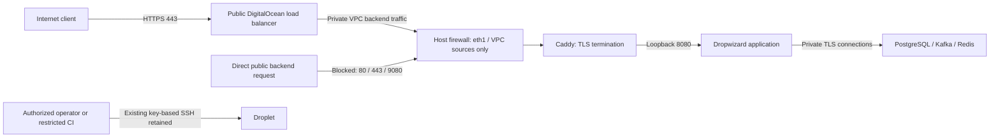

# Backend network hardening — deployed scope and remaining work

## Current state: 27 November 2026

The direct-public-backend exposure is closed on all three existing Droplets by active, persistent Ubuntu UFW policy. Public requests should use **https://174.138.121.225**. No additional paid resource was created and no application/container restart was required.

This is a completed **host-ingress restriction**, not a claim that every proposed network control is finished. DigitalOcean CLI authentication is unavailable and the browser is signed out. Changing provider Cloud Firewall rules requires an authorized DigitalOcean session. SSH source restrictions and outbound allowlisting are not implemented by this change.



| Control | Implemented state |
| --- | --- |
| Public Droplet HTTP/HTTPS | Old any-source UFW allowances for 80/443 removed, including IPv6 counterparts |
| Proxy backend ingress | TCP 80/443 only from 10.122.0.0/20 on eth1 to the node's private VPC address |
| Load-balancer health ingress | TCP 9080 constrained to the same private interface, source subnet and destination address |
| Java application/admin | Existing loopback 8080/8081 retained |
| Cluster ports | Existing private peer rules, TLS and credentials retained |
| SSH | Existing public 22/key-only policy retained, including the restricted CI promotion account |
| Outbound connections | Existing default-allow policy retained; application webhook destination/DNS validation retained |
| Provider firewall | Existing rules unchanged; load-balancer-UID-only backend source rules still pending |

The Caddy process still has wildcard listeners. Ingress is restricted by the host firewall; do not describe this release as changing its bind addresses. Current services use host networking, so these UFW INPUT controls apply. Docker bridge-published ports need separate forwarding controls; the applicator refuses an installation whose proxy is not host-networked.

## What was verified

See [machine-readable evidence](evidence/network-hardening-host-2026-11-27.json).

- All three direct public HTTPS probes failed even when preserving the valid service TLS identity. This is network blocking, not reliance on certificate mismatch.
- All three direct public HTTP probes failed.
- All 39 external TCP probes failed: 13 application, health, metrics and cluster ports per public Droplet IP.
- Private proxy HTTPS and private health requests returned 200 for each node when tested from another cluster node.
- Fresh verified-host-key SSH connections, loopback readiness and loopback metrics succeeded for every node.
- The public load-balancer readiness endpoint returned 200 after every node change.
- Public LB request access logs observed private source addresses 10.122.0.7 and 10.122.0.8 on nodes 1 and 3. The bounded sample did not record node 2 receiving those requests; provider-side membership/health remains to be inspected after sign-in. This is not proof that all three nodes were selected by the LB.
- The rollback timer was cancelled on each node only after external/private/SSH checks passed. No rollback timer is left armed.
- Authenticated subscription listing through the public LB returned 200. Replaying the historical event returned 202, duplicate=true and its original ID; no new event was created.
- All three application readiness checks returned 200 and all nodes were undrained after hardening.
- Local validation passed 41 HA and 12 single-host Python tests; both changed shell scripts passed Bash syntax checks. The Java application source was unchanged.

An aggregate LB readiness response proves one routed backend is ready; it does not establish all three provider backend health states. Existing dependency readiness checks remained healthy. This task did not intentionally fail a database/Kafka member or create new events.

## Reproducible host policy

Source: [network-policy.py](../deploy/ha/network-policy.py), [tests](../deploy/ha/test_network_policy.py). The signed HA runtime packaging includes the operator helper. [HA bootstrap](../deploy/ha/bootstrap.sh) now creates private-interface web/health allowances rather than public web allowances for future hosts. Do not run the legacy single-host bootstrap over this HA cluster.

Review a plan on a node, using its own private address (node 1 shown):

```bash
python3 network-policy.py --private-ip 10.122.0.2
```

Operator application on an existing HA node:

```bash
sudo python3 network-policy.py --apply --private-ip 10.122.0.2 \
  --snapshot /opt/notification-fanout/ha/network-policy-backup-<unique-timestamp>
```

The helper requires active UFW, IPv4/IPv6 default-deny ingress, an RFC1918 VPC, a real private-interface address and a host-networked proxy. It refuses using the default-route interface. It snapshots user.rules/user6.rules, arms a 180-second independent rollback timer, installs private rules first and then removes the old public allowances. It does not edit SSH, cluster or egress rules.

**Before cancelling rollback:** verify direct public backend requests fail; private proxy/9080 requests work; public LB readiness works; fresh SSH and local app/metrics requests work. Then run on that node:

```bash
sudo systemctl stop notification-network-rollback.timer
sudo systemctl is-active notification-network-rollback.timer
```

Expected timer state: inactive. A failure during application restores the snapshot immediately; a lost caller session leaves the timer to restore it. Emergency rollback restores the former policy, which includes public web access, so use only to recover a verified connectivity failure:

```bash
sudo python3 /opt/notification-fanout/ha/network-stage/network-policy.py \
  --restore /opt/notification-fanout/ha/network-policy-backup-<actual-timestamp>
```

Backups are root-owned local operator state; do not commit their contents or unrelated secrets.

## Provider-side work still required

After authorized sign-in to **Blitz_team13_Hyd**:

1. Confirm LB 15a568f0-1172-4b6f-9ddb-6a4fad34ee1f, its VPC, forwarding rules, health configuration and all three backend memberships.
2. Snapshot the existing firewall and find every firewall attached to these Droplets. Allow rules are additive; another broad firewall can defeat a narrow rule.
3. Replace the backend allowances for TCP 80, 443 and 9080 with **this load balancer UID as source**, preserving cluster rules and existing deployment access. Add the narrower rules before removing broad rules.
4. Verify all backend health states, public HTTPS and certificate/challenge routing, protected API authentication, direct-backend blocking, cluster readiness and CI SSH access.

Use a provider LB identity rather than hard-coding its currently observed private IPs: managed nodes can be replaced or resized. The host firewall's VPC rule is a second boundary; the desired provider rule restricts it further to the LB.

References: [DigitalOcean firewall rules](https://docs.digitalocean.com/products/networking/firewalls/how-to/configure-rules/), [LB private traffic and health checks](https://docs.digitalocean.com/support/how-to-troubleshoot-load-balancer-health-check-issues/).

SSH narrowing needs an approved operator/VPN source and a deployment path compatible with GitHub-hosted runners' changing egress IPs. Restricting 22 to the workstation's current address would break the existing hosted-runner deployment path. No VPN, bastion, paid static runner or new credential was created. Outbound narrowing likewise needs the required provider/OS/backup/registry/metrics destinations and approved webhook ports preserved. These remain explicit gaps rather than assumed controls.
