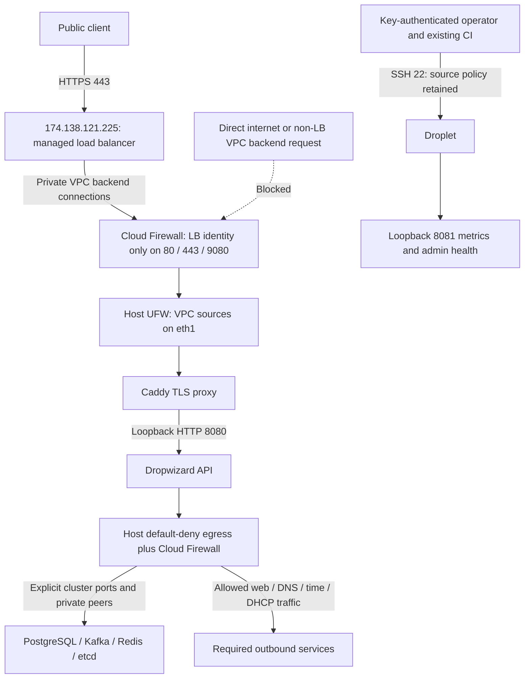

# Production network access — current deployed policy

## Verified state: 27 November 2026

Public clients use **https://174.138.121.225**. Provider Cloud Firewall rules now accept backend TCP **80, 443 and 9080 only from load balancer notification-fanout-ha**, using its resource identity rather than fixed LB private IPs. The firewall is attached to all three existing Droplets. The provider shows the LB **Healthy** and **all three backends Active** after the changes.

All three hosts retain private-interface ingress restrictions and now have **outbound default-deny with explicit allowances**. No paid resource, new node, new API token or repository firewall secret was created. **SSH sources remain unchanged at the user's explicit request**; see [SSH access decision](ci-ssh-window.md).



## Inbound access

| Surface | Provider Cloud Firewall | Host/application layer |
| --- | --- | --- |
| Backend HTTP 80, HTTPS 443 | Only LB UID `15a568f0-1172-4b6f-9ddb-6a4fad34ee1f` | eth1, VPC source 10.122.0.0/20, own private destination IP |
| Private health 9080 | Same LB UID only | Same private-interface/source boundary; drain-aware `/health/ready` |
| Java 8080 and admin/metrics 8081 | No public allowance | Loopback listeners only |
| etcd 2379–2380, PostgreSQL 5432, Redis 6379, Patroni 8008, Kafka 9092–9093, Sentinel 26379 | Only 10.122.0.2/32, .5/32 and .6/32 | Private peer rules plus TLS/authentication |
| SSH 22 | All IPv4/IPv6 sources retained | Key-only login, operator trust, restricted CI privileges; no password/keyboard-interactive login |

Caddy still has wildcard listeners; the change enforces network ingress rather than changing bind addresses. Current proxy/Java/cluster containers use host networking. Docker bridge-published ports would need separate forwarding controls; the host ingress applicator refuses a non-host-network proxy.

A TLS certificate mismatch alone never counted as isolation. Negative tests preserve the service TLS identity while connecting to each backend public IP. Non-LB VPC clients are now blocked too: a peer-host connection to another backend's private HTTPS address fails, while the LB remains healthy.

## Outbound access

| Layer | Allowed traffic |
| --- | --- |
| Cloud Firewall, general destinations | TCP 53/80/443; UDP 53/67/123; existing ICMP allowance |
| Cloud Firewall, private cluster destinations | TCP to the three exact private peer /32 addresses |
| Host UFW | Outbound default-deny; TCP 53/80/443 and UDP 53/67/123; explicit peer TCP 22, 2379–2380, 5432, 6379, 8008, 9092–9093 and 26379 on eth1; existing loopback/established/essential ICMP framework behavior |

Cloud peer TCP allows all ports only to the three peer /32s; host rules narrow those connections to the listed service ports. This is combined-layer enforcement, not a claim that the provider peer rule enumerates every port. Existing stateful return traffic remains allowed.

General web/DNS ports allow all IPv4/IPv6 destinations; this is **port-restricted egress, not a hostname/destination allowlist or protection against every exfiltration path**. Application origin approval, connection-time DNS/address validation, TLS hostname checks and redirect refusal remain necessary for webhook SSRF protection. Current approved receivers use HTTPS443. Before approving another webhook port, update/review both host and provider policies; the API does not automatically provision network exceptions.

Allowed web traffic preserves package repositories, image/CI access, certificate issuance, metrics export attempts, Spaces and registered webhook receivers. A successful Spaces HTTPS probe establishes connectivity, not a fresh authenticated backup/restore test. Provider metrics Explorer visibility remains unverified independently of network reachability.

## What passed

- Original host rollout recorded 39 blocked public application/cluster port probes. Final protocol checks found direct-IP HTTP and service-identity-preserving HTTPS timed out on all three backends; LB HTTPS readiness returned 200. TCP handshake results alone are not accepted as proof because this workstation crosses a corporate secure web gateway. An HTTP destination override retaining the LB Host header returned a gateway-mediated redirect while simultaneous backend eth0 capture received zero port-80 packets. See [final checks and test limitation](evidence/network-hardening-final-2026-11-27.json).
- Provider control panel: one firewall attached/up-to-date on all three Droplets; LB Healthy and all three backends Active after restrictions.
- Post-provider checks on every host: app readiness 200, loopback metrics 200, GitHub HTTPS200, webhook-provider HTTPS200, Spaces HTTPS200, verified private PostgreSQL query, outbound default-deny and no armed rollback timer.
- A non-LB VPC peer could not connect to the other backend's private HTTPS443, confirming the narrower provider boundary.
- Before removing broad outbound rules, allowed service rules were installed. Each host policy was applied with a 180-second independent rollback; fresh SSH/dependency checks passed before cancelling rollback.
- Authenticated API operation also passed end-to-end after provider/host restrictions: one synthetic event returned202, matched a temporary subscription and delivered with HTTP204 on its first attempt. The external receiver capture and tenant-derived HMAC signature were verified. The temporary subscription was then deleted. [Callback evidence](evidence/network-webhook-2026-11-27.json).

Evidence: [original host rollout](evidence/network-hardening-host-2026-11-27.json), [provider configuration and host egress](evidence/provider-network-hardening-2026-11-27.json), [current release](submission-status.md). The provider snapshot is recorded from the Control Panel's visible selected/saved state; it is not an API export or Terraform state.

## Source, reproduction and rollback

- [Provider reference policy](../deploy/ha/firewall-policy.json): the reviewed request-body representation of current rules, firewall `9ebfb734-0687-4487-babd-8853bc73bb97`. It is not automatically applied. Compare newer live rules before using it; never overwrite a later tighter rule blindly.
- [Host ingress policy](../deploy/ha/network-policy.py) and [tests](../deploy/ha/test_network_policy.py).
- [Host egress policy](../deploy/ha/egress-policy.py) and [tests](../deploy/ha/test_egress_policy.py).
- [HA bootstrap](../deploy/ha/bootstrap.sh) now creates restricted ingress and outbound allowances/default-deny for future hosts. Do not use the legacy single-host bootstrap on this cluster.

Plan host ingress using that node's own private address; node 1 example:

```bash
python3 network-policy.py --private-ip 10.122.0.2
```

Plan host egress:

```bash
python3 egress-policy.py --peers 10.122.0.2 10.122.0.5 10.122.0.6
```

Operator application adds `--apply --snapshot /opt/notification-fanout/ha/<unique-backup-directory>` to the appropriate command. The helpers require an existing active UFW installation and refuse unsafe/unreviewed input. Ingress preserves SSH and cluster rules. Egress refuses pre-existing explicit outbound allowances rather than silently replacing them. Snapshot user.rules/user6.rules; egress also snapshots `/etc/default/ufw` because it changes the default policy.

After applying, verify public LB access, denied direct backend access, fresh SSH, local readiness/metrics and required outbound/private connections before cancelling the matching timer:

```bash
sudo systemctl stop notification-network-rollback.timer
sudo systemctl stop notification-egress-rollback.timer
```

Both timers must be inactive in the verified steady state. A lost caller session leaves rollback armed. Emergency host rollback commands use the actual backup directory created on that host:

```bash
sudo python3 /opt/notification-fanout/ha/network-stage/network-policy.py --restore '/opt/notification-fanout/ha/network-policy-backup-<actual-timestamp>'
sudo python3 /opt/notification-fanout/ha/egress-stage/egress-policy.py --restore '/opt/notification-fanout/ha/egress-backup-<actual-timestamp>'
```

Ingress rollback restores the earlier host web allowances; provider LB-only rules remain a separate boundary. Egress rollback restores the previous host outbound policy; provider egress restrictions also remain separate. Restoring one layer does not automatically revert the other. Do not disable either firewall as a routine diagnostic step. Roll provider changes back only to a reviewed snapshot while retaining the minimum necessary access.

## Remaining boundaries

SSH source narrowing was explicitly declined; existing CI remains unchanged and no firewall token is stored in GitHub. No WAF, OIDC, VPN, bastion, static runner or new egress proxy is implied. Backends retain public IPs for existing SSH/outbound use, while public application ports are blocked. Same-region capacity/HA/backup limitations remain in [submission status](submission-status.md).

Sources: [DigitalOcean firewall rules](https://docs.digitalocean.com/products/networking/firewalls/how-to/configure-rules/) and [LB private-network health](https://docs.digitalocean.com/support/how-to-troubleshoot-load-balancer-health-check-issues/).
