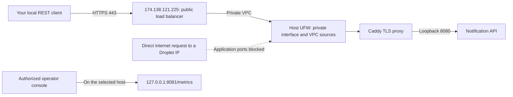

# Onboarding: access and test the deployed service

Use this page first, then follow the [one-event/two-subscriber test](manual-two-subscriber-test.md) for every copy-and-paste REST request. Current network scope is described in [network hardening](network-hardening.md); outstanding controls are explicitly marked there.

## Public URLs you can open now

| Purpose | URL | Authentication |
| --- | --- | --- |
| Process health | [https://174.138.121.225/health/live](https://174.138.121.225/health/live) | None |
| Service readiness | [https://174.138.121.225/health/ready](https://174.138.121.225/health/ready) | None |
| REST API base | `https://174.138.121.225/v1` | Tenant bearer token on each request |

Expected health responses are HTTP 200 with `alive` or `ready`. Readiness can return 503 during dependency failure. The base URL is an API, not a browser dashboard. Normal browser navigation does not attach a tenant bearer token.

## Understand which address to use



| Address | Use |
| --- | --- |
| `174.138.121.225` | Public load-balancer entry point for clients |
| `64.227.168.29`, `139.59.13.207`, `159.65.153.56` | Identify Droplets for authorized operator access; do not use as public API endpoints |
| `10.122.0.2`, `10.122.0.6`, `10.122.0.5` | Node 1/2/3 private VPC addresses; cluster/internal routing only |
| `127.0.0.1:8080` | Java application reachable inside the selected Droplet |
| `127.0.0.1:8081` | Private admin health/metrics reachable inside the selected Droplet |

Direct public Droplet HTTP/HTTPS is now blocked. A timeout/refused connection there is expected. Do not disable the firewall, expose 8080/8081 or disable TLS validation to make a direct-backend request succeed. The host policy accepts VPC/interface traffic; provider load-balancer-identity-only filtering is still pending. SSH 22 remains broadly sourced with key-only authentication and a restricted CI deployment identity; outbound narrowing also remains pending. Do not describe every Droplet port as private-only.

## Run the functional smoke test

1. Open the two public health links above.
2. Open the IntelliJ terminal inside the Rancher Ubuntu container at `/workspaces/notification-fanout`; use the same Bash session throughout the test.
3. Follow [manual-test preparation](manual-two-subscriber-test.md#1-prepare-the-local-terminal), supplying your tenant token privately. The administrator/DigitalOcean tokens are different credentials.
4. Create two independent receiver inboxes, then register both subscriptions **before** emitting the event. The manual guide accounts for the external provider's inbox-creation quota.
5. Emit one event and retain the returned internal event ID. Confirm `GET /v1/events/{id}`, then poll `GET /v1/events/{id}/deliveries` until both test subscriptions have delivered results and attempt HTTP codes.
6. Confirm the corresponding POST in each receiver inbox. Each has the same event ID and a different delivery/subscription ID. The service's 202 response proves durable acceptance, not completed delivery.
7. Optionally replay the exact event/key to verify idempotency. Clean up only the two test subscriptions after delivery finishes; deletion does not cancel already-created work.

Creation responses can precede visibility on a read replica. Retry a GET briefly instead of creating another new event. There is no single-subscription GET endpoint or rule-update PUT/PATCH endpoint in the deployed v1 API.

## Inspect metrics on each Droplet

Open an authorized DigitalOcean console/operator shell for each IP below. The restricted CI account is not a general-purpose shell. Run the command **inside that Droplet**, not on your laptop or development container:

```bash
curl --fail-with-body --silent --show-error --max-time 5 \
  http://127.0.0.1:8081/metrics | jq .
```

| Console to open | Command location |
| --- | --- |
| Droplet `64.227.168.29` | Run in node 1's shell |
| Droplet `139.59.13.207` | Run in node 2's shell |
| Droplet `159.65.153.56` | Run in node 3's shell |

Use the [individual per-Droplet commands, health checks and metric interpretation](manual-two-subscriber-test.md#10-metrics-and-operator-health) for details. Metrics were verified HTTP 200 on all three hosts during network hardening. Counters are per process; shared database backlog gauges must not be summed across instances. DigitalOcean custom Explorer visibility remains unverified after the last provider export error; use API audit and receiver capture for this demo.

## Current limits and remaining work

The shared fixed-second quota is 1,000 authenticated requests/tenant/second across application replicas; reads and writes count. Five simultaneous tenants is a 5,000/second target, not certified throughput. The five-minute identity cache remains bounded at 32 MiB accounted bytes / 50,000 entries, shared with subscription caching, so it cannot retain the full target working set. PostgreSQL protects duplicates on cache misses. No paid resize was performed.

Provider Cloud Firewall LB-only rules, provider backend-membership reinspection, SSH source narrowing and outbound narrowing remain outstanding. All three apps' local readiness passed, but one successful public readiness response does not prove all three provider backends are Active. Review [deployment evidence](submission-status.md) and [network rollout/rollback instructions](network-hardening.md) before any infrastructure change.
