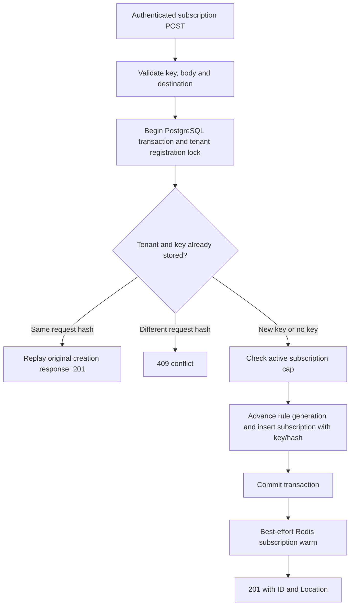

# Subscription creation idempotency

`POST /v1/subscriptions` accepts an optional tenant-scoped `Idempotency-Key` (1..200 nonblank characters, no control characters). With a key, the same normalized URL/filter request returns the original 201 body, ID, timestamp and Location; different content returns 409. Omitted/default filter fields and object-field order are normalized; array order and URL text remain significant. The key/hash and subscription commit in one PostgreSQL transaction, with a tenant registration lock and unique index protecting concurrent instances. Replay is checked before the active-subscription cap and does not advance subscription generation. Keys are separate from event keys and retained with subscription rows, including soft-deleted rows: replay after deletion returns the original creation response without reactivating it. A fresh registration after deletion needs a new key. Authentication, rate limiting, validation and current destination policy still apply on replay. Without a key, each POST intentionally creates a distinct registration. No Redis key or five-minute expiry governs subscription registration identities.

Migration 011 adds nullable key/hash columns and a tenant/key unique index to the existing subscriptions table. Existing rows and callers remain compatible. No new table or backup manifest format is needed; pg_dump includes the new columns/index. The schema migration must run before updated app instances accept traffic. Old application images ignore the additive columns, but do not provide the new header contract: complete the fleet rollout before relying on keyed retry guarantees.

The hash is SHA-256 over the normalized request with recursively sorted JSON object fields. Key reuse with a conflicting request never overwrites a rule. Distinct keys allow intentional registrations for the same URL/filter. Keep keys private and stable across uncertain retries; do not generate a new key every attempt. There is no PUT/PATCH/ETag API and replay does not update configuration. The original creation body is a historical response, not an assertion that a later-deleted subscription remains active; use the active list.

Verification covers HTTP response and Location replay, deletion replay, conflicts, key validation/authentication, tenant/operation isolation, canonical object ordering, concurrent Store clients, unchanged generation, retry at the active cap, transaction rollback, and one delivery recipient after repeated registration. See [manual demo](manual-two-subscriber-test.md) for two independent receivers and one logical event.

## Release image portability

The local fallback image uses the same application JAR that passed 98 Java tests and the current vulnerability gate. A legacy Docker 20 builder adds a non-standard parent-image reference in Config.Image; current Docker removes it from image inspect. The portable verifier normalizes only that build field in addition to empty defaults, while still checking the signed archive config digest, every filesystem layer, architecture, OS and execution configuration (including user, environment and entrypoint). Regression tests cover parent-field removal and reject environment/user/entrypoint/layer tampering. [Docker's documented removal](https://docs.docker.com/engine/deprecated/#non-standard-fields-in-image-inspect). The image's application source label remains fa1a0b1; the later deployment-bundle revision includes this helper correction and documentation only.
