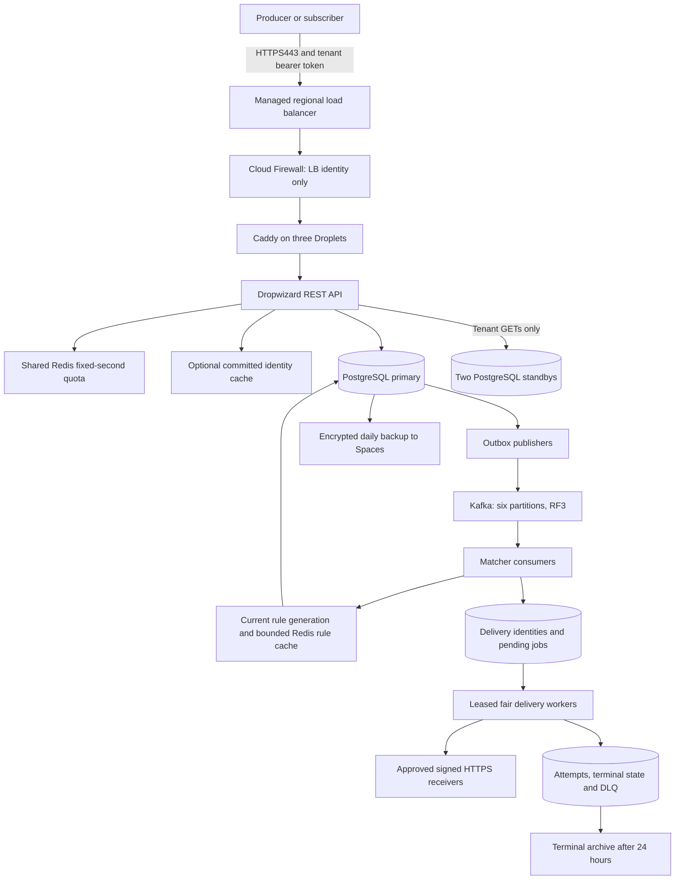
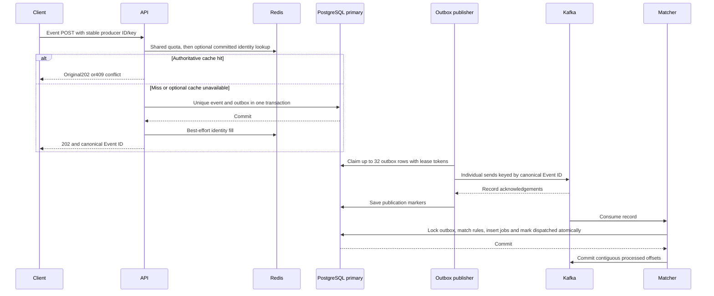
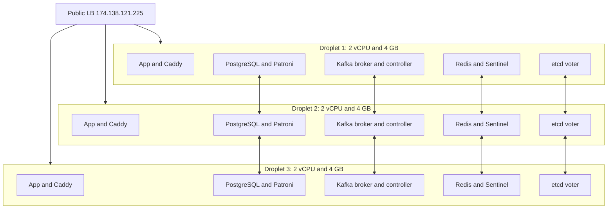
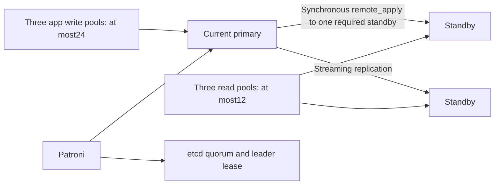
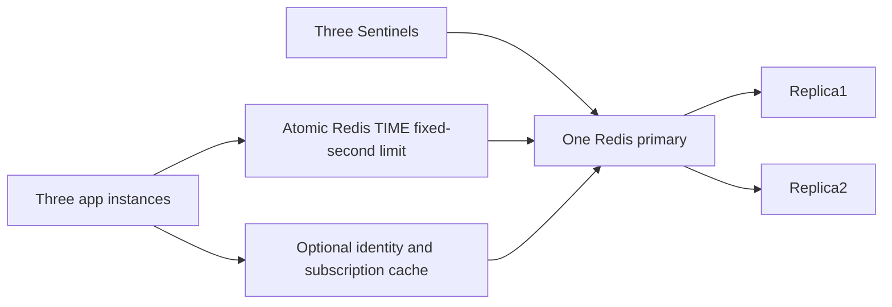
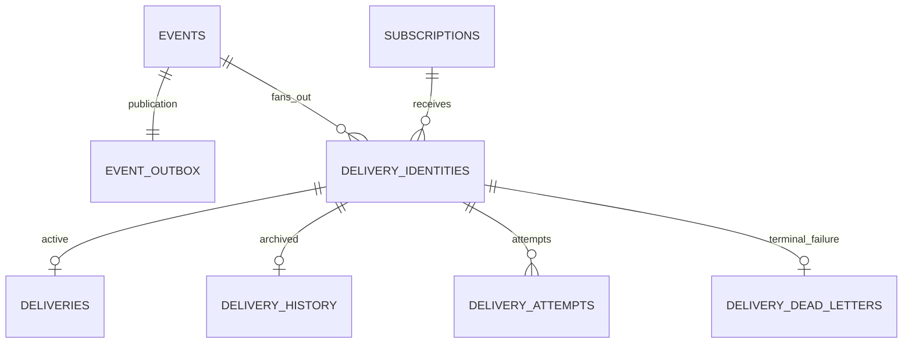
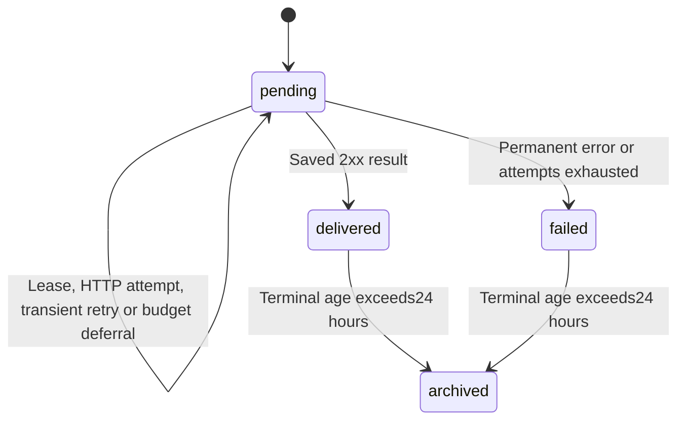

# Current system design

This is the single architecture and component-design document. [API](api.md), [operations](operations.md), [demo](interviewer-demo.md), [verification](validation.md). Deployment evidence is dated; implementation descriptions come from current source/configuration.

## Requirements and scope

| Requirement | Implemented behavior |
| --- | --- |
| Durable event ingestion | REST accepts type, source and arbitrary JSON payload; event plus outbox commit before 202 |
| Dynamic subscriptions | Tenant create/list/delete; HTTPS URL and type/source/JSON Pointer equality filters; no restart |
| Fanout | Kafka consumer transaction selects current eligible subscriptions and creates unique delivery jobs |
| Delivery/retry | Bounded workers, persistent attempts/backoff, per-subscription reservations, six transient attempts total and durable DLQ |
| Audit | Tenant-scoped event, subscription and individual delivery history; timestamps, nullable HTTP status and final state |
| Engineering | Mermaid flows, simple Java components, migrations, unit/integration tests, Actions pipeline, signed deployment and documented limitations |

Missing source/type/payload and unsafe destinations are rejected. At most1,000 active subscriptions per tenant bound matching work. One event can intentionally produce many notifications. Distinct subscriptions pointing at the same URL are distinct recipients. No PUT/PATCH or time-range replay API exists.

Measurable implemented bounds include256 KiB request bodies,5-second webhook deadlines,30-second delivery leases, six attempts, writer/read pools 8/4, four workers/app, and tenant admission1,000 authenticated requests per fixed second. These are resource/control bounds, not measured latency/availability SLOs.

## Architecture and request flow

API 202 means PostgreSQL acceptance, not Kafka acknowledgement or webhook receipt. DB-first acceptance supports immediate original-response/conflict decisions but makes PostgreSQL the initial ingestion bottleneck. Kafka-first ingestion would change that contract; it is not implemented.

Matching happens at successful consumer transaction time. A subscription created after acceptance but before matching can receive the event. Deletion before matching excludes it; deletion after matching does not cancel existing jobs. Completed events are not rematched by ingestion replay.

## Deployment and failure boundaries

The primary/replica roles are dynamic; this drawing does not designate a permanent leader. One-host failure is the intended HA boundary when safe quorum/replicas survive. Two whole-host failures remove coordination/durability requirements and normal writes must stop. Two failed application containers alone are different: the remaining app can serve if data services remain healthy. Same-region placement is not proof of independent availability zones or regional disaster tolerance. There is no Droplet replacement controller or autoscaler.

Each host has eight service containers, including the independent metrics bridge. Monolith versus microservices is a deployment choice here: app components share one JVM and bounded resources, with explicit database transactions and durable boundaries. Separate role deployments/dedicated data-service capacity are future scaling options.

## Component low-level designs

### Notification application

[NotificationResource](../src/main/java/com/example/notifications/NotificationResource.java) validates contracts; [ApiSecurity](../src/main/java/com/example/notifications/ApiSecurity.java) authenticates/admit requests; [Store](../src/main/java/com/example/notifications/Store.java) owns SQL transactions; [KafkaPipeline](../src/main/java/com/example/notifications/KafkaPipeline.java) publishes/consumes; [DeliveryWorker](../src/main/java/com/example/notifications/DeliveryWorker.java) schedules attempts; [WebhookSender](../src/main/java/com/example/notifications/WebhookSender.java) sends signed requests.

No network webhook call holds a database transaction/connection. Writes, authoritative identity/origin checks, matching and claims use the primary. Tenant list/history GETs use read-only standby transactions and return503 rather than falling back to the primary. Replica lag can temporarily produce404 or an empty list after a committed write.

### Dropwizard runtime

The three apps use Java 25/Dropwizard 5, [config/ha.yml](../config/ha.yml), and loopback application/admin ports 8080/8081. [BoundedServerFactory](../src/main/java/com/example/notifications/BoundedServerFactory.java) configures 8–64 application threads,1–8 admin threads,32 active admitted requests,128 suspended requests and a 1-second admission wait. Health paths are exempt. These explicit bounds do not establish that every third-party internal queue is bounded.

Each app has four webhook workers, one event publisher, one matcher consumer, one DLQ loop and bounded maintenance/HTTP transport tasks. HTTP connection/semaphore limits track worker count; automatic HTTP-client retries and redirects are disabled. Database pools are 8 primary/4 standby connections per app, shared by the respective operations, with a 3-second acquisition bound. A512 MiB heap fits inside an 896 MiB app container with 192 MiB metaspace ceiling and native/thread overhead.

### PostgreSQL and Patroni

Three PostgreSQL 17 members use strict synchronous mode, one required synchronous standby, remote_apply, timeline/lag checks and watchdog fencing. Patroni uses etcd for safe primary ownership. Promotion/reconnect can cause temporary errors; an eligible synchronized replica must survive for the acknowledged-commit single-failure guarantee. Do not force an unsafe asynchronous promotion.

Per server: max_connections 100, shared_buffers 128 MiB, work_mem 4 MiB and a 640 MiB container ceiling. Three superuser slots are reserved. work_mem is per eligible query operation, not a total per-connection memory cap. max_connections is not a safe concurrent-query target or a value that automatically follows Droplet size. Caddy, Patroni, replication, backup, migration and operator activity are additional to app pool budgets.

Migrations001–011 are immutable/additive history under [migrations.xml](../src/main/resources/migrations.xml). Runtime, migration, backup, replication and Caddy roles are separated. Tenant predicates/composite foreign keys and unique indexes enforce ownership/identity. PostgreSQL is not sharded; no search service or general query cache is needed by this API.

### Kafka

Three colocated broker/controllers use KRaft, six event partitions, replication factor3, minimum ISR 2, acks=all and disabled unclean election. Broker/controller/app connections use private TLS and scoped ACLs. The canonical internal Event UUID is the key, favoring distribution for single-type traffic; source/tenant order and receiver delivery order are not guaranteed.

There are three publisher loops total, one/app; each claims up to 32 eligible outbox rows with FOR UPDATE SKIP LOCKED and a 30-second persisted token lease. Database row locks end at claim commit. Kafka sends happen outside SQL. The publisher waits up to a 10-second batch deadline for individual acknowledgements, then saves publication markers under matching tokens.

**A 32-record claim is not an atomic Kafka transaction.** Partial publication is possible. An uncertain/failed batch can republish already-accepted records. Producer idempotence does not remove application-level resend duplicates. The consumer transaction locks outbox state, skips completed matching, preserves unique delivery identities and commits offsets only after durable processing. There is no application-defined consumer fencing epoch; delivery/outbox ownership tokens protect SQL updates, not remote side effects.

published_at means acknowledged publication. dispatched_at means consumer matching committed. Published-but-undispatched rows can be republished after 60 seconds. Retention is bounded by broker time/size settings; Kafka is not the audit archive. Pending authoritative event/outbox data remains in PostgreSQL. One broker can restart with two healthy in-sync members; losing two brokers prevents quorum/required writes.

### Redis and Sentinel

One Redis primary, two replicas and three Sentinels use private TLS and ACLs. Quota keys and cache keys have separate namespaces and client-pool bulkheads. Tenant limits use Redis TIME and atomic counters:1,000 authenticated requests/tenant/second across all apps. Reads and duplicate requests count. Health is exempt. Retry budgets default to 300/tenant/minute and 30/subscription/minute.

Quota failures reject admission with 503; there is no local/SQL counter fallback. The script requests replication acknowledgement with WAIT 1; asynchronous failover can still lose recent counters or permit overshoot. Fixed windows allow boundary bursts. This is load protection, not exact entitlement accounting.

Optional cache failures fall back to PostgreSQL. Committed event identities contain IDs/hash/timestamp, not payloads/credentials; their300-second lifetime is anchored to original acceptance and is not extended by replay. Identity entries are not LRU victims before expiry, but the 32 MiB/50,000-entry admission budget can reject new cache entries. Full-window coverage is not guaranteed at high load.

Subscription cache keys include tenant, persistent generation and subscription ID. Create/delete advances generation transactionally; matcher shared-locks that generation and reads candidate IDs from the primary, then batch-fetches cache misses. Best-effort warming cannot resurrect an old generation. Subscription-only LRU keeps at most floor(active tenant subscriptions×20%) current-generation records; fewer than five can mean zero cached rules.

Live Redis limits are 64 MiB dataset,128 MiB container, noeviction and AOF appendfsync always. Each replica stores the whole dataset; three members do not divide memory requirements.

### etcd

Three etcd voters store Patroni leadership/coordination state, not notification events. A two-member majority is required to make leadership decisions. PostgreSQL streaming replication copies data; etcd coordinates who may own the primary role. Patroni demotion/watchdog behavior supplies additional fencing. Kafka uses its own KRaft coordination and Redis uses Sentinel; neither uses etcd for its leader election.

### Caddy

Caddy terminates backend HTTPS, redirects HTTP, forwards allowed requests to loopback 8080, blocks public /v1/admin routes and exposes drain-aware readiness on 9080. Three proxies use PostgreSQL-backed shared certificate storage/locks; local Caddy volumes also persist state. A database outage can affect cold proxy startup/certificate renewal. Public certificate state is not included in the notification database backup.

Listeners can be wildcard-bound, but Cloud Firewall and UFW enforce backend isolation. Caddy admin 2019 is loopback-only. This is a reverse proxy, not an OAuth identity provider, WAF or full API gateway.

### DigitalOcean load balancer

The regional external managed LB fronts all three private backends; recorded configuration has two managed units. Health probes use HTTP 9080 /health/ready every 5 seconds, timeout 3 seconds, thresholds 2 failed/2 successful, and sticky sessions off. Distribution is provider-managed; no exact round-robin/least-connections or equal-per-request split is claimed. Settings were inspected on 25 November and backend health/firewall boundaries on 27 November: [provider evidence](evidence/load-balancer-2026-11-25.json).

A failed backend is excluded after health detection; that is not instantaneous failover or automatic host replacement. Drain 20 seconds precedes normal application replacement.

## Data model and transactions

The SQL foreign keys and indexes are defined by the migration files. Tenant rule generations and origin-policy audits are listed separately below.

| Table/view | Purpose and constraints/access path |
| --- | --- |
| events | Tenant/internal ID, producer UUID, type/source/payload, accepted_at, content hash, key and configured identity; tenant/key and tenant/producer uniqueness |
| event_outbox | Event/tenant, publication/dispatch markers, availability, attempts and token/expiry; due/undispatched indexes |
| subscriptions | Tenant/UUID, HTTPS URL, filter, timestamps, scheduling metadata and nullable creation key/hash; active/matching indexes, tenant/key unique index |
| subscription_versions | Per-tenant generation synchronizes create/delete with consumer matching |
| delivery_identities | Permanent Delivery ID, tenant/event/subscription references; unique event/subscription pair across archival |
| deliveries | Pending/hot terminal jobs, destination snapshot, attempts, due time, claim token/expiry; due/expired/event/subscription indexes |
| delivery_history | Terminal jobs moved after 24 hours; same IDs/status/destination/audit linkage |
| delivery_attempts | Unique delivery/attempt number, start/end, nullable HTTP code, outcome and bounded error category |
| delivery_dead_letters | One durable terminal failure per delivery, reason/count/time and Kafka publication lease/state |
| kafka_dead_letters | Malformed Kafka-record quarantine, unique topic/partition/offset |
| approved_webhook_origins | Durable normalized HTTPS origin approval/revocation |
| webhook_origin_audit | Administrator origin-policy change audit |
| databasechangelog / databasechangeloglock | Liquibase migration history/coordination |

There are fourteen physical public tables: twelve application tables plus the two Liquibase tables. Backup metadata covers thirteen snapshot tables, excluding the migration lock table. all_deliveries is a UNION ALL view, not another table.

Acceptance inserts event/outbox atomically. Matching locks outbox/generation, inserts identities/jobs and marks dispatch complete atomically. Result saving fences ownership and commits attempt/final state/DLQ together. Subscription creation persists key/hash with the resource. Archival moves at most 100 terminal rows per batch in one transaction; pending/leased jobs remain active. Attempts/DLQ reference the permanent identity anchor. Event, subscription and delivery audit endpoints keep the same IDs after archival; clients do not select a table.

Subscription/event keys remain authoritative as long as their rows are retained. There is no automatic event/audit/history deletion. Archiving shrinks active scheduling work, not total storage. Backup retention is a separate policy. Partitioning/sharding are future choices after measuring growth, not current features.

## Delivery state, retry and guarantees

Archived is a storage location; API status remains delivered/failed. A transaction selects the least-recently-claimed due subscription, locks/rechecks its reservation count and leases work. One active attempt/subscription is enforced across apps. This is subscription-level fairness, not weighted tenant/domain-wide scheduling. Slow receivers occupy bounded workers, not every application thread.

A five-second HTTP deadline is shorter than the 30-second claim. Attempt start/result updates require current ownership; lease expiry permits recovery. A stale publisher can still send to Kafka and a stale HTTP sender can still affect a receiver. Tokens prevent incorrect saved state, not physical duplicate network effects.

| Retry path | Actual policy |
| --- | --- |
| Transient webhooks | Six attempts total; min(60s,1s×2^(failed attempt−1)) ceiling; random delay between 50% and 100% of ceiling |
| Five scheduled webhook retries | Approximately 0.5–1,1–2,2–4,4–8,8–16 seconds, excluding HTTP/scheduling/budget delays |
| Retryable responses | Network/unknown status,408,429,5xx; destination-policy failures and other non-2xx can fail immediately |
| Budget exhaustion | Defer to next minute boundary plus up to 1 second jitter without spending an HTTP attempt |
| Outbox errors | SQL availability delay 2 seconds and loop error pause 1 second; no exponential application backoff |
| Consumer processing error | Rewind affected partition, sleep 500 ms in the single consumer loop; general error pause 1 second |
| Delivery-DLQ publication error | Fixed1 second loop pause; outstanding 30-second lease can delay reclamation |
| Metrics export | One attempt per 60-second collection; no growing spool or transport retry queue |

Webhook Retry-After handling, longer recovery schedules, per-record publication acknowledgements and partition pause/resume backoff were proposed but are not deployed.

Kafka/outbox processing is at-least-once with idempotent database effects. HTTP attempts are at-least-once within the retry policy: bounded exhaustion can end failed without receiver success. A receiver can accept a request before the sender loses its response or crashes. Stable Delivery IDs enable receiver-side deduplication; exactly-once remote business effects require receiver cooperation. DLQ query is not a replay API.

## Security and trust boundaries

Untrusted clients cross public HTTPS, static tenant/admin authentication, quota, validation and tenant-scoped SQL. Administrators use separate credentials and private routes. Operator/root/signing access is highly trusted; restricted CI upload users cannot use a general shell or read production secrets.

Receivers are untrusted external services. Approved HTTPS origins, public-address DNS validation at connection time, TLS hostname checks, disabled redirects and bounded deadlines reduce SSRF/resource abuse. Webhook signatures use a tenant-derived HMAC key; provision receiver keys out of band and deduplicate Delivery IDs. Raw payloads, bearer tokens and signing keys do not belong in operational logs or metric labels.

Separate TLS trust/identities protect PostgreSQL, Kafka, Redis/Sentinel and etcd/Patroni. Internal certificates need operator renewal before expiry. Application-to-proxy loopback HTTP is host-local. Encrypted Spaces archives are implemented; complete active-disk encryption at rest was not established by this assessment. No compliance certification, managed secret service, OIDC or public administration surface is claimed. [Effective network controls](operations.md#network-and-ports).

## Capacity, cost and evolution

The three 2 vCPU/4 GB/80 GB hosts share application/data-service resources. Admission is 1,000 authenticated requests/tenant/second; the five-tenant target is 5,000/second aggregate, not proven sustainable throughput or five automatically provisioned customer identities.

At 5,000 unique events/second, a 300-second window contains 1.5 million events and up to 3 million cache aliases. At the earlier conservative 1,400 bytes/alias estimate this is 4.2 GB accounting before headroom, much larger than the current 32 MiB cache budget and 64 MiB Redis dataset limit. Cache rejection falls back to PostgreSQL; quotas do not resize storage.

With 1 KiB payloads,5,000 events/second alone represents about 442 GB/day of raw payload, excluding replicas, indexes, outbox, jobs, attempts and backups. With an average of 5 matching subscriptions,1,000 events/second creates 5,000 delivery jobs/second before retries. Twelve workers at 100 ms/attempt have an illustrative 120 attempts/second ceiling before SQL/scheduling overhead, not a measured rate. This assumes enough independent due subscriptions; one subscription can bottleneck at its concurrency limit even when workers are idle.

Burst backlog grows as arrival rate minus completed processing rate. Kafka cannot protect the initial PostgreSQL write. Current controls include bounded pools/admission, approximate per-app backlog sampling, shared tenant quota, durable buffering, fairness and retry budgets. Global admission tied to backlog age/disk, tested scaling thresholds, circuit-breaker cooldown and measured p95/p99/SLOs remain future work.

| Decision | Why chosen | Trade-off and reconsideration trigger |
| --- | --- | --- |
| PostgreSQL-first acceptance/outbox | Atomic durable acceptance and immediate authoritative deduplication | Initial DB write bottleneck; reconsider Kafka-first when measurements justify a changed acceptance contract |
| Modular single JVM/app | Simple implementation and low infrastructure count | Shared resources; split role deployments when profiling shows independent scaling needs |
| Three self-managed colocated nodes | One-host HA with controlled cost | Shared host/region failures and operator burden; consider dedicated/managed data services as budget/traffic grows |
| UUID Kafka key | Spreads single-type event traffic | No source ordering; change only with an explicit source-ordering and retry scheduling design |
| Small optional Redis caches | Bounded memory and database correctness fallback | Cannot cover high-rate five-minute working sets; resize from measured entry/traffic data |
| Shared quotas and subscriber fairness | Cross-instance protection and slow-subscriber isolation | Redis failover overshoot and no tenant/domain weighted fairness |
| Daily encrypted DB snapshot | Low-cost off-host database recovery | Up to roughly 24h disaster loss, short retention/no PITR; strengthen when recovery objectives require it |
| Terminal history table | Keeps scheduler's active set smaller without changing API | Total storage still grows; add agreed retention/partitioning later |

Existing cost drivers are three Droplets, the managed LB and Spaces, plus storage/transfer usage. This audit creates no paid resources. Historical cost estimates are not current price quotations; inspect the account before resizing.

Managed Kafka, per-source ordered delivery, subscriber time-range replay, horizontal autoscaling, WAF/OIDC, per-user quotas and general response caching are not implemented. Alarms/tickets were explicitly excluded. [Executed evidence and remaining work](validation.md).
